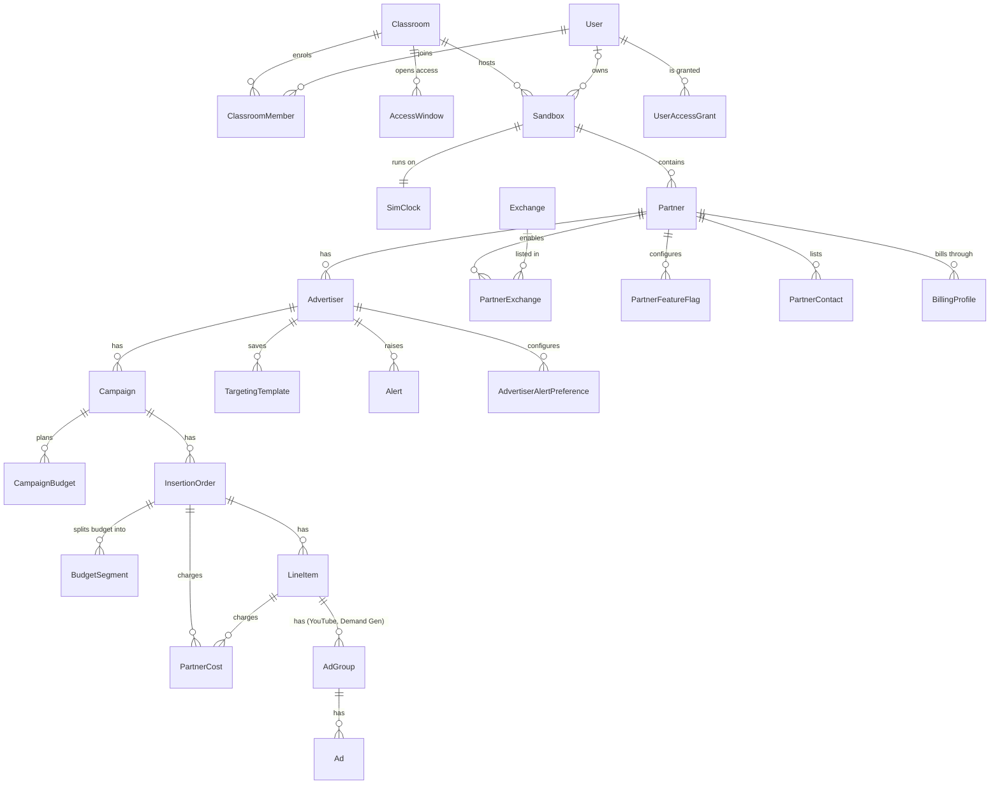
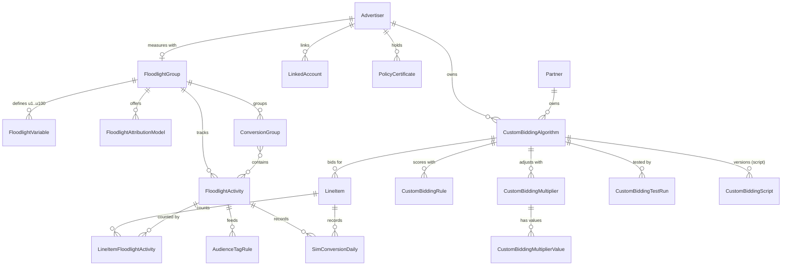
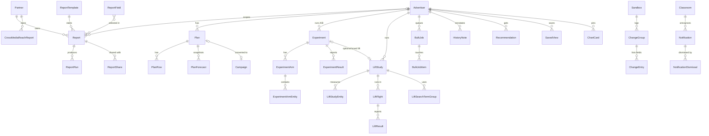
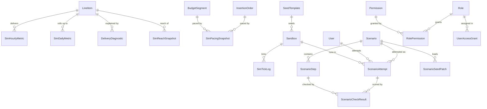

# Data model (P2-01)

Spec for the full data model of **DV360 Simulator by Adsmetor**. Status: draft v1, written 2026-10-28.
Inputs: `PROJECT.md` (§7.1 stack, §7.2 entity outline, §7.3 engine), `docs/PROJECT-LOG.md`, `docs/explore/01..18`.
Stack: PostgreSQL + Prisma. Every table below maps to a Prisma model (core ones are in the appendix, the rest are field tables only).

Conventions used in this file:

- **Source tags.** Nothing is tagged when the field or option list was seen in the demo account (the explore file is named where it helps). Items that were blocked in the demo (see `17-gap-sweep.md` and PROJECT-LOG "Known gaps") are filled from public DV360 knowledge and carry the tag `(from public docs)`. Where I was unsure even about public behaviour the item says `(assumption)` and is repeated in section 8.
- **Types.** `str` text, `text` long text, `int`, `bigint`, `dec` Decimal(20,6) for money unless stated, `pct` Decimal(9,4), `bool`, `ts` timestamptz, `date` calendar date, `json` jsonb, `X[]` Postgres array, `enum X` Prisma enum (values in section 4).
- **Null column.** `N` = not null, `Y` = nullable.
- **Base columns.** Every tenant table has `id` (cuid, PK), `sandboxId`, `createdAt`, `updatedAt` unless noted. Every editable entity (partner, advertiser, campaign, IO, LI, ad group, ad, creative, audience, list, deal, report, plan, experiment) also has `version int not null default 1`, +1 on every update (optimistic lock, RT `expectedVersion`; RC-020). Tables marked **PID** also have `publicId` (bigint, unique, from the sequence `entity_public_id_seq`); `publicId` is the number that appears in URLs and in the grids (the "ID" column). Base columns are not repeated in the field tables.
- **Money.** Stored in the currency of the owning advertiser (`Advertiser.currencyCode`). Partner and USD figures in reports are computed at read time from a fixed FX table (`FxRate`, global). Services convert at the boundary: the wire uses major units (RT `Money`), validation rules receive integer minor units (VAL 0.2) (RC-019).
- **Time.** Wall-clock times (`createdAt`) are real UTC. Everything the engine produces (`simHour`, `simDate`, flight dates as the student sees them) is in **sim time**, which is advertised in the advertiser time zone. See `SimClock`.

> Resolved RC-052: the spec deltas (`Δ-nn-m` / `DELTAnn-m`) listed in each module file (`docs/specs/modules/*`, section 3 or 4) are part of this data model. Each module's first build task applies its deltas as a migration; `docs/specs/conflicts.md` lists the precedence rules.

---

## 1. ER overview

The model is split over five diagrams so each stays readable. Attributes are left out here on purpose; section 5 has them. Relationship labels use the verb the UI uses.

### 1.1 Training layer and the entity hierarchy



### 1.2 Creatives, targeting, audiences, inventory

```mermaid
erDiagram
    Advertiser ||--o{ Creative : "owns"
    Creative ||--o{ CreativeAsset : "stores"
    Creative ||--o{ CreativeReview : "reviewed per exchange"
    Creative ||--o{ CreativeRestriction : "restricted by"
    Creative ||--o{ CreativeUrl : "uses"
    Creative ||--o{ CreativeAppeal : "appealed in"
    Creative ||--o{ CreativeAssignment : "assigned via"
    LineItem ||--o{ CreativeAssignment : "serves"
    Exchange ||--o{ CreativeReview : "approves"
    LineItem ||--o{ TargetingAssignment : "targets"
    AdGroup ||--o{ TargetingAssignment : "targets"
    TargetingTemplate ||--o{ TargetingAssignment : "stores"
    Advertiser ||--o{ TargetingAssignment : "locks rules"
    Partner ||--o{ TargetingAssignment : "defaults"
    TargetingOption ||--o{ TargetingAssignment : "picked in"
    TargetingOption |o--o{ TargetingOption : "parent of"
    Advertiser ||--o{ Audience : "owns"
    Audience ||--o{ AudienceTagRule : "filled by (tag based)"
    Audience ||--o{ AudienceSeed : "seeded from (lookalike)"
    Audience ||--o{ CombinedAudienceTerm : "combines"
    Audience ||--o{ CustomListEntry : "defined by"
    Audience ||--o{ CustomerMatchUpload : "loaded by"
    GoogleAudience ||--o{ TargetingAssignment : "picked in"
    Advertiser ||--o{ Channel : "owns"
    Channel ||--o{ ChannelEntry : "lists"
    Advertiser ||--o{ KeywordList : "owns"
    KeywordList ||--o{ KeywordListEntry : "lists"
    Advertiser ||--o{ LocationList : "owns"
    LocationList ||--o{ LocationListEntry : "lists"
    Exchange ||--o{ InventorySourceDeal : "sells"
    InventoryOrder ||--o{ InventorySourceDeal : "groups deals"
    InventorySourceDeal ||--o{ DealAccess : "shared with"
    InventorySourceDeal }o--o{ DealGroup : "member of"
    DealGroup ||--o{ DealGroupMember : "has"
    InventoryPackage }o--o{ DealGroup : "member of"
    Exchange ||--o{ InventoryPackage : "sells"
    LineItem ||--o{ LineItemInventory : "buys from"
    InventorySourceDeal ||--o{ LineItemInventory : "assigned"
    InventoryPackage ||--o{ LineItemInventory : "assigned"
    DealGroup ||--o{ LineItemInventory : "assigned"
    Partner ||--o{ Negotiation : "negotiates"
    Negotiation |o--o| InventorySourceDeal : "creates"
    MarketplaceProduct ||--o{ InventoryPackage : "assigned as"
```



### 1.3 Measurement and bidding resources



### 1.4 Reporting, planning, experiments, bulk, history



### 1.5 Simulation, scenarios, access



---

## 2. Multi-tenancy

### 2.1 Rule

One student = one **sandbox**. A sandbox holds a complete private copy of the DV360 world (a partner, its advertisers, everything below them, and every simulation row those entities produced). Students never see another sandbox. Instructors see all sandboxes of their classrooms through the instructor console only (not through the DV360 screens).

```
Classroom (instructor owns)
  └─ Sandbox (one per student; instructor can also own template and demo sandboxes)
       └─ Partner → Advertiser → Campaign → IO → Line item → ...  (every row has sandboxId)
```

### 2.2 How `sandboxId` / `classroomId` scope rows

| Layer | Mechanism |
|---|---|
| Column | Every tenant table has `sandboxId String NOT NULL` (indexed, always the first column of the composite indexes). Global reference tables (`Exchange`, `TargetingOption`, `GoogleAudience`, `ReportField`, `ReportTemplate`, `MarketplaceProduct`, `Role`, `Permission`, `FxRate`, `Scenario`, `SeedTemplate`) have no `sandboxId`. |
| Referential integrity | A child references its parent with a **composite FK** `(parentId, sandboxId) → (id, sandboxId)`. Each tenant table therefore has `@@unique([id, sandboxId])`. The database refuses a row that points at a parent from another sandbox. Only `Partner` (and the history table `ChangeGroup`) hold a plain FK `sandboxId → Sandbox.id`; everything else inherits the scope down the tree. The Prisma appendix shows this pattern on every core model. |
| Soft references | Fields that point at a tenant row without FK (`TargetingAssignment.refId`, `ChangeGroup.entityId`, `Alert.lineItemId`, `SimHourlyMetric.creativeId` and similar) are always paired with `sandboxId` and checked by the service layer; the seed and reset code delete by `sandboxId` so nothing is orphaned. |
| Row-level security | Postgres RLS on every tenant table: `USING (sandboxId = current_setting('app.sandbox_id'))`. The app sets `SET LOCAL app.sandbox_id = ...` at the start of each request transaction (from the session's resolved sandbox), and `app.bypass_rls = on` only for the engine and instructor jobs. RLS is the safety net, not the primary check. |
| App layer | A Prisma client extension injects `where: { sandboxId }` on every read and `data.sandboxId` on every create, and throws if a query reaches a tenant model without a sandbox in context. URL IDs (`/p/{publicId}/a/{publicId}`) are global-unique but always re-checked against the session's sandbox; a foreign ID returns the same 404 page as a missing one (see `17-gap-sweep.md`). |
| `classroomId` | Lives on `Sandbox` (one hop away). It is also **denormalised** (plain column, no FK) onto the tables the instructor console queries across sandboxes: `SimDailyMetric`, `ChangeGroup`, `ScenarioAttempt`, `Notification`. That keeps "all students in class X, last 7 days" a single indexed scan. |
| Access windows | `AccessWindow` rows decide whether any member of a classroom can log in (R3). The login check is: user is a member of a classroom with an `OPEN` window now, or user is an `ADMIN` or `SUPER_ADMIN` (RC-068). An expired window freezes the sandbox (`SandboxStatus.FROZEN`) and pauses its `SimClock`. |
| Reset | `DELETE ... WHERE sandboxId = $1` over the tenant tables in reverse dependency order, then re-seed. Because the composite FKs cascade from `Partner`, deleting the sandbox's partners already removes the tree; the order only matters for the soft-reference tables. For the large simulation tables the delete is done per partition (2.3). |

### 2.3 Physical layout notes

- `SimHourlyMetric`, `SimDailyMetric`, `DeliveryDiagnostic`, `ChangeEntry` are the big tables. Plan: native Postgres **hash partitioning on `sandboxId`** (16 partitions) created in the migration SQL (Prisma cannot express partitions, so the Prisma model is the parent table and the migration adds `PARTITION BY HASH`). Reset of one sandbox is a targeted delete using the partition key.
- Hourly rows (totals per line item, no slices) are kept for **14 sim days**; daily rows (with slices) are kept for the life of the sandbox. A nightly engine job trims hourly rows older than 14 sim days (RC-024, ENG 1.4).
- Size guide: 60 students x 1 advertiser x ~12 active line items x 24 hours x ~30 slices/hour = ~520k hourly rows per sim day for the class. This is why the slice grain is capped (see `SimHourlyMetric` in section 5.18) and why the instructor can slow the clock.

### 2.4 Roles and permissions across tenants

Two separate role systems, deliberately not mixed:

1. **App role** (`User.appRole`): `USER`, `ADMIN`, `SUPER_ADMIN` (RC-068; formerly `STUDENT`, `INSTRUCTOR`, `ADMIN`). Decides which Adsmetor area you get (DV360 UI in your own sandbox, instructor console and `/manage` for your own users, everything). Module 19 defines the hierarchy and who may manage whom. `DvRole.ADMIN` below is a different enum.
2. **DV360 role** (`UserAccessGrant.role`): `ADMIN`, `STANDARD`, `READ_ONLY`, `REPORTING_ONLY`, `PARTNER_CLIENT`, `CREATIVE`. Per partner or per advertiser inside a sandbox, exactly as on the DV360 Users page ("You can give users different roles for each advertiser or partner they have access to"). A student is `STANDARD` on their own sandbox partner by default (RC-047; a scenario may raise it to `ADMIN` through `accessOverride`); instructors can hand out lower roles to practise permission scenarios (for example a scenario that gives the student `READ_ONLY` on one advertiser). Roles seen in the demo: Standard, Read only, Partner client, Reporting only; `ADMIN` and `CREATIVE` are `(from public docs)`.

---

## 3. Seeding strategy

All data in the simulator is synthetic (R5). No real client names, URLs, e-mails, budgets or metrics are ever copied from the demo account.

### 3.1 Seed pipeline

1. **Global seed** (once per deployment, versioned, idempotent upsert by `code`):
   - `Exchange` (about 70 rows). Names follow the exchange list in `02-partner-level.md`; these are public vendor names and are reference data, not client data. `needsSeatId`/`needsNetworkId` flags follow the demo (for example Google Ad Manager needs Network ID + Agency ID; SmartClip and Yieldlab need a Seat ID). Per-exchange simulation profile (`simSupplyShare`, `simFloorCpm`, `auctionType`, format support) is invented.
   - `TargetingOption` catalogue: languages (the 50-odd in `07-targeting.md`), browsers, device types, OS, connection speeds, carriers/ISPs (synthetic names), categories (the 26 top-level groups in `07` with generated sub-categories), content genres, geography (a reduced world list: all countries, about 400 regions/cities for India, Singapore, UK, US, a few postal-code areas and DMAs), digital content labels, sensitive categories, DOOH venue types `(from public docs)`.
   - `GoogleAudience` catalogue (affinity and in-market paths such as the "Sports & Fitness » Sports Fans » Basketball Fans" example, life events, detailed demographics `(from public docs)`), with a generated size per inventory type.
   - `MarketplaceProduct` (Featured carousels, Discover results, instant-deal sellers), `ReportField` (the ~700-field catalogue from `12-reporting.md`), `ReportTemplate` (7 suggested templates), `Role`/`Permission`, `FxRate`.
2. **Sandbox seed** (per student, runs inside one transaction on sandbox creation or reset). Input: `SeedTemplate.key`, `Sandbox.seedValue`. A deterministic PRNG (seeded from `seedValue`) makes every student's world unique but reproducible, which helps the instructor debug ("same seed, same data").
3. **Backfill**: an `engine.fastForward` job (ENG 10.3) runs 14 sim days hourly plus 90 sim days daily before the student first logs in (RC-024), so lists, charts, History and reports are not empty. `SimClock.simNow` ends at "today" in the advertiser time zone.
4. **Scenario patches**: when an instructor loads a `Scenario`, its `ScenarioSeedPatch` rows are applied on top of the sandbox (for example "make IO 2 underpace", "disapprove creative 3 on two exchanges"). Every patch writes `ChangeGroup` rows with `source = SCENARIO` and a system actor so the History page shows them only when "Include system changes" is on.

### 3.2 Seed templates

| key | Content |
|---|---|
| `blank` | Partner + 1 empty advertiser (currency, time zone, Floodlight group, default targeting rules). For "build everything from scratch" classes. |
| `starter-agency` | Partner + 2 advertisers (one INR, one SGD, to show multi-currency like the demo), 3 campaigns each, 2 to 4 IOs per campaign, 2 to 5 LIs per IO covering Display, Video, CTV, Audio, YouTube; about 30 creatives with mixed review states; audiences of every type; channels, keyword lists, location lists; 2 deals + 1 PG deal + 1 package; a Floodlight group with 6 activities; one custom bidding algorithm; 90 sim days of history. |
| `troubleshooting-lab` | Same as starter but with planted problems (underpacing IO, LI with bid too low, disapproved creative, audience below minimum size, expired PG deal) used by the troubleshooting scenarios. |
| `ctv-launch` / `youtube-reach` | Smaller advertisers focused on one channel for the matching scenarios. |

### 3.3 Synthetic naming and IDs

- **Brands and advertisers**: generated from fictional brand parts (for example "Northwind Outfitters", "Lumen Grocer", "Pixel Harbor"), never real companies. A blocklist test in the seed unit tests rejects any generated name equal to a known real brand from a short list.
- **Partner names**: `Sandbox {studentCode}` (for example `Sandbox ST-014`).
- **User e-mails**: `student014@sim.adsmetor.invalid`; the `.invalid` TLD cannot route. Real student e-mails live only in `User` (login), never in a DV360-facing field. SDF administrator e-mail, partner contacts and notes use the synthetic form.
- **Websites**: `https://brand-name.example`. Landing pages and click trackers use `example` domains. Creative assets are generated placeholders (solid colours + text), 300x250, 728x90, 320x50, 970x250, 160x600, 1x1 VAST stubs.
- **Numeric IDs**: one Postgres sequence `entity_public_id_seq` (start 5100000001, increment 1 with random gaps via `nextval` x small random skips in the seeder) feeds every `publicId`. IDs are 10 digits like the demo, unique across entity types and sandboxes. Orders use a `MP`-prefixed string `externalCode` as in the demo.
- **Money**: budgets drawn from log-normal ranges per channel; CPMs and CTRs from benchmark tables owned by the engine spec (P2-05).
- **Time**: all seeded timestamps are relative to `SimClock.simNow` so a re-seed always yields a "current" account.

### 3.4 Seed size knobs (per template)

`advertisers`, `campaignsPerAdvertiser`, `iosPerCampaign`, `lineItemsPerIo`, `creativesPerAdvertiser`, `historyDays`, `plantedProblems[]`. Defaults for `starter-agency` produce roughly 1,000 tenant rows, tens of thousands of daily metric rows and a few hundred thousand hourly rows after backfill (hourly backfill is capped to the last 14 sim days).

---

How to read the rest: section 4 lists every enum with the exact DV360 option labels. Section 5 has one block per entity. Each block follows the same pattern: purpose, parent/child relations, unique keys and indexes, then the field table.

---

## 4. Enumerations (exact DV360 option lists)

Format: `ENUM_VALUE` = label shown in the UI. Where the value name is the label in capitals, only the label list is given.

### 4.1 Status and lifecycle

| Enum | Values |
|---|---|
| `EntityStatus` | `DRAFT` (hollow circle), `ACTIVE` (green dot), `PAUSED` (grey pause), `ARCHIVED`, `SCHEDULED_FOR_DELETION`. UI pickers: Campaign Active / Paused; IO and LI Draft / Active (then Paused); Advertiser and Partner Active / Paused; Advertiser list filter Active / Paused / Scheduled for deletion; Deals filter Active / Archived / Paused / Draft / Completed / Not servable. "Completed" and "Not servable" are **derived** states (flight ended; deal expired or creative not servable), exposed as `servingState`, not stored in `status`. |
| `SandboxStatus` | `ACTIVE`, `RESETTING`, `FROZEN` (access window closed), `ARCHIVED` |
| `AccessWindowStatus` | `SCHEDULED`, `OPEN`, `CLOSED`, `CANCELLED` |
| `BulkJobStatus` | `QUEUED`, `RUNNING`, `COMPLETED` (green check), `FAILED` (red warning) |
| `AlertState` | `OPEN`, `RESOLVED`, `DISMISSED` |

### 4.2 Partner, advertiser, campaign

| Enum | Values |
|---|---|
| `SdfVersion` | `V9` = 9, `V9_1` = 9.1, `V9_2` = 9.2, `V10` = 10, `V10_1` = 10.1, `V11` = 11 (dropdown order). Version 9 shows the deprecation note (unsupported from 28 Jan 2027). |
| `AdServerType` | `THIRD_PARTY_ONLY` = Third-party ad servers only (seen); `CM360_HYBRID` = Campaign Manager 360 hybrid `(from public docs)` |
| `EuPoliticalAds` | `CONTAINS_EU_POLITICAL_ADS` = Yes, ... plans to serve EU political ads; `DOES_NOT_CONTAIN_EU_POLITICAL_ADS` = No, ... doesn't. `NULL` = unanswered (the LI form blocks Create; SDF upload turns NULL into "No"). |
| `CampaignGoal` | `AWARENESS` = Raise awareness of my brand or product; `ONLINE_ACTION` = Drive online action or visits; `OFFLINE_SALES` = Drive offline or in-store sales; `APP_INSTALLS` = Drive app installs or engagements |
| `Kpi` | `CPM`, `CPV` (Cost per YouTube view), `VIEWABLE_PCT` (Viewability % / "Viewable %"), `CPIAVC` (Cost per impression audible and visible at completion), `CPC`, `CPA`, `CTR`, `CPCL` (Cost per complete audio listen), `CPCV` (Cost per complete video view), `COMPL_AUDIO` (Completion rate, Audio), `COMPL_VIDEO` (Completion rate, Video), `TOS10` (Time on screen 10+ seconds), `VCPM` (Cost per thousand viewable impressions), `VTR` (YouTube view rate), `VALUE_COST` (Custom impression value / cost, shown as "Value/Cost"), `CLICK_CVR` (Click conversion rate), `IMPR_CVR` (Impression conversion rate), `OTHER` (free text, campaign only). |
| `CampaignKpiRecommendation` (static table, not a DB enum) | Raise awareness: recommended CPV, CPM, Viewable %, CPIAVC; not recommended CPA, CPC, CTR. Online action: recommended CPM, CPC, CPA, CTR, Viewable %; not recommended CPV (+ others). Offline sales: recommended CPV, CPM, Viewable %, CPIAVC; not recommended CPA, CPC, CTR. App installs: recommended CPM, CPC, CPA, CTR, Viewable %; not recommended CPV (+ others). All lists end with Other.... A non-recommended KPI is a non-blocking warning. |
| `CampaignCreativeType` | `DISPLAY`, `VIDEO`, `AUDIO` (at least one required) |
| `FrequencyMode` | `INHERIT` (IO: "Unlimited up to the campaign's frequency cap"; LI: "Unlimited up to the higher level frequency cap"), `UNLIMITED` (campaign "No limit"; YouTube "No limit"), `LIMITED` ("Limit frequency to n exposures per ...") |
| `FrequencyUnit` | `MONTH`, `WEEK`, `DAY`, `HOUR`, `MINUTE` (this order in the dropdown) |

> Resolved RC-001: campaign goal and KPI keys follow `validation.md` 1.3 (`AWARENESS`, `OFFLINE_SALES`, `APP_INSTALLS`, `VIEWABLE_PCT`, `COMPL_AUDIO`, `COMPL_VIDEO`, `IMPR_CVR`, `VALUE_COST`). The IO objective `BRAND_AWARENESS` is a different enum and keeps its name.

### 4.3 Insertion order

| Enum | Values |
|---|---|
| `IoType` | `STANDARD` = Standard; `CTV_OTT` = Connected TV and OTT streaming; `DOOH` = Digital out of home |
| `IoObjective` | `BRAND_AWARENESS` = Brand awareness; `CLICKS` = Clicks; `CONVERSIONS` = Conversions; `CUSTOM` = Custom; `NONE` = Insertion order without objective |
| `BudgetUnit` | `CURRENCY` = {currency}; `IMPRESSIONS`. Locked after IO creation. |
| `PacingPeriod` | `FLIGHT` (Recommended), `DAILY` |
| `PacingType` | `AHEAD`, `EVEN`, `ASAP`. Allowed combinations in the UI: Flight x {Ahead (default for new IO), Even}; Daily x {Even, ASAP} plus a daily amount. LI pacing allows Flight / Daily x Even / ASAP, and only ASAP when the IO automates bid and budget. Flight x ASAP exists in the public API `(from public docs)` and is stored but not offered. |
| `IoBidBudgetControl` | `IO_AUTOMATED` = Automate bid & budget at insertion order level; `LI_CONTROLLED` = Control bid and budget at the line item level |
| `IoOptimizeTarget` | `MAX_VIEWABLE_IMPRESSIONS` (default), `MAX_VIEWABLE_10S` = Maximize viewable for at least 10 seconds, `MAX_COMPLETED_IN_VIEW_AUDIBLE` = Maximize completed in-view and audible, `MAX_CUSTOM_VALUE_COST` = Maximize custom value / cost, `MAX_REACH` = Maximize reach. Plus `prioritizeFullBudget` = "while prioritizing spending my full budget (recommended)". |
| `FeeKind` | `CPM_FEE` (CPM fee 1, 2), `MEDIA_FEE` (Media fee 1 locked system fee, Media fee 2) |
| `FeeType` | `DEFAULT`, `THIRD_PARTY_AD_SERVER`, `DOUBLEVERIFY`, `ADSAFE`, `ADXPOSE`, `VIZU`, `AGGREGATE_KNOWLEDGE`, `TERACENT`, `EVIDON`, `AGENCY_TRADING_DESK`, `SHOPLOCAL`, `TRUSTMETRICS`, `INTEGRAL_AD_SCIENCE_VIDEO`, `MOAT_VIDEO`, `SCOPE3`, `CUSTOM_FEE_1` to `CUSTOM_FEE_5`, plus `DV360_FEE` for the locked "Automated cost - Display & Video 360 Fee" row |

**Objective matrix** (stored as static rules, not tables; used by validation P2-04 and the engine):

| Objective | KPIs allowed | Bid strategies allowed | LI types allowed |
|---|---|---|---|
| `BRAND_AWARENESS` | CPCL, CPCV, CPIAVC, CPM, CPV, COMPL_AUDIO, COMPL_VIDEO, TOS10, VCPM, VTR, VALUE_COST, VIEWABLE_PCT | MAX_COMPLETED_IN_VIEW_AUDIBLE, MAX_CUSTOM_VALUE_COST, MAX_REACH, MAX_VIEWABLE_10S, MAX_VIEWABLE_IMPRESSIONS, MAX_CPV, TARGET_CPM, TARGET_CPV, TARGET_CUSTOM_VALUE_COST, TARGET_VIEWABLE_IMPRESSIONS | DISPLAY, VIDEO, CTV, AUDIO, MOBILE_APP_INSTALL, ADS_IN_MOBILE_APPS, YT_VIDEO, YT_AUDIO |
| `CLICKS` | CPC, CTR, VALUE_COST | MAX_CLICKS, MAX_CUSTOM_VALUE_COST, TARGET_CPC, TARGET_CUSTOM_VALUE_COST | DISPLAY, VIDEO, MOBILE_APP_INSTALL, ADS_IN_MOBILE_APPS, DEMAND_GEN |
| `CONVERSIONS` | CPA, CLICK_CVR, IMPR_CVR, VALUE_COST | MAX_CONVERSION_VALUE, MAX_CONVERSIONS, MAX_CUSTOM_VALUE_COST, TARGET_CPA, TARGET_ROAS, TARGET_CUSTOM_VALUE_COST | DISPLAY, VIDEO, CTV, AUDIO, MOBILE_APP_INSTALL, ADS_IN_MOBILE_APPS, DEMAND_GEN |
| `CUSTOM` | VALUE_COST | MAX_CUSTOM_VALUE_COST, TARGET_CUSTOM_VALUE_COST | DISPLAY, VIDEO, CTV, AUDIO, MOBILE_APP_INSTALL, ADS_IN_MOBILE_APPS |
| `NONE` | any | any | DISPLAY, VIDEO, AUDIO, CTV, MOBILE_APP_INSTALL, ADS_IN_MOBILE_APPS, YT_VIDEO, YT_AUDIO, DEMAND_GEN |

Type rules: `CTV_OTT` disables `CLICKS`; with `BRAND_AWARENESS` its KPIs are CPM and VALUE_COST and its LI types are `CTV` plus `YT_ON_CTV`. `DOOH` allows only objective `NONE`, no KPI, fixed bid, LI types `DOOH_DISPLAY` and `DOOH_VIDEO`.

### 4.4 Line item and YouTube

| Enum | Values |
|---|---|
| `LineItemType` | `DISPLAY` = Display; `VIDEO` = Video; `CTV` = Connected TV; `AUDIO` = Audio; `MOBILE_APP_INSTALL` = Mobile app install; `ADS_IN_MOBILE_APPS` = Ads in mobile apps; `YT_VIDEO` = YouTube & partners video; `YT_AUDIO` = YouTube & partners audio; `YT_ON_CTV` = YouTube & partners on connected TV (CTV IO only); `DEMAND_GEN` = Demand Gen; `DOOH_DISPLAY` = Display digital out of home; `DOOH_VIDEO` = Video digital out of home. Over-the-top (OTT) is covered by `CONNECTED_TV` plus device targeting `(assumption)`. |
| `AppAdFormat` | `DISPLAY` (image, H5, rich media), `VIDEO` (for Mobile app install and Ads in mobile apps) |
| `MobileAppPlatform` | `ALL` = All platforms, `IOS`, `ANDROID` |
| `YouTubeSubtype` | `EFFICIENT_REACH` = Efficient reach (bumper, skippable, in-feed, Shorts), `NON_SKIPPABLE_REACH` = Non-skippable (5-30 s), `TARGET_FREQUENCY` = Target frequency (bumper, skippable, in-feed or Shorts), `TARGET_FREQUENCY_IN_STREAM` = Target frequency, only in-stream formats, `TRUEVIEW_VIEWS` = TrueView views, `AD_SEQUENCE` = Ad sequence (bumper, skippable, non-skippable). `VIDEO_ACTION` = Video action and `AUDIO_REACH` = YouTube audio reach are `(from public docs)`. UI step 1 radio: Reach / Target frequency / TrueView views / (Show more) Ad sequence. |
| `YouTubeSurface` | `IN_STREAM` = In-stream ads (skippable, bumper), `IN_FEED`, `SHORTS` |
| `YtAdFormat` | `RESPONSIVE` (the demo shows "Responsive ads"), `IN_STREAM_SKIPPABLE`, `BUMPER`, `NON_SKIPPABLE_IN_STREAM`, `IN_FEED`, `SHORTS`, `AUDIO`, `DEMAND_GEN_VIDEO`, `DEMAND_GEN_IMAGE`, `DEMAND_GEN_CAROUSEL` `(from public docs)` |
| `AdReviewStatus` | `PENDING`, `APPROVED`, `REJECTED`, `RESTRICTED` (feeds YouTube ads rejected alerts) |
| `InventoryQuality` | `AUTHORIZED_DIRECT_SELLERS` = Authorized Direct Sellers; `AUTHORIZED_DIRECT_SELLERS_AND_RESELLERS` = Authorized Direct Sellers And Resellers (default); `AUTHORIZED_AND_NON_PARTICIPATING` = Authorized and Non-Participating Publishers |
| `FlightDateMode` | `INHERIT_IO` = Use same dates as insertion order; `CUSTOM` = Custom dates |
| `BudgetMode` | `UNLIMITED_UP_TO_IO` = Unlimited up to the insertion order's budget; `FIXED` = {amount} |
| `BidStrategyKind` | `AUTOMATED` = Automated bidding; `FIXED` = Fixed bid (CPM). YouTube LIs use `AUTOMATED` with the goal locked by subtype; ad groups hold the Target CPM. |
| `BidGoal` | `MAX_CLICKS`, `MAX_CONVERSIONS`, `MAX_CONVERSION_VALUE`, `MAX_VIEWABLE_IMPRESSIONS`, `MAX_VIEWABLE_10S`, `MAX_COMPLETED_IN_VIEW_AUDIBLE`, `MAX_REACH`, `MAX_CUSTOM_VALUE_COST`, `MAX_CPV`, `TARGET_CPM`, `TARGET_CPV`, `TARGET_CPC`, `TARGET_CPA`, `TARGET_ROAS`, `TARGET_CUSTOM_VALUE_COST`, `TARGET_VIEWABLE_IMPRESSIONS` |
| `BidPriority` | `SPEND_FULL_BUDGET` = while prioritizing spending my full budget (recommended); `TARGET_VALUE` = while prioritizing a target CPC (or CPA, ROAS...) with `bidTargetValue` |
| `ConversionCounting` | `ALL` = Count all conversions; `POST_CLICK_ONLY` = Count only post-click conversions; `PERCENTAGE` = Count a percentage of conversions (`conversionCountingPct`, default 100, applies to post-views; all post-clicks still count) |
| `RevenueModelType` | `TOTAL_MEDIA_COST_MARKUP` = Total media cost markup (%); `CPM_VALUE` = CPM value; `MEDIA_COST_MARKUP` `(from public docs)` |

> Resolved RC-005: these are the canonical YouTube subtype keys. `validation.md` and `routes.md` are edited to match (`TARGET_FREQUENCY`, `TARGET_FREQUENCY_IN_STREAM`, `EFFICIENT_REACH`, `NON_SKIPPABLE_REACH`).

> Resolved RC-004: `BidGoal` values are the `validation.md` `BidStrategy` keys (`MAX_*`, `MAX_CPV`, `TARGET_*`). `FIXED_BID` in VAL equals `bidKind = FIXED` with no `bidGoal`; `bidKind = AUTOMATED` carries one `bidGoal`.

> Resolved RC-003: line item type keys follow `validation.md` 1.3 (`CTV`, `YT_VIDEO`, `YT_AUDIO`, `YT_ON_CTV`). There is no separate OTT type. `CreativeKind.YOUTUBE_VIDEO` and `FloodlightPlatform.CONNECTED_TV` are different enums and keep their names.

### 4.5 Creatives

| Enum | Values |
|---|---|
| `CreativeKind` | `STANDARD_IMAGE` (Upload > HTML5 or image, image), `STANDARD_HTML5` (HTML5 zip), `THIRD_PARTY_DISPLAY`, `NATIVE_SITE`, `NATIVE_VIDEO`, `VIDEO_FILE` (Upload > Video file), `YOUTUBE_VIDEO` (Upload > YouTube video), `AUDIO_FILE`, `THIRD_PARTY_VIDEO` (VAST), `THIRD_PARTY_AUDIO`. The library columns "Type" (Standard, ...) and "Format" (Third-party display, Image, ...) are derived from `kind`. Creative from the format gallery produces `kind` plus `formatKey` (Optimized, Native display, Native video, Parallax, Swirl). |
| `CreativeSource` | `DV360` = Display & Video 360; `CM360` = Third party (CM360); `THIRD_PARTY` = Third party |
| `Dv360ReviewStatus` | `PENDING`, `SERVABLE` (green check "Servable"), `NOT_SERVABLE` |
| `ExchangeReviewStatus` | `PENDING` (dots), `APPROVED` (check), `DISAPPROVED` (cross); same enum for the SSL column. The library shows an aggregate "Servable (1 of 2)". |
| `AiLabel` | `UNSET`, `AI_GENERATED` = Label this creative as created or edited with AI, `NOT_AI_GENERATED` = Don't label this creative |
| `ExpandDirection` | `NONE`, `UP`, `DOWN`, `LEFT`, `RIGHT`, `UP_AND_LEFT`, `UP_AND_RIGHT`, `DOWN_AND_LEFT`, `DOWN_AND_RIGHT` |
| `CreativeAssetRole` | `MAIN`, `LOGO`, `COMPANION`, `THUMBNAIL`, `EXTRA` |
| `CreativeUrlType` | `LANDING_PAGE`, `CLICK_TRACKER`, `IMPRESSION_TRACKER`, `DETECTED_DESTINATION`. Creative History shows `URL 0 - Type is User specified landing page URL`. |
| `AppealStatus` | `OPEN`, `ACCEPTED`, `REJECTED` (column "Result" in Appeal history) |

### 4.6 Targeting

| Enum | Values |
|---|---|
| `TargetingDimension` | `GEOGRAPHY`, `LANGUAGE`, `GENDER`, `AGE`, `PARENTAL_STATUS`, `HOUSEHOLD_INCOME`, `AUDIENCE_LIST`, `DEVICE_TYPE`, `DEVICE_MAKE_MODEL`, `OPERATING_SYSTEM`, `BROWSER`, `CONNECTION_SPEED`, `CARRIER_ISP`, `ENVIRONMENT`, `DAY_TIME`, `VIEWABILITY`, `POSITION_ON_SCREEN`, `POSITION_IN_CONTENT`, `VIDEO_PLAYER_SIZE`, `CONTENT_DURATION`, `CONTENT_STREAM_TYPE`, `CONTENT_GENRE`, `CATEGORY`, `KEYWORD`, `NEGATIVE_KEYWORD_LIST`, `BRAND_SUITABILITY`, `DIGITAL_CONTENT_LABEL`, `SENSITIVE_CATEGORY`, `THIRD_PARTY_VERIFIER`, `APPS_AND_URLS`, `INVENTORY_SOURCE`, `AUTHORIZED_SELLER`, `REWARDED`, `AUDIO_CONTENT_TYPE`, `OPTIMIZED_TARGETING`, `TARGETING_EXPANSION`, `YOUTUBE_PLACEMENT`, `DOOH_VENUE`. UI "Add targeting" groups: Content = Brand suitability, Apps & URLs, Keywords, Categories, Environment, Position, Viewability, Language; Audience = Audience lists, Geography, Day & time, Demographics (gender, age, parental status, household income); Technology = Browser, Device (type, OS, make and model), Connection speed, Carrier & ISP. |
| `TargetMode` | `INCLUDE`, `EXCLUDE` |
| `TargetOwnerType` | `PARTNER` (default for new LIs), `ADVERTISER` (locked rules), `TEMPLATE`, `LINE_ITEM`, `AD_GROUP` |
| `TargetRefType` | `AUDIENCE`, `GOOGLE_AUDIENCE`, `CHANNEL`, `COLLECTION`, `KEYWORD_LIST`, `LOCATION_LIST`, `EXCHANGE`, `DEAL`, `PACKAGE`, `DEAL_GROUP`, `CUSTOM_LIST` |
| `AudienceSection` | `FIRST_PARTY_AND_PARTNER` ("AND & OR"), `GOOGLE` ("OR"), `COMBINED` ("OR"), `CUSTOM_LIST` ("OR"); sections are joined by OR; inside the first-party and partner section, groups are AND-ed (intersect to narrow) and the lists inside one group are OR-ed; excluded lists are subtracted (RC-030) |
| Option lists | Position on screen: Above the fold, Below the fold, Unknown. Position in content (Display): In-article, In-feed, Interstitial, In-banner, Unknown; (Native): In-article, In-feed, Peripheral, Recommendation, Unknown. Active View predicted viewability: 90% or greater ... 10% or greater, All impressions (default). Connection speed: Unknown, Dialup (56kbps and slower), Broadband/4G (2mbps and faster), EDGE/2G (57kbps and faster), UMTS/3G (384kbps and faster), Basic DSL (768kbps and faster), HSDPA/3.5G (1.8mbps and faster), All connection speeds (default). Device type: Computer, Smartphone, Tablet, Connected TV. Gender: Male, Female, Unknown. Age: 18, 25, 35, 45, 55, 65, 65+ and Unknown. Parental status: Parent, Not a parent, Unknown. Household income: Top 10%, Top 11-20%, Top 21-30%, Top 31-40%, Top 41-50%, Lower 50%, Unknown. Day & time time zone: Local, Advertiser; presets Custom, All days, Mondays-Fridays, Saturdays-Sundays. Environment: Web, App. Video player size: Large, HD, ... (Small, Medium, Unknown `(from public docs)`). Third-party verifier: No third party verification, DoubleVerify, Integral Ad Science, Scope3. Inventory mode: Maximum inventory (locked), Not yet labeled. Apps & URLs categories: Channels, Collections, URLs, Apps. |

### 4.7 Audiences, inventory

| Enum | Values |
|---|---|
| `AudienceType` | `TAG_BASED` = Tag-based; `CUSTOMER_MATCH` = Customer match; `YOUTUBE_USERS` = YouTube users; `LOOKALIKE` = Lookalike; `COMBINED` = Combined audience; `CUSTOM_AFFINITY` = Custom affinity; `CUSTOM_INTENT_DISPLAY_VIDEO` = Custom Intent (Display, Video); `CUSTOM_INTENT_YOUTUBE` = Custom Intent (YouTube); `PARTNER` = Partner (commerce). Google audiences (Affinity, In-market, Life events, Detailed demographics) live in the global `GoogleAudience` catalogue, not here. Picker dropdown for first-party/partner: First-party, PAIR, Partner, Commerce, Linear TV, Third-party. |
| `AudienceStatus` | `PROCESSING` (available within 4 h sim time, combined immediately), `ACTIVE`, `INACTIVE`, `ARCHIVED` |
| `AudienceSource` | `DISPLAY_VIDEO_360`, `GOOGLE_ANALYTICS`, `COMMERCE_PARTNER`, `YOUTUBE` |
| `GoogleAudienceKind` | `AFFINITY`, `IN_MARKET`, `LIFE_EVENT` `(from public docs)`, `DETAILED_DEMOGRAPHIC` `(from public docs)` |
| `ContactType` (customer match) | `EMAIL`, `PHONE`, `MAIL_ADDRESS`, `MOBILE_DEVICE_ID` `(from public docs)` |
| `ExchangeKind` | `EXCHANGE`, `APP_MEDIATION_PARTNER` |
| `AuctionType` | `FIRST_PRICE`, `SECOND_PRICE` |
| `DealType` | `PRIVATE_AUCTION`, `PREFERRED_DEAL`, `PROGRAMMATIC_GUARANTEED`, `INSTANT_DEAL`. Hierarchy in the UI is Order > Deal. |
| `DealCommitment` | `GUARANTEED`, `NON_GUARANTEED` |
| `DealDeliveryMethod` | `PROGRAMMATIC` (only value seen); `TAGGED` `(from public docs)` |
| `DealRateType` | `FIXED` (Rate type CPM, Fixed), `FLOOR` `(from public docs)` |
| `DealStatus` | uses `EntityStatus` (Active, Archived, Paused, Draft) + derived Completed / Not servable |
| `NegotiationStatus` | `DRAFT`, `PROPOSED`, `COUNTERED`, `ACCEPTED`, `DECLINED`, `EXPIRED` (six statuses in the filter chip "Status: 6 selected"; names `(assumption)`) |
| `SellerKind` | `EXCHANGE`, `PUBLISHER` (badge in instant deal and Discover) |
| `MarketplaceProductType` | `CENTRAL_PARTNER_DEAL`, `DEAL`, `PACKAGE`, `PUBLISHER` |
| `InventoryFormat` | `DISPLAY`, `VIDEO`, `AUDIO` |

### 4.8 Floodlight, bidding, resources

| Enum | Values |
|---|---|
| `FloodlightPlatform` | `WEB`, `MOBILE_APP`, `CONNECTED_TV` |
| `FloodlightFormat` | `GOOGLE_TAG`, `IFRAME_TAG`, `IMAGE_TAG` |
| `FloodlightType` | `COUNTER`, `SALE` |
| `CountingMethod` | `STANDARD` (count every conversion), `UNIQUE` (first per user per 24-h day, US Eastern), `PER_SESSION`, `TRANSACTIONS` (all conversions + sales count + revenue), `ITEMS_SOLD` |
| `FloodlightCategory` | Sales: `PURCHASE`, `ADD_TO_CART`, `BEGIN_CHECKOUT`, `SUBSCRIBE_PAID`. Lead: `CONTACT`, `SUBMIT_LEAD_FORM`, `BOOK_APPOINTMENT`, `SIGN_UP`, `REQUEST_QUOTE`, `GET_DIRECTIONS`, `OUTBOUND_CLICK`, `QUALIFIED_LEAD`, `CONVERTED_LEAD`. More: `PAGE_VIEW`. |
| `PersonalizedAdExclusion` | `DONT_EXCLUDE` = Don't exclude locations, `EXCLUDE_ALL_LOCATIONS` |
| `CustomBiddingSource` | `RULE_BASED`, `SCRIPT`, `GOAL` |
| `CustomBiddingObjective` | `BRAND_AWARENESS`, `CLICKS`, `CONVERSIONS`, `CUSTOM` (wizard cards; Custom also offers SCRIPT) |
| `CustomBiddingStatus` | `ACTIVE`, `SUSPENDED`, `TRAINING` |
| `CustomBiddingMultiplierKind` | `AD_POSITION`, `CREATIVE_DIMENSION`, `DAY_AND_TIME`, `DEVICE_TYPE`, `GENRE`, `DELIVERY_TYPE`, `DURATION` (max 4 per algorithm) |
| `OwnerScope` | `PARTNER`, `ADVERTISER` (Owner column) |
| `LinkedAccountType` | `ADS_DATA_HUB`, `EXTERNAL_DATA_PARTNER`, `YOUTUBE_CHANNEL`, `YOUTUBE_CREATOR_VIDEOS`, `GOOGLE_ADS`, `BIGQUERY_EXPORTER`, `GOOGLE_ANALYTICS`, `CM360`, `MERCHANT_CENTER` `(from public docs)`, `GOOGLE_MY_BUSINESS` |
| `LocationListType` | `REGIONAL` (postal codes or DMA regions), `PROXIMITY` (street addresses or lat/long pairs) |
| `ChannelEntryKind` | `URL`, `ANDROID_APP`, `IOS_APP`, `CTV_APP` |
| `PolicyCertificateKind` | `ADDICTION_SERVICES`, `CRYPTOCURRENCY`, `PHARMA_DRUG_SALES`, `SPECULATIVE_FINANCIAL`, `GAMBLING`, `ONLINE_PHARMACY`, `PHARMA_MANUFACTURER`, `PHARMA_NON_PRESCRIPTION`, `POLITICAL_EU`, `POLITICAL_INDIA`, `POLITICAL_US`, `NEW_YORK_REGISTRATION`, `CALIFORNIA_ELECTIONS`, `SOCIAL_CASINO` |
| `CertificateStatus` | `NONE`, `REQUESTED`, `APPROVED`, `REJECTED` (simulator-only workflow, instructor approves) |

### 4.9 Reporting, planning, experiments

| Enum | Values |
|---|---|
| `ReportKind` | `INSTANT`, `OFFLINE_FLOODLIGHT`, `OFFLINE_INVENTORY_AVAILABILITY` |
| `ReportVisualization` | `TABLE`, `PIVOT_TABLE`, `COLUMN`, `TIME_SERIES`, `PIE`, `SCATTER` |
| `ReportTimeZone` | `ADVERTISER`, `UTC` |
| `ReportFormat` | `CSV`, `XLSX` |
| `ReportRepeat` | `DAILY`, `WEEKLY`, `MONTHLY`, `QUARTERLY`, `YEARLY` `(from public docs; demo showed Daily)` |
| `ReportRunStatus` | `QUEUED`, `RUNNING`, `DONE`, `FAILED` |
| `ReportFieldKind` | `DIMENSION`, `METRIC` |
| `CrossMediaCountry` | Argentina, Australia, Brazil, Canada, Chile, Colombia, France, Germany, Japan, Mexico, United Kingdom, United States, Vietnam |
| `PlanStatus` | `PLANNED`, `TRAFFICKED` (default list filter shows both) |
| `PlanBuyingMethod` | `OPEN_AUCTION`, `PROGRAMMATIC_GUARANTEED`, `PREFERRED_DEAL`, `PRIVATE_AUCTION`, `YOUTUBE_RESERVE` `(from public docs; demo showed "Open Auction")` |
| `PlanChannel` | `DIGITAL` (seen), `TV`, `CROSS_MEDIA` `(from public docs)` |
| `ExperimentTarget` | `INSERTION_ORDER`, `LINE_ITEM` |
| `ExperimentGoal` | Standard: `CLICKS`, `CONVERSIONS` (default), `REACH`; channel specific: `CUSTOM_IMPRESSION_VALUE`, `VIDEO_COMPLETIONS`, `VIEWS_YOUTUBE`. Report-only metrics: Impressions, Clicks, Conversions, Reach, Video completions, AVOC, Custom impression value, Engagements (Demand Gen, cross exchange), Engagements (YouTube), Views (YouTube). |
| `ExperimentStatus` | `SCHEDULED` `[SIM]` (start date in the future), `ACTIVE`, `COMPLETED` (ended with "End") |
| `ConfidenceLevel` | `P90` (default), `P95` |
| `LiftType` | `BRAND_LIFT`, `SEARCH_LIFT` |
| `BrandLiftMetric` | `VIDEO_AD_RECALL`, `AWARENESS`, `CONSIDERATION`, `FAVORABILITY`, `PURCHASE_INTENT`, `ASSOCIATION` (max 3 per study) |
| `LiftStrength` | `STANDARD` (detects lift of 2% and above), `ENHANCED` (YouTube only, 3x budget, detects 1.2% and above) |
| `IntendedAction` | `BUY`, `CHOOSE`, `USE` (required when Purchase intent is selected) |
| `LiftStatus` | `ELIGIBLE`, `NOT_ELIGIBLE`, `IN_PROGRESS`, `COMPLETE`, `PAUSED`, `ENDED` (RC-010) |
| `LiftSlice` | `OVERALL`, `AGE`, `GENDER`, `INSERTION_ORDER`, `LINE_ITEM`, `DEVICE`, `YOUTUBE_AD_VIDEO` (YT tab); `CREATIVE`, `PUBLISHER_DOMAIN`, `PUBLISHER_VERTICAL` (cross exchange tab) |
| `LiftMeasure` | `ABSOLUTE`, `RELATIVE`, `HEADROOM` |

### 4.10 Bulk, history, alerts, simulation

| Enum | Values |
|---|---|
| `BulkSource` | `DUPLICATION`, `BULK_EDIT`, `CAMPAIGN_DOWNLOAD`, `SDF_DOWNLOAD`, `SDF_UPLOAD` (UI source values: Duplication, Bulk Edit, Campaign Download; SDF items `(from public docs)` naming) |
| `BulkAction` | `ACTIVATE`, `PAUSE`, `ARCHIVE`, `DUPLICATE`, `APPLY_TARGETING_TEMPLATE`, `EDIT_SETTINGS`, `EDIT_CREATIVE_ASSIGNMENT`, `DOWNLOAD_SDF`, `DOWNLOAD_QA`, `UPLOAD_SDF` |
| `SdfEntityFile` | `CAMPAIGNS`, `MEDIA_PRODUCTS`, `INSERTION_ORDERS`, `LINE_ITEMS`, `AD_GROUPS`, `ADS` |
| `ChangeActor` | `USER`, `SYSTEM` |
| `ChangeKind` | `CREATE`, `UPDATE`, `DELETE`, `STATUS_CHANGE` |
| `ChangeSource` | `UI`, `SDF_UPLOAD`, `BULK_EDIT`, `DUPLICATION`, `ENGINE`, `SCENARIO`, `INSTRUCTOR`, `SEED`, `PARTNER_FANOUT` (partner-level change copied onto each advertiser History) |
| `EntityType` | `PARTNER`, `ADVERTISER`, `CAMPAIGN`, `INSERTION_ORDER`, `LINE_ITEM`, `AD_GROUP`, `AD`, `CREATIVE`, `AUDIENCE`, `CHANNEL`, `KEYWORD_LIST`, `LOCATION_LIST`, `DEAL`, `FLOODLIGHT_GROUP`, `FLOODLIGHT_ACTIVITY`, `CUSTOM_BIDDING_ALGORITHM`, `TARGETING_TEMPLATE`, `EXPERIMENT`, `LIFT_STUDY`, `REPORT`, `PLAN` |
| `AlertType` | `NO_SPEND` (No spend), `UNDERPACING`, `UNDERPERFORMING`, `LIMITED_AUDIENCE_SIZE`, `DEALS_OFFLINE`, `RESTRICTED_AUDIENCE_LIST`, `REJECTED_CREATIVE`, `RESTRICTED_CREATIVE`, `EXCEEDED_SPEND_THRESHOLD`, `CONFLICTING_SETTINGS` (these ten match Alert preferences), plus `YOUTUBE_AD_REJECTED` and `AD_GROUP_NOT_RUNNING` (campaign Intelligence panel list) |
| `AlertSeverity` | `CRITICAL` (red), `NEEDS_ATTENTION` (amber) |
| `AlertCategory` | `BUDGET`, `CREATIVES` (the two chip filters on the Alerts page) plus `PERFORMANCE`, `TARGETING`, `SETTINGS`, `SPEND_THRESHOLD` |
| `DeviceType` / `Environment` | Computer, Smartphone, Tablet, Connected TV / Web, App (sim slice dimensions) |
| `DiagFunnelStage` (UI constant, not a DB enum; RC-021) | `TOTAL_AVAILABLE_REQUESTS`, `FILTERED_IMPRESSIONS`, `ELIGIBLE_IMPRESSIONS`, `FILTERED_ELIGIBLE_IMPRESSIONS`, `BIDS_SUBMITTED`, `FILTERED_BY_AUCTION`, `BID_RESPONSES`, `EXTERNALLY_FILTERED_RESPONSES`, `IMPRESSIONS_WON` |
| `DiagFunnelReason` (UI constant, not a DB enum; RC-021) | `NONE`; filtered impressions: `TARGETING`, `CREATIVES`; filtered eligible: `FREQUENCY`, `BUDGET`, `PACING`; filtered by auction: `BELOW_MINIMUM_BID`, `AUCTION_LOST_INTERNAL`; externally filtered: `BID_TOO_LOW`, `CREATIVES_EXTERNAL`, `OTHERS`, `EXTERNALLY_LOST_NOT_REPORTED` |
| `AccessRole` etc. | `AppRole` = USER, ADMIN, SUPER_ADMIN (RC-068). `DvRole` = ADMIN `(from public docs)`, STANDARD, READ_ONLY, REPORTING_ONLY, PARTNER_CLIENT, CREATIVE `(from public docs)`. |
| `ScenarioStatus` | `NOT_STARTED`, `IN_PROGRESS`, `PASSED`, `FAILED`, `ABANDONED` |
| `ScenarioCheckKind` | `ENTITY_EXISTS`, `FIELD_EQUALS`, `FIELD_RANGE`, `METRIC_THRESHOLD`, `ALERT_CLEARED`, `STATUS_IS`, plus the engine kinds `ENTITY_STATE`, `METRIC`, `DIAGNOSTIC`, `ALERT_ABSENT`, `LEARNING`, `PACING`, and `CUSTOM_FN` (a registered function; instructors never author raw SQL). The DSL is module 18 section 4.7 (RC-017) |
| `RecommendationType` | `ENABLE_AUTOMATED_BID_BUDGET_IO`, `ENABLE_AUTOMATED_BIDDING_LI`, `ENABLE_AUTO_BUDGET_ALLOCATION`, `USE_OPTIMIZED_TARGETING`, `ADD_CREATIVES` (first three seen in Intelligence panel), plus the engine rules `RAISE_BID`, `BROADEN_TARGETING`, `BID_LEARNING` (RC-014; engine "add creative sizes" maps to `ADD_CREATIVES`) |

---

## 5. Entities

Block layout: **Purpose**, **Parent / children**, **Keys and indexes**, **Fields**. `PID` = also has `publicId`. "Prisma" = full model in Appendix A; otherwise the field table is the spec (TODO model for the build session).

### 5.1 Training layer (classroom, users, sandbox, scenarios)

#### User (global) , Prisma
App login account (R1: Adsmetor login, no Google sign-in). One row per person. Not tenant scoped; access to a sandbox goes through `Sandbox.ownerUserId` or `UserAccessGrant`.
Keys: `email` unique. Index: none extra.

| Field | Type | Null | Default | Notes |
|---|---|---|---|---|
| email | str (citext) | N | | unique case-insensitive, stored lowercase; real address only here; never in the repo |
| name | str | N | | |
| passwordHash | str | Y | | argon2id (bcrypt cost 12 or more as documented fallback); null = cannot sign in; never logged or returned |
| appRole | enum AppRole | N | USER | `USER`, `ADMIN`, `SUPER_ADMIN` (RC-068) |
| status | enum AccountStatus | N | ACTIVE | `ACTIVE`, `DISABLED`, `LOCKED`, `ARCHIVED`; replaces `isActive` (module 19 4.3) |
| mustChangePassword | bool | N | true | forced change at next sign in |
| failedLoginCount | int | N | 0 | reset on success; lock at the policy threshold (default 5) |
| lockedUntil | ts | Y | | default 15 minutes after the lock |
| sessionVersion | int | N | 0 | bumped on password change, disable, archive, role change, sign out everywhere |
| activeSessionId | str | Y | | current `sid` when the policy allows one session per account |
| passwordChangedAt | ts | Y | | |
| createdById, ownerAdminId | cuid FK | Y | | creator; the Admin responsible for a User (scoping key) |
| cohortId | cuid FK | Y | | `Classroom` the User was added to (RC-069); sandbox resolution still uses `ClassroomMember` (RC-061) |
| accessStartsAt, accessEndsAt | ts | Y | | account level access period, Users only (module 19 4.5) |
| notes | text | Y | | visible to creator, owner admin and Super admins |
| disabledAt, disabledById, archivedAt | ts / cuid / ts | Y | | |
| lastLoginAt | ts | Y | | |

> Delta: module 19. Role enum renamed (RC-068), `isActive` replaced by `status`, account columns added (Δ19-1, Δ19-2), `email` is case-insensitive unique (`citext`, Δ19-8). Also applies the module 18 columns of Δ18-1 under the names `failedLoginCount` and `mustChangePassword` (RC-074). Row scoping of accounts is done in the app layer by `scopedUsers()` (module 19 3.4), not by sandbox RLS.

#### Classroom (global) , Prisma
A class run by an instructor. Parent of members, access windows, sandboxes.

| Field | Type | Null | Default | Notes |
|---|---|---|---|---|
| name | str | N | | |
| code | str | N | | unique join code |
| timeZone | str | N | Asia/Kolkata | time zone used to display access windows |
| realSecondsPerSimDay | int | N | 300 | default clock speed for new sandboxes ("1 sim-day per 5 real minutes") |
| defaultSeedTemplate | str | N | blank | `SeedTemplate.key` |
| ownerAdminId | cuid FK | N | | the Admin who runs the class; unique `(ownerAdminId, name)` (module 19, RC-069) |
| capacity | int | N | 25 | maximum non-archived Users, 1 to 60, above 25 only by a Super admin |
| defaultAccessStartsAt / defaultAccessEndsAt | ts | Y | | default account access period for new Users |

> Delta: module 19. A `Classroom` is called a **cohort** in the account management UI (RC-069). `Classroom` also gets the module 18 columns of Δ18-2.

#### ClassroomMember , Prisma
Unique `(classroomId, userId)`. Fields: `classroomId`, `userId`, `appRole` (enum, N, USER; ADMIN for co-admins, RC-068), `joinedAt`. An instructor user can be a member of many classrooms; a student normally of one.

#### AccessWindow , Prisma
Instructor opens and closes access per session (R3).
Indexes: `(classroomId, opensAt)`, `(status, closesAt)`.

| Field | Type | Null | Default | Notes |
|---|---|---|---|---|
| classroomId | cuid FK | N | | |
| label | str | N | | e.g. "Week 3, Tue 6 pm" |
| opensAt / closesAt | ts | N | | |
| status | enum AccessWindowStatus | N | SCHEDULED | a cron flips SCHEDULED to OPEN to CLOSED |
| repeatRule, seriesId, note | json Y, cuid Y, text Y | | | RC-016: weekly repeat (`byDay`, `until`), series id for repeated windows, instructor note. The wire DTO maps `opensAt/closesAt` to `startsAt/endsAt` |
| createdById | cuid | Y | | instructor |

#### Sandbox , Prisma
The tenant. Unique `(classroomId, ownerUserId)`. Index `(classroomId, status)`.

| Field | Type | Null | Default | Notes |
|---|---|---|---|---|
| classroomId | cuid FK | N | | |
| ownerUserId | cuid FK | Y | | student; null for instructor demo or template sandboxes |
| name | str | N | | |
| status | enum SandboxStatus | N | ACTIVE | |
| seedTemplateKey | str | N | blank | |
| seedValue | int | N | | PRNG seed, reproducible data |
| seedVersion | int | N | 1 | version of the seed code that produced it |
| resetCount / lastResetAt | int / ts | N / Y | 0 / | |
| frozenReason | enum('WINDOW','ACCOUNT') | Y | | why the sandbox is `FROZEN`: class window closed or account disabled; the window tick unfreezes only `WINDOW` (module 19 Δ19-4, RC-076) |

#### SimClock (1:1 with Sandbox) , Prisma
PK = `sandboxId`. The clock of one sandbox, advanced by the tick job (engine spec P2-05).

| Field | Type | Null | Default | Notes |
|---|---|---|---|---|
| simNow | ts | N | | current sim time (advertiser-time-zone wall clock stored as UTC instant) |
| epochStart | ts | N | | first sim moment; used for sim-day numbering |
| realSecondsPerSimDay | int | N | classroom default | instructor can speed up or slow down |
| paused | bool | N | true | paused when the window is closed |
| state, minutesPerSimDay, remainderMs, runOutsideSession | | | | RC-028: adopt the engine columns (ENG 1.2): `state` RUNNING / PAUSED / STEPPING / LOCKED replaces `paused`; seeds and tick bookkeeping as in ENG 1.2 |
| lastTickRealAt | ts | Y | | |
| tickCount | bigint | N | 0 | one tick = one sim hour |

#### SeedTemplate (global)
`key` (unique), `title`, `description`, `version` int, `sizeKnobs` json (section 3.4), `isDefault` bool. Used by `Classroom.defaultSeedTemplate` and the scenario loader.

#### UserAccessGrant , Prisma
DV360-style role of a user inside one sandbox ("Users" page: Name, Email, Role, Partners, Advertisers).
Unique `(userId, sandboxId, partnerId, advertiserId)`; index `sandboxId`. Note: nulls are distinct in Postgres unique indexes, so the service layer must prevent duplicate null-scoped grants (or use `NULLS NOT DISTINCT` in the migration, Postgres 15+).

| Field | Type | Null | Default | Notes |
|---|---|---|---|---|
| userId | cuid FK | N | | |
| sandboxId | cuid | N | | |
| partnerId | cuid | Y | | grant at partner level |
| advertiserId | cuid | Y | | grant at advertiser level (exactly one of partnerId / advertiserId is set) |
| role | enum DvRole | N | | |

#### Role , Permission , RolePermission (global seed tables) `(from public docs)`
`Role(key, label, description)`: ADMIN, STANDARD, READ_ONLY, REPORTING_ONLY, PARTNER_CLIENT, CREATIVE. `Permission(key, label)`. `RolePermission(roleKey, permissionKey)`.

| Permission key | ADMIN | STANDARD | READ_ONLY | REPORTING_ONLY | PARTNER_CLIENT | CREATIVE |
|---|---|---|---|---|---|---|
| entity.read | x | x | x | | x | x |
| entity.write (campaign, IO, LI, ad group, ad) | x | x | | | | |
| creative.write | x | x | | | | x |
| audience.write, resource.write | x | x | | | | |
| report.read | x | x | x | x | x | |
| report.write | x | x | | x | | |
| sdf.upload, bulk.edit | x | x | | | | |
| user.manage | x | | | | | |
| partner.settings.write | x | | | | | |
| billing.read | x | | | | | |

(`PARTNER_CLIENT` is read-mostly with advertiser-scoped reporting; the exact matrix is an open question, section 8.)

#### Scenario (global) and related tables
Exercises ("Launch a CTV campaign", "Fix under-pacing IO", "Add PG deal"). Authored by Adsmetor; classroom-specific copies are possible via `classroomId`.

| Table | Fields |
|---|---|
| Scenario | `key` unique, `title`, `description`, `difficulty` (1-5), `estimatedMinutes`, `seedTemplateKey`, `version`, `classroomId` Y (null = global), `isPublished` bool, `createdAt` |
| ScenarioStep | `scenarioId`, `ordinal`, `instruction` text, `hint` text Y, `checkKind` enum ScenarioCheckKind, `checkSpec` json (entity type, field, expected value, tolerance, metric, window), `points` int |
| ScenarioSeedPatch | `scenarioId`, `ordinal`, `op` (CREATE / UPDATE / DELETE / SET_STATUS / SET_METRIC_BIAS), `entityType`, `selector` json, `payload` json. Applied after the template seed. |
| ScenarioAttempt | `scenarioId`, `userId`, `sandboxId`, `classroomId` (denormalised), `status` enum ScenarioStatus, `startedAt`, `finishedAt` Y, `score` int Y, `maxScore` int. Index `(classroomId, scenarioId)`, unique `(scenarioId, sandboxId, startedAt)` |
| ScenarioCheckResult | `attemptId`, `stepId`, `passed` bool, `evaluatedAt`, `observed` json Y (what the checker saw), `points` int |

Auto-checks read the live tenant tables (entity exists, field equals, metric over threshold, alert cleared) after each save and at each tick.

#### Notification , NotificationDismissal
Instructor-authored announcements shown in the top-bar bell (replaces Google announcements). `Notification`: `classroomId` Y (null = platform-wide), `kind` ("Announcement"), `title`, `body`, `learnMoreRoute` Y (a route path, RC-015), `publishedAt`, `expiresAt` Y, `createdById`. `NotificationDismissal`: `notificationId`, `userId`, `dismissedAt`; unique `(notificationId, userId)`. Not tenant rows (no `sandboxId`): the same notice reaches every sandbox in the classroom.

---

### 5.2 Partner level

#### Partner (PID) , Prisma
Root of a sandbox. Source: `02-partner-level.md` Basic details.
Keys: unique `(id, sandboxId)`, unique `publicId`. Index `sandboxId`.
Children: Advertiser, PartnerExchange, PartnerFeatureFlag, PartnerContact, BillingProfile, ThirdPartyRateCard, Report (partner level), TargetingAssignment (ownerType PARTNER), CustomBiddingAlgorithm (owner PARTNER), Channel (partner level).

| Field | Type | Null | Default | Notes |
|---|---|---|---|---|
| name | str | N | | required |
| status | enum EntityStatus | N | ACTIVE | UI: Active / Paused |
| timeZone | str | N | Asia/Calcutta | locked after creation |
| currencyCode | str(3) | N | INR | locked after creation |
| nielsenContractCountry | str | Y | | dropdown, e.g. United States |
| includeDataInCmTransfer | bool | N | false | "Include DV360 data in CM360 Data Transfer reports" |
| reportCostToCm | bool | N | false | "Report DV360 cost to CM360" |
| autoEnableNewExchanges | bool | N | false | "Automatically enable new exchanges" |
| sdfVersion | enum SdfVersion | N | V11 | |
| sdfAdminEmail | str | Y | | synthetic e-mail |
| dataTermsAcceptedAt | ts | Y | | Google Ads Data Processing Terms; locked once set |

#### PartnerContact
Data protection tabs. Unique `(partnerId, role)`. Fields: `partnerId`, `role` (PRIMARY, DATA_PROTECTION_OFFICER, EU_REPRESENTATIVE), `name`, `email`, `address`, `phone` (all Y), `isContactPerson` bool (the radio "Person to be contacted"; exactly one true).

#### PartnerFeatureFlag , PartnerFeatureAdvertiser
Advertiser configurations page (`/third-party-configuration`). `PartnerFeatureFlag`: `partnerId`, `key` (ENHANCED_AUTOMATION, PRODUCT_IMPROVEMENT, GOOGLE_PARTNER_INVENTORY, YOUTUBE_GUARANTEED_INSTANT_DEALS, AUTO_TAGGING, ADVANCED_AD_SERVING), `enabled` bool, `scope` (ALL_ADVERTISERS / SELECTED), `termsAcceptedAt` Y, `termsAcceptedById` Y. Unique `(partnerId, key)`. `PartnerFeatureAdvertiser`: `flagId`, `advertiserId` (rows only when scope = SELECTED). Defaults: ENHANCED_AUTOMATION on (Recommended), AUTO_TAGGING on (Recommended), GOOGLE_PARTNER_INVENTORY on, ADVANCED_AD_SERVING on, PRODUCT_IMPROVEMENT read-only while ENHANCED_AUTOMATION is on, YOUTUBE_GUARANTEED_INSTANT_DEALS off.
Effects: GOOGLE_PARTNER_INVENTORY enables YouTube & partners and Demand Gen line item types for the advertisers in scope.

#### Exchange (global) , Prisma
Reference list of exchanges (about 70 rows; names in `02`). Unique `code`.

| Field | Type | Null | Default | Notes |
|---|---|---|---|---|
| code | str | N | | stable key, e.g. `index-exchange` |
| name | str | N | | display name |
| kind | enum ExchangeKind | N | EXCHANGE | App mediation partners are a nested group (6 of 8 enabled in demo) |
| supportsDisplay / Video / Audio / Ctv / Dooh | bool | N | | format support; Audio: Google Ad Manager, Spotify Ad Exchange and others (11 audio exchanges in the demo count) |
| needsSeatId / needsNetworkId | bool | N | false | Google Ad Manager: Network ID + Agency ID; SmartClip, Yieldlab: Seat ID |
| enabledByDefault | bool | N | true | |
| sortOrder | int | N | 0 | alphabetical in the panel |
| auctionType | enum AuctionType | N | SECOND_PRICE | simulation |
| simSupplyShare | dec(8,6) | N | | share of synthetic bid opportunities (sums to 1 over enabled exchanges) |
| simFloorCpm | dec | N | | average floor in USD, converted per advertiser currency |

#### PartnerExchange , Prisma
Which exchanges a partner enabled ("54 Exchanges enabled"). Unique `(partnerId, exchangeId)`. Fields: `enabled` bool N true, `seatId` Y, `networkId` Y, `agencyId` Y.

#### BillingProfile , Invoice , ThirdPartyRateCard `(from public docs)`
Billing is hidden by Limited Access in the demo, so these are the minimum needed for the Billing items listed in PROJECT.md §5.2.

| Table | Fields |
|---|---|
| BillingProfile | `partnerId`, `name`, `currencyCode`, `invoiceLevel` (ADVERTISER / INSERTION_ORDER / CAMPAIGN), `purchaseOrder` Y, `billToName`, `billToAddress`, `isDefault` bool, `status` |
| Invoice | `billingProfileId`, `invoiceNumber` str unique per sandbox, `periodMonth` date, `status` (OPEN, ISSUED, PAID), `subtotal`, `tax`, `total`, `currencyCode`, `issuedAt` Y. Generated from `SimDailyMetric` at month end by the engine. |
| InvoiceLine | `invoiceId`, `advertiserId`, `ioId` Y, `description`, `mediaCost`, `feeCost`, `amount` |
| ThirdPartyRateCard | `partnerId` or `advertiserId`, `vendorKey`, `vendorName` (fictional), `rateMediaFeePct`, `termsAcceptedAt` Y. Advertiser Settings "Bidding rate cards" (two vendors seen, 5% and 14%). |

---

### 5.3 Advertiser

#### Advertiser (PID) , Prisma
Source: `14-advertiser-settings.md`, create form `(from public docs)`: name, currency, time zone, website, ad server, Floodlight config, billing profile.
Keys: unique `(id, sandboxId)`, `publicId`. Index `(sandboxId, partnerId, status)`.
Children: Campaign, InsertionOrder, LineItem, AdGroup, Ad, Creative, Audience, TargetingTemplate, Channel, KeywordList, LocationList, FloodlightGroup, CustomBiddingAlgorithm, Plan, Experiment, LiftStudy, Report, Alert, LinkedAccount, PolicyCertificate, HistoryNote, BulkJob.

| Field | Type | Null | Default | Notes |
|---|---|---|---|---|
| partnerId | cuid FK | N | | composite FK |
| name | str | N | | required |
| status | enum EntityStatus | N | ACTIVE | Active / Paused; banner "This advertiser is currently paused..." when Paused. SCHEDULED_FOR_DELETION via the footer button. |
| websiteUrl | str | N | | required |
| industry | str | Y | | optional dropdown on Create advertiser only: e-commerce, lead gen, travel, finance, auto, CPG, media, other (RC-046) |
| currencyCode | str(3) | N | partner | locked after creation; may differ from partner (example INR partner, SGD advertiser) |
| timeZone | str | N | partner | locked after creation |
| adServer | enum AdServerType | N | THIRD_PARTY_ONLY | |
| floodlightGroupId | cuid | Y | | "Attribution settings" link to `FloodlightGroup` |
| sdfVersion | enum SdfVersion | N | V9 | `V9` only on the seeded demo advertisers; a new advertiser copies the partner `sdfVersion` (V11) (RC-045) |
| sdfAdminEmail | str | Y | | |
| productImprovement | bool | N | true | Authorizations |
| orderIdReporting | bool | N | false | |
| adBadging | bool | N | true | "About this ad" |
| shareDataWithCommercePartners | bool | N | false | |
| creativesContainTracking | bool | N | false | |
| authorizeVideoForTvReporting | bool | N | false | |
| prismaEnabled | bool | N | false | media-planning system |
| euPoliticalAds | enum EuPoliticalAds | Y | NULL | demo: No. Copied to every new and existing LI. |
| demandGenFloodlightOptimization | bool | N | false | **gate for the Demand Gen LI type** |
| ytBusinessName | str(25) | Y | | default for YouTube and Demand Gen ads |
| ytLogoAssetId | cuid | Y | | once set it cannot be cleared at ad level |
| integrationCode / integrationDetail | str | Y | | Additional settings |
| iasClientId | bigint | N | 0 | Third-party verifier configuration |
| thirdPartyConfig | json | Y | | vendor checkboxes: viewability (3), brand safety (3), reach (10), brand lift (4), conversion attribution (1), YouTube measurement vendors; fictional vendor names |
| scheduledDeletionAt | ts | Y | | |

Advertiser-level **targeting rules** (Brand suitability locked, Channels & YouTube URLs, Keywords, Viewability) are stored as `TargetingAssignment` rows with `ownerType = ADVERTISER`, `isLocked = true` (see 5.8). Rules are merged into every LI before the auction check.

#### AdvertiserAlertPreference
One row per `(advertiserId, alertType)`; unique. Defaults in the table below drive `Alert` generation (`14-advertiser-settings.md`, Alert preferences).

| alertType | enabled default | threshold fields |
|---|---|---|
| NO_SPEND | true | |
| UNDERPACING | true | `underpacingPct` int default 90 ("less than 90% of the current budget segment will be spent by its end date") |
| UNDERPERFORMING | true | |
| LIMITED_AUDIENCE_SIZE | true | requires UNDERPACING on |
| DEALS_OFFLINE | true | requires UNDERPACING on; "no inventory in 48 h" |
| RESTRICTED_AUDIENCE_LIST | true | |
| REJECTED_CREATIVE | true | |
| RESTRICTED_CREATIVE | true | |
| EXCEEDED_SPEND_THRESHOLD | false | `dailySpendThreshold` dec default 0.00 |
| CONFLICTING_SETTINGS | true | |

#### LinkedAccount `(from public docs)`
Data manager > Linked accounts. Fields: `advertiserId`, `type` enum LinkedAccountType, `externalId` (synthetic), `displayName`, `status` (LINKED, PENDING, REMOVED), `linkedAt`. Demo: "Google My Business for YouTube assets 1 linked", "YouTube channels 1 linked". Pure display plus the YouTube users audience source.

#### PolicyCertificate
Policy center. Fields: `advertiserId`, `kind` enum PolicyCertificateKind, `countryCode` Y (political EU / India / US; gambling per country), `status` enum CertificateStatus, `requestedAt`, `decidedAt` Y, `decidedById` Y (instructor). Unique `(advertiserId, kind, countryCode)`. Californian elections block (provided name, California ID, "Advertisements regarding") is `details` json. Certificates are informational in v1: the engine does not block serving for a missing certificate (RC-046). Scenario checks may read `status`. The instructor approves or rejects through `decidePolicyCertificate` (RC-052).

---

### 5.4 Campaign

#### Campaign (PID) , Prisma
Source: `03-campaigns.md`. Keys: unique `(id, sandboxId)`; index `(sandboxId, advertiserId, status)`. Children: CampaignBudget, InsertionOrder (and LineItem via IO).

| Field | Type | Null | Default | Notes |
|---|---|---|---|---|
| advertiserId | cuid FK | N | | |
| name | str(240) | N | | "Enter a value" |
| status | enum EntityStatus | N | ACTIVE | UI Active / Paused; Archived hidden from default filter |
| goal | enum CampaignGoal | Y | | required in UI; gear note says "These settings don't impact serving" |
| kpi | enum Kpi | Y | | |
| kpiValue | dec | Y | | currency for CPM / CPA / CPC / CPV / CPIAVC, percent for CTR / Viewable %; "Enter a value" |
| kpiOtherText | str | Y | | when `kpi = OTHER` |
| creativeTypes | enum[] | N | | at least one of DISPLAY, VIDEO, AUDIO |
| plannedSpend | dec | Y | | |
| plannedStart | date | N | UI: today | locked once started |
| plannedEnd | date | Y | | |
| freqMode | enum FrequencyMode | N | UNLIMITED | UNLIMITED or LIMITED |
| freqMaxExposures / freqUnitCount | int | Y | | "n exposures per [1] [Month]" |
| freqUnit | enum FrequencyUnit | Y | | |
| landingPageUrls | str[] | N | {} | optional, drive URL suggestions |
| keywords | str[] | N | {} | up to 5 |

Campaign **budgets** are an informational planning table (the "Additional budget details" grid), distinct from IO budget segments.

#### CampaignBudget , Prisma
| Field | Type | Null | Default | Notes |
|---|---|---|---|---|
| campaignId | cuid FK | N | | |
| unit | enum BudgetUnit | N | CURRENCY | grid toolbar "Budget type" |
| amount | dec | N | | "Budget (required)" |
| name | str | N | | "Name (required)" |
| startDate / endDate | date | Y | | |
| invoiceGroupingId | str | Y | | |
| externalBudgetId | str | Y | | |

---

### 5.5 Insertion order

#### InsertionOrder (PID) , Prisma
Source: `04-insertion-orders.md`. Keys: unique `(id, sandboxId)`; indexes `(sandboxId, campaignId, status)`, `(sandboxId, advertiserId)`. Children: BudgetSegment, PartnerCost, LineItem, SimPacingSnapshot.

| Field | Type | Null | Default | Notes |
|---|---|---|---|---|
| campaignId, advertiserId | cuid FK | N | | advertiserId denormalised for the advertiser-level IO list (`/a/{aid}/explorerios`) |
| name | str(240) | N | | |
| status | enum EntityStatus | N | DRAFT | Draft or Active at create |
| type | enum IoType | N | STANDARD | step 1 |
| objective | enum IoObjective | N | | step 1; editable on details page to NONE only |
| budgetUnit | enum BudgetUnit | N | CURRENCY | locked after creation |
| pacingPeriod | enum PacingPeriod | N | FLIGHT | |
| pacingType | enum PacingType | N | AHEAD | Ahead for new Flight IO; Even / ASAP for Daily |
| dailyMaxAmount / dailyMaxImpressions | dec / bigint | Y | | Daily pacing amount per segment |
| kpi | enum Kpi | Y | first KPI of objective | NULL for DOOH |
| kpiValue | dec | Y | | "Enter a number greater than 0" |
| kpiOtherText | str | Y | | |
| bidBudgetControl | enum IoBidBudgetControl | N | IO_AUTOMATED | default `IO_AUTOMATED` when objective and type allow it; the service stores `LI_CONTROLLED` for objective `NONE`, DOOH and other types that cannot automate (RC-002) |
| optimizeTarget | enum IoOptimizeTarget | Y | MAX_VIEWABLE_IMPRESSIONS | only when IO_AUTOMATED |
| prioritizeFullBudget | bool | N | true | |
| autoBudgetAllocation | bool | N | false | "Automatically optimize your budget allocation" |
| ytReachFreqOptimization | bool | N | false | ALPHA |
| freqMode / freqMaxExposures / freqUnit / freqUnitCount | enum / int | N / Y | INHERIT | nests under campaign cap |
| integrationCode, integrationDetail | str | Y | | |

Derived (not stored): flight dates = min start / max end of segments; budget = sum of segments; spent, remaining, pacing %, budget at risk (from `SimPacingSnapshot`).

#### BudgetSegment , Prisma
Unique `(id, sandboxId)`; index `(sandboxId, ioId, startDate)`.

| Field | Type | Null | Default | Notes |
|---|---|---|---|---|
| ioId | cuid FK | N | | |
| ordinal | int | N | 0 | display order |
| amount | dec | N | | currency or impressions per IO `budgetUnit`; > 0; red border when empty |
| description | str | Y | | |
| startDate | date | N | today | locked once the segment started |
| endDate | date | N | end of month | |
| externalBudgetId | str | Y | | |

Validation to add in P2-04 (not tested in the demo): segments must not overlap, end >= start, first segment covers LI flights.

#### PartnerCost , Prisma
CPM fees and media fees on IO and LI ("Partner costs"). Exactly one of `ioId`, `lineItemId` is set. Index `(sandboxId, ioId)`, `(sandboxId, lineItemId)`.

| Field | Type | Null | Default | Notes |
|---|---|---|---|---|
| ioId / lineItemId | cuid FK | Y | | one of them |
| kind | enum FeeKind | N | | CPM_FEE or MEDIA_FEE |
| slot | int | N | | CPM fee 1, 2; Media fee 1 (locked system), 2 |
| feeType | enum FeeType | N | DEFAULT | |
| amount | dec | Y | | CPM fee amount in advertiser currency |
| percentage | pct | Y | | media fee percent |
| invoiced | bool | N | false | |
| isSystem | bool | N | false | Media fee 1 "Automated cost - Display & Video 360 Fee" (locked, invoiced) |

---

### 5.6 Line item, ad group, ad

#### LineItem (PID) , Prisma
Source: `05-line-items.md`, `06-youtube.md`; DOOH, Demand Gen and Mobile app install step 2 are `(from public docs)`.
Keys: unique `(id, sandboxId)`; indexes `(sandboxId, ioId, status)`, `(sandboxId, advertiserId, type)`, `(sandboxId, campaignId)`.
Children: PartnerCost, AdGroup, CreativeAssignment, TargetingAssignment, LineItemInventory, LineItemFloodlightActivity, SimHourlyMetric, SimDailyMetric, SimConversionDaily, DeliveryDiagnostic, SimReachSnapshot.

| Field | Type | Null | Default | Notes |
|---|---|---|---|---|
| ioId, campaignId, advertiserId | cuid FK | N | | campaign and advertiser denormalised for list queries |
| name | str(240) | N | | "Enter a value" |
| status | enum EntityStatus | N | DRAFT | |
| type | enum LineItemType | N | | filtered by the IO objective matrix |
| appAdFormat | enum AppAdFormat | Y | | Mobile app install / Ads in mobile apps |
| mobileAppPlatform, mobileAppId | enum / str | Y | | install LIs: platform + app (app search returned nothing in demo; `(from public docs)`: app id, store, display name, publisher) |
| ytSubtype | enum YouTubeSubtype | Y | | read-only after step 1 |
| ytSurfaces | enum[] | N | {} | In-stream, In-feed, Shorts; new LI = all three |
| inventoryQuality | enum InventoryQuality | N | AUTHORIZED_DIRECT_SELLERS_AND_RESELLERS | |
| targetCuratedCtv | bool | N | false | "Target DV360 curated CTV auction inventory" (Video, CTV) |
| optimizedTargeting | bool | N | false | "Use optimized targeting" |
| targetingTemplateId | cuid | Y | | last applied template ("No targeting template applied") |
| flightMode / flightStart / flightEnd | enum / ts | N / Y | INHERIT_IO | custom dates only when CUSTOM |
| budgetMode / budgetAmount | enum / dec | N / Y | UNLIMITED_UP_TO_IO | |
| pacingPeriod / pacingType | enum | N | FLIGHT / EVEN | ASAP forced when IO is `IO_AUTOMATED` |
| dailyMaxAmount / dailyMaxImpressions | dec / bigint | Y | | YouTube LI: Daily amount required |
| bidKind | enum BidStrategyKind | N | AUTOMATED | the service sets `FIXED` for `AUDIO` and `DOOH_*` types (RC-040) |
| bidGoal | enum BidGoal | Y | | when AUTOMATED; list limited by IO objective |
| bidPriority / bidTargetValue | enum / dec | N / Y | SPEND_FULL_BUDGET | target input appears for TARGET_VALUE |
| fixedBidCpm | dec | Y | | when FIXED |
| customBiddingAlgorithmId | cuid | Y | | for custom value / cost goals |
| creativeOptimization | bool | N | true | "Optimize towards line item's bid strategy" |
| freq* | | | INHERIT | same four fields as IO; shown "The higher level frequency cap is set to 3 exposures per week" |
| viewFreqMode / viewFreqMax / viewFreqUnit / viewFreqUnitCount | | | UNLIMITED | YouTube "View Frequency" block |
| conversionCounting / conversionCountingPct | enum / int | N / Y | ALL | |
| attributionModelId | cuid | Y | | NULL = Primary model |
| euPoliticalAds | enum EuPoliticalAds | Y | NULL | **required to create**, no prefill from the advertiser; the advertiser value is used only by SDF upload (RC-040) |
| revenueModelType / revenueMarkupPct / revenueCpm | enum / pct / dec | N / Y | TOTAL_MEDIA_COST_MARKUP | |
| productFeedEnabled | bool | N | false | Merchant Center feed (YouTube) |
| relatedVideoIds | str[] | N | {} | YouTube related videos |
| integrationCode, integrationDetail | str | Y | | |
| copiedFromId | cuid | Y | | set by "Copy settings from an existing line item" / duplicate |

Targeting, inventory source selection (exchanges, deals, packages, groups), creative assignment and Floodlight conversions are child tables (5.7, 5.8, 5.11, 5.12). Derived: warning messages, "Advanced ad serving rate" (CPM of assigned creatives with advanced features), forecast panels.

Demand Gen `(from public docs)`: needs `Advertiser.demandGenFloodlightOptimization = true`; structure is AdGroup > Ad with `YtAdFormat` DEMAND_GEN_*. DOOH `(from public docs)`: fixed bid only, venue targeting via `DOOH_VENUE`, exchanges flagged `supportsDooh` (VIOOH, Vistar, Hivestack, Place Exchange appear in the exchange list).

#### LineItemFloodlightActivity `(from public docs for per-LI windows)`
Conversions picked in the LI "Select conversions" panel. Unique `(lineItemId, activityId)`. Fields: `postClickWindowDays` int Y, `postViewWindowDays` int Y (default from the Floodlight group attribution settings), `isPrimary` bool.

#### AdGroup (PID) , Prisma
YouTube & partners (and Demand Gen) ad groups. Unique `(id, sandboxId)`; index `(sandboxId, lineItemId, status)`. Targeting for the ad group (demographics, audience lists and expansion, placements, keywords, categories) is in `TargetingAssignment` with `adGroupId`.

| Field | Type | Null | Default | Notes |
|---|---|---|---|---|
| lineItemId, advertiserId | cuid FK | N | | |
| name | str(255) | N | | |
| status | enum EntityStatus | N | ACTIVE | |
| adSourceLabel | str | Y | | "Ad source" column |
| bidValue | dec | Y | | Target CPM (field depends on LI bid strategy) |
| cm360Id | str | Y | | |

An ad group without ads raises the warning "This active ad group doesn't have any ads. It won't run until you create ads." and the `AD_GROUP_NOT_RUNNING` alert.

#### Ad (PID) , Prisma
YouTube ad. Unique `(id, sandboxId)`; index `(sandboxId, adGroupId, status)`.

| Field | Type | Null | Default | Notes |
|---|---|---|---|---|
| adGroupId, advertiserId | cuid FK | N | | |
| name | str(255) | N | | |
| status | enum EntityStatus | N | ACTIVE | |
| format | enum YtAdFormat | N | RESPONSIVE | |
| reviewStatus / reviewFeedback | enum / str | N / Y | PENDING | |
| youtubeVideoId | str | N | | search or pasted URL; synthetic video IDs only |
| logoAssetId, companionAssetId | cuid | Y | | CreativeAsset |
| headline (30), longHeadline (90, required), description (90, required), callToAction (10), businessName (25) | str | Y | | length limits from the form |
| displayUrl, path1 (15), path2 (15) | str | Y | | |
| landingPageUrl | str | N | | required |
| clickTrackerUrl | str | Y | | |

---

### 5.7 Creatives

#### Creative (PID) , Prisma
Source: `08-creatives.md`, `17-gap-sweep.md` (image creative page). Upload, native, video, audio and VAST forms are `(from public docs)`.
Keys: unique `(id, sandboxId)`; index `(sandboxId, advertiserId, status)`; secondary `(sandboxId, dv360Review)`.
Children: CreativeAsset, CreativeReview, CreativeRestriction, CreativeUrl, CreativeAppeal, CreativeAssignment.

| Field | Type | Null | Default | Notes |
|---|---|---|---|---|
| advertiserId | cuid FK | N | | |
| name | str(512) | N | | |
| status | enum EntityStatus | N | ACTIVE | |
| kind | enum CreativeKind | N | | |
| formatKey | str | Y | | format gallery (OPTIMIZED, NATIVE_DISPLAY, NATIVE_VIDEO, PARALLAX, SWIRL) |
| source | enum CreativeSource | N | DV360 | |
| cm360Id | str | Y | | |
| width / height | int | N | 0 | "W x H" |
| durationSeconds | int | Y | | video, audio |
| landingPageUrl | str(1024) | Y | | |
| dontScaleToFit | bool | N | false | |
| requiresMraid / requiresHtml5 | bool | N | false | |
| expandDirection / expandsOnHover | enum / bool | N | NONE / false | |
| thirdPartyTag | text | Y | | third-party tag; macros like `${CLICK_URL}`, `${GDPR}`, `${GDPR_CONSENT_755}` |
| vastTagUrl | str | Y | | third-party video `(from public docs)` |
| appendTrackingTag | bool | N | false | "Append HTML tracking tag" |
| requiresPing | bool | N | false | "Requires ping for attribution" |
| aiLabel | enum AiLabel | N | UNSET | |
| integrationCode / notes | str | Y | | |
| companionOfCreativeId | cuid | Y | | companions column |
| dv360Review | enum Dv360ReviewStatus | N | PENDING | |
| dv360Feedback | str | Y | | "Creative is servable" |
| reviewCompletedAt | ts | Y | | "Review completed" |
| cmAuditFeedback | str | Y | | e.g. Pending validation, Ok (appears in creative History) |

Derived: library column "Line Items" = count of `CreativeAssignment`; "Exchange status" = `Servable (n of m)` from `CreativeReview`.

#### CreativeAsset , Prisma
Fields: `creativeId`, `role` enum CreativeAssetRole, `fileName`, `mimeType`, `sizeBytes`, `storageKey` (object storage or `data:` stub for generated placeholders), `width`, `height`, `durationSeconds`. `creativeId` is nullable: the advertiser logo and YouTube ad logos and companion banners are assets owned by the advertiser (`advertiserId`) without a creative.

#### CreativeReview , Prisma
One row per creative and exchange. Unique `(creativeId, exchangeId)`. Index `(sandboxId, status)`. Fields: `status` enum ExchangeReviewStatus (PENDING), `sslStatus` enum ExchangeReviewStatus (PENDING), `feedback` str Y ("How to fix this?"), `lastSyncAt` Y, `decideAt` Y (sim time when the engine will flip the status).
State machine: `Dv360ReviewStatus` PENDING to SERVABLE or NOT_SERVABLE; per exchange PENDING to APPROVED or DISAPPROVED after a sim delay; appeal moves DISAPPROVED to PENDING again.

#### CreativeRestriction
`creativeId`, `kind` (LEGAL_COUNTRY, POLICY), `countryCode` Y, `message`, `blocksGeoTargeting` bool. Example: "Legal: China, must comply with local laws... restricted from serving in line items that target China". Engine: blocks LIs whose geography includes the country (`CREATIVES` diagnostic).

#### CreativeUrl
`creativeId`, `type` enum CreativeUrlType, `url`, `ordinal`. Detected destination URLs are system rows.

#### CreativeAppeal
Appeal history page. `creativeId` Y, `adId` Y, `campaignImpact` str ("N line items"), `appealType`, `inventory` str (exchange), `policy` str, `status` enum AppealStatus, `createdAt`, `completedAt` Y, `result` Y. Engine resolves after a sim delay.

#### CreativeAssignment , Prisma
Unique `(lineItemId, creativeId)`; index `(sandboxId, creativeId)`. Fields: `lineItemId`, `creativeId`, `assignedById` Y, `assignedAt`. Panel "Select creatives" tabs All / Eligible / Assigned are queries (eligible = format fits the LI type and size).

---

### 5.8 Targeting

Targeting is **one row per selected option** (or per config block for range dimensions), attached to an owner. The merge order the engine uses for a line item is: partner defaults (copied into the LI at creation, so editable) < template (copied at apply time) < LI rows < locked advertiser rules (`isLocked`, override). AND across dimensions, OR within a dimension (`07-targeting.md` rules); audience include groups are OR between groups.

#### TargetingOption (global) , Prisma
Catalogue of selectable values. Unique `(dimension, code)`; index `(dimension, parentId)`; self-relation `parentId` for trees (categories, geography, audience paths, apps).

| Field | Type | Null | Default | Notes |
|---|---|---|---|---|
| dimension | enum TargetingDimension | N | | |
| code | str | N | | stable key (`LANG_en`, `GEO_IN_MH_MUMBAI`) |
| name | str | N | | label |
| path | str | Y | | breadcrumb ("Sports & Fitness » Sports Fans » Basketball Fans") |
| parentId | cuid | Y | | |
| sortOrder | int | N | 0 | |
| meta | json | Y | | geo type (Country / Region / City / District / Postal / DMA / Airport / University), lat/lng, population; carrier vs ISP; browser family; etc. |

#### TargetingAssignment , Prisma
Indexes `(sandboxId, lineItemId, dimension)`, `(sandboxId, adGroupId, dimension)`, `(sandboxId, advertiserId, dimension)`, `(sandboxId, templateId)`, `(sandboxId, refType, refId)`.

| Field | Type | Null | Default | Notes |
|---|---|---|---|---|
| ownerType | enum TargetOwnerType | N | | |
| partnerId / advertiserId / templateId / lineItemId / adGroupId | cuid | Y | | exactly one set, matching ownerType. `advertiserId`, `templateId`, `lineItemId`, `adGroupId` are composite FKs with cascade. `partnerId` is a plain id (kept soft so partner defaults survive partner edits `(assumption)`). |
| dimension | enum TargetingDimension | N | | |
| mode | enum TargetMode | N | INCLUDE | |
| optionId | cuid FK | Y | | catalogue value |
| refType / refId | enum TargetRefType / cuid | Y | | pointer to a tenant list (audience, channel, keyword list, location list, deal, package, group) or global Google audience |
| valueText | str | Y | | free text (keyword, URL, app ID, bulk-added address) |
| groupIndex | int | N | 0 | audience include group number (groups are OR-ed) |
| audienceSection | enum AudienceSection | Y | | first-party "AND & OR" vs Google "OR" etc. |
| config | json | Y | | range or composite settings, shapes below |
| isLocked | bool | N | false | inherited advertiser rule shown with a lock |

How each dimension is stored:

| Dimension | Rows | `config` shape |
|---|---|---|
| GEOGRAPHY | one per region (`optionId`) or list (`refType = LOCATION_LIST`) | radius: `{ "kind":"RADIUS", "center":{"lat":..,"lng":..} or "poi":"..", "radiusKm": n }`; bulk POI list as `valueText` rows |
| LANGUAGE, BROWSER, CARRIER_ISP, DEVICE_MAKE_MODEL, OPERATING_SYSTEM, CATEGORY, CONTENT_GENRE, DIGITAL_CONTENT_LABEL, SENSITIVE_CATEGORY, DOOH_VENUE | one row per option, mode INCLUDE or EXCLUDE | |
| GENDER, PARENTAL_STATUS, DEVICE_TYPE, ENVIRONMENT, HOUSEHOLD_INCOME, POSITION_ON_SCREEN, POSITION_IN_CONTENT, VIDEO_PLAYER_SIZE | one row per ticked option | |
| AGE | single row | `{ "min":18, "max":65, "includeUnknown":false }` (65 means 65+) |
| KEYWORD | one row per keyword, mode INCLUDE / EXCLUDE | |
| NEGATIVE_KEYWORD_LIST | one row | `refType = KEYWORD_LIST`; advertiser-level negatives use `ownerType = ADVERTISER` |
| AUDIENCE_LIST | one row per audience | `groupIndex`, `audienceSection`, mode (Include / Exclude); `refType` AUDIENCE, GOOGLE_AUDIENCE or CUSTOM_LIST |
| DAY_TIME | one row per segment | `{ "days":[1..7], "startMin":540, "endMin":1020, "tz":"LOCAL"|"ADVERTISER" }` |
| VIEWABILITY | single row | `{ "openMeasurement":true, "predictedViewabilityMin":0..90 }`, Display default Open Measurement locked |
| CONNECTION_SPEED | single row | `{ "speed":"ALL" }` or an option |
| BRAND_SUITABILITY | rows | `{ "inventoryMode":"MAXIMUM", "contentTypeExclusions":[...] }`; locked at advertiser level |
| THIRD_PARTY_VERIFIER | single row | `{ "provider":"DV"|"IAS"|"SCOPE3"|"NONE", "options":[{"key":"authentic-brand-safety","costCpm":20.95},...], "totalCostCpm": n }` |
| APPS_AND_URLS | one row per channel / collection / URL / app | `refType = CHANNEL` or `COLLECTION`, or `valueText` |
| INVENTORY_SOURCE | `refType = EXCHANGE` rows (public inventory), plus a flag row | `{ "targetNewExchanges":true, "subexchanges":[] }`; deals / packages / groups are in `LineItemInventory` |
| AUTHORIZED_SELLER | on LI as `inventoryQuality`; advertiser rule here | |
| CONTENT_DURATION, CONTENT_STREAM_TYPE, REWARDED, AUDIO_CONTENT_TYPE, TARGETING_EXPANSION | single row | video / audio options `(from public docs)` |
| OPTIMIZED_TARGETING | boolean on `LineItem.optimizedTargeting` (kept for query speed); row optional | |
| YOUTUBE_PLACEMENT | ad group rows | channel / video / app IDs, keywords, topics `(from public docs)` |

#### TargetingTemplate (PID) , Prisma
Targeting templates page. Fields: `advertiserId`, `name` (240), `description` (600) Y, `lineItemType` enum (Display, Video, Audio, Connected TV, Demand Gen, YouTube & partners video; not for DOOH, Mobile app install, Ads in mobile apps, YouTube audio, YouTube on CTV), `status` (ACTIVE default, ARCHIVED). Templates also store inventory source quality and optimized targeting in `config` `(assumption)`. "Last modified" = `updatedAt`.

---

### 5.9 Audiences

#### Audience (PID) , Prisma
One table for every list the advertiser owns, discriminated by `type`. Source: `10-audiences.md`, detail page in `17`.
Unique `(id, sandboxId)`; index `(sandboxId, advertiserId, type)`.

| Field | Type | Null | Default | Notes |
|---|---|---|---|---|
| advertiserId | cuid FK | N | | `PARTNER` type audiences are shared at partner level: `advertiserId` points at a hidden "partner pseudo advertiser" `(assumption)` |
| name | str(255) | N | | |
| description | str | Y | | combined, custom |
| type | enum AudienceType | N | | |
| status | enum AudienceStatus | N | PROCESSING | becomes ACTIVE at `availableAt` |
| source | enum AudienceSource | N | DISPLAY_VIDEO_360 | |
| sizeDisplay / sizeYoutube / sizeMobileApp / sizeCtv | bigint | Y | | grid columns; UI buckets ("< 1K", "1K-10K"...), stored exact |
| membershipDays | int | Y | | customer match, tag-based `(from public docs)`: 1 to 540 |
| floodlightActivityId | cuid | Y | | tag-based source |
| lookalikeReachPct | dec(4,1) | Y | 5.0 | slider 2.5 to 10 |
| lookalikeCountries | str[] | N | {} | "Geography" |
| config | json | Y | | `YOUTUBE_USERS`: `{ "linkedAccountId":.., "rule":"VIEWED_ANY_VIDEO"|"VISITED_CHANNEL"|"SUBSCRIBED"|"LIKED"|"SHARED"|"VIEWED_SPECIFIC_VIDEOS", "videoIds":[..] }` `(from public docs)` |
| availableAt | ts | Y | | sim time; Combined audiences get `createdAt`, others +4 sim hours |

Business rules: lookalike needs seed total >= 1,000 active users and at most 10 seeds; first-party lists below the minimum size cannot be targeted (LIMITED_AUDIENCE_SIZE alert); Display line items count column = count of `TargetingAssignment` rows with `refType = AUDIENCE`.

Detail tables:

| Table | Fields |
|---|---|
| AudienceTagRule | `audienceId`, `activityId` (FloodlightActivity), `variableKey` Y (u1..u100), `operator` (EQUALS, NOT_EQUALS, CONTAINS, STARTS_WITH, GREATER_THAN, LESS_THAN), `value`, `ordinal`. Rows of one audience are AND-ed ("Add rule to narrow"). Required fields on the form: name, activity. |
| AudienceSeed | lookalike seeds: `audienceId`, `seedAudienceId`; unique pair; max 10 |
| CombinedAudienceTerm | `audienceId`, `mode` (INCLUDE / EXCLUDE), `groupIndex`, `memberKind` (AUDIENCE / GOOGLE_AUDIENCE / CUSTOM_LIST), `memberId`. Within a group: OR. Between include groups: AND ("intersect groups to narrow"). Excluded members are subtracted from the result (RC-030) |
| CustomListEntry | custom affinity / custom intent: `audienceId`, `kind` (INTEREST, URL, APP, KEYWORD), `value`, `ordinal` |
| CustomerMatchUpload | `audienceId`, `contactType` enum ContactType, `fileName`, `rowCount`, `matchedCount`, `matchRatePct`, `status`, `uploadedAt`. Rows themselves are not stored; the engine draws the match rate and the list size (hashed-identifier file format is `(from public docs)`: SHA-256 hashed e-mail / phone / address, one column per identifier). |

#### GoogleAudience (global)
`kind` enum GoogleAudienceKind, `code`, `name`, `path` ("Display & Video 360 Audiences » Affinity Categories » ..."), `parentId` Y, `sizeDisplay`, `sizeYoutube`, `sizeMobileApp`, `sizeCtv`, `eligibleFor` (DISPLAY, YOUTUBE flags; the picker filter "Audience eligibility: Display"). Referenced by `TargetingAssignment.refType = GOOGLE_AUDIENCE`.

---

### 5.10 Channels, keyword lists, location lists

| Table | Fields |
|---|---|
| Channel (PID) | `partnerId` Y, `advertiserId` Y (one set), `name`, `status`. Derived columns: Mobile & CTV Apps count, URLs count, Included by line items, Excluded by line items (from TargetingAssignment). Limit 10,000 entries. Leave-page warning when dirty. |
| ChannelEntry | `channelId`, `kind` enum ChannelEntryKind, `value` (URL or app ID), `displayName` Y ("{App name} - Android ({package})"), unique `(channelId, kind, value)` |
| KeywordList (PID) | negative keyword list: `advertiserId`, `name`, `partnerId` Y; derived Keywords count and Line items count. Limit 5,000 keywords. |
| KeywordListEntry | `keywordListId`, `keyword` (lowercased), unique pair |
| LocationList (PID) | `advertiserId`, `name`, `type` enum LocationListType; derived Number of locations, Line items |
| LocationListEntry | `locationListId`, `value` (postal code, DMA, address or "lat,lng"), `resolvedOptionId` Y, `lat`, `lng` Y |

Channel / keyword list create forms are `(from public docs)`: name + textarea of entries, same fields as the editors in `17-gap-sweep.md`.

---

### 5.11 Inventory: deals, packages, marketplace

| Table | Fields and notes |
|---|---|
| InventoryOrder (PID) | order parent row ("MP..." code). `partnerId`, `exchangeId`, `sellerName`, `externalCode` str, `name`, `status` EntityStatus. Expands to child deals. |
| InventorySourceDeal (PID) | Deal page. `orderId` Y, `exchangeId`, `dealId` str (exchange deal ID), `name`, `description`, `status` EntityStatus, `dealType` enum DealType, `sellerName`, `sellerKind` enum SellerKind Y, `allowPausing` bool (seller attribute, read-only for students, RC-036), `deliveryMethod` enum, `commitment` enum DealCommitment, `pgDirect` bool (locked once started), `rateType` enum DealRateType (FIXED = CPM fixed), `rate` dec, `cost` dec Y, `quantityImpressions` bigint Y, `shareOfVoicePct` Y, `startAt`, `endAt`, `dayTimeSpec` json Y ("No restrictions"), `frequencyCap` json Y (advanced frequency management), `format` enum InventoryFormat, `durationSeconds` Y, `creativeSource` ("Advertiser provided"), `targetingSummary` json (geography, audience lists, demographics), `bidRatioPct` dec Y, `centralPartnerDeal` bool, `allAdvertisers` bool (true = every advertiser of the partner has access; replaces the null `DealAccess` row, RC-036), `sizes` str[], `source` ("NEGOTIATED", "INSTANT", "MARKETPLACE"). Unique `(partnerId, exchangeId, dealId)`. Derived: Delivery stats, "Action required" (PG deal with no LI, expired, offline 48 h). |
| DealAccess | `dealId`, `partnerId` Y, `advertiserId` Y, `isDefaultAdvertiser` bool. "All advertisers permissioned" = `InventorySourceDeal.allAdvertisers = true` (RC-036). Write access rule: Inventory is view only unless the user can write to all advertisers assigned to the deal. |
| InventoryPackage (PID) | `partnerId`, `exchangeId`, `name`, `packageUuid` str (the UUID shown as ID), `format` enum InventoryFormat, `rate` dec, `rateCurrencyOriginal` str / `rateOriginal` dec (shown "₹529.29 (€5.00)"), `bidRatioPct`, `startAt`, `endAt` Y, `status`, `marketplaceProductId` Y |
| DealGroup (PID) | `partnerId` or `advertiserId`, `name`, `kind` (DEAL_GROUP, PREFERRED_DEAL_GROUP) `(from public docs)`, columns Groups, Type, ID, Deals |
| DealGroupMember | `groupId`, `memberKind` (DEAL / PACKAGE), `memberId`, unique triple |
| LineItemInventory | what an LI buys from besides public exchanges: `lineItemId`, `kind` (DEAL / PACKAGE / GROUP), `refId`, `mode` (INCLUDE / EXCLUDE), unique triple. LI "Deals and Packages" and "Deal groups and preferred deal groups" rows. |
| Negotiation (PID) `(from public docs)` | Negotiations page: `partnerId`, `advertiserId` Y, `sellerName`, `name`, `rfpId` str, `status` enum NegotiationStatus, `deliveryMethod`, `commitment`, `exchangeId`, `volume` bigint Y, `averagePrice` dec Y, `spend` dec Y, `lastEditedAt`, `resultingDealId` Y. "Import negotiation" creates one from a pasted RFP ID. History of proposals in `NegotiationMessage(negotiationId, authorKind BUYER/SELLER, body, proposedRate, proposedVolume, sentAt)`. |
| MarketplaceProduct (global) | catalog behind Featured and Discover: `type` enum MarketplaceProductType, `exchangeId`, `name`, `description`, `sevenDayImpressions` bigint, `floorPrice` dec + `floorCurrency`, `startAt`, `endAt` Y, `featuredCarousel` Y (carousel title), `categories` str[], `googleAudienceCount` int, `scale` json (gender, geo, device, format donuts). Assigning a product to a sandbox creates an `InventoryPackage` or `InventorySourceDeal`. Instant-deal sellers (9 in the demo) are products with type PUBLISHER or exchange. |

Instant deal flow: choose seller (SellerKind), name (200), targeting (country and region, format, verticals, device, publisher, at least one), advertiser access, "Request forecast" (engine dry run) then accept creates a non-guaranteed `InventorySourceDeal` with `source = INSTANT`.

---

### 5.12 Floodlight

| Table | Fields and notes |
|---|---|
| FloodlightGroup (PID) | Floodlight configuration of an advertiser (partner-level groups exist too: `partnerId` Y). `advertiserId`, `name`, `clickWindowDays` int, `impressionWindowDays` int (conversion window: Clicks [n] Days, Impressions [n] Days), `imageTagOnly` bool (false), `dynamicTag` bool (true), `personalizedAdExclusion` enum, `defaultConsent` json, `importedDataConsent` json, `viewableImpressionPct` int (default 50), `engagedViewMetricVariable` Y, `activeViewMetricVariable` Y, `enhancedConversions` bool, `appAttributionPartners` json (e.g. Adjust, Appsflyer links), `googleAnalyticsLinked` bool, `googleTagId` str Y ("Google tag" tab: Configuration, History, Admin, read-only mode in demo). |
| FloodlightActivity (PID) | Floodlight conversion. Index `(sandboxId, groupId, status)`. `groupId`, `name`, `status` EntityStatus (Active), `platform` enum, `format` enum FloodlightFormat, `type` enum FloodlightType, `countingMethod` enum CountingMethod, `category` enum FloodlightCategory Y, `remarketingEnabled` bool, `youtubeEnabled` bool, `valueBasedBidding` bool, `commercePartnerMeasurement` bool, `personalizedAdExclusion` enum, `customVariableKeys` str[], `appId` / `ctvAppId` Y (Mobile app and CTV forms are `(from public docs)`: app store ID, conversion event name). Derived grid columns: Line Items count, Impressions (Yesterday). |
| FloodlightVariable | `groupId`, `key` (u1..u100), `name`, `dataType` (STRING / NUMBER), `ordinal`. "show n more". |
| FloodlightAttributionModel | `groupId`, `name`, `isPrimary` bool, `kind` (FLOODLIGHT_DEFAULT, LAST_CLICK, FIRST_CLICK, LINEAR, TIME_DECAY, POSITION_BASED, DATA_DRIVEN) `(from public docs)`; demo: "Floodlight Attribution Model", "Second ... Last Click". |
| ConversionGroup , ConversionGroupActivity | `groupId`, `name`; join `(conversionGroupId, activityId)`. "Conversion groups (n groups)". |
| SimConversionDaily | engine output, see 5.18 |

Counting semantics the engine must implement: STANDARD counts every conversion; UNIQUE counts the first per user per 24-hour US Eastern day; PER_SESSION one per session; TRANSACTIONS counts conversions + sales count + revenue; ITEMS_SOLD counts per transaction and per item + revenue. Windows: post-click and post-view lookback from the group (or the LI override).

---

### 5.13 Custom bidding

| Table | Fields and notes |
|---|---|
| CustomBiddingAlgorithm (PID) | `advertiserId` Y, `partnerId` Y, `ownerScope` enum, `name`, `source` enum CustomBiddingSource, `objective` enum CustomBiddingObjective, `status` enum CustomBiddingStatus, `modelReadiness` enum (NOT_READY, TRAINING, READY), `errorPct` dec, `activeLineItems` int (derived), `updatedAt`. Wizard: 1 Set up, 2 Test, 3 Save. |
| CustomBiddingRule | `algorithmId`, `groupKey` ("Click rules"; other groups such as viewability, conversion, video rules `(from public docs)`), `matchMode` (ANY / ALL), `signal` ("Clicked"), `operator` (IS), `value` ("True"), `score` dec (default 1), `ordinal`. "At least 1 rule is required". |
| CustomBiddingMultiplier | `algorithmId`, `kind` enum CustomBiddingMultiplierKind, `ordinal` (1 to 4). Unique `(algorithmId, kind)`. |
| CustomBiddingMultiplierValue | `multiplierId`, `valueKey` (e.g. device `SMARTPHONE`, position `ABOVE_THE_FOLD`, day-hour bucket), `multiplier` dec (0.1 to 10 `(assumption)`) |
| CustomBiddingTestRun `(from public docs)` | Test step output: `algorithmId`, `ranAt`, `sampleImpressions`, `scoreHistogram` json, `warnings` json, `passed` bool |
| CustomBiddingScript `(from public docs)` | script algorithms: `algorithmId`, `version` int, `sourceText`, `state` (ACCEPTED, REJECTED, PENDING), `errors` json, `uploadedAt` Dormant in v1: the Script card is disabled and no engine evaluator exists (RC-037). |

Score at bid time = sum of matched rule scores x product of matched multipliers; used by `MAX_CUSTOM_VALUE_COST` and `TARGET_CUSTOM_VALUE_COST` goals. The per-impression custom value is recorded in `SimHourlyMetric.customValue`.

---

### 5.14 Reporting

| Table | Fields and notes |
|---|---|
| ReportField (global) | catalogue of ~700 fields from `12-reporting.md`: `key`, `label`, `category` (Active View, Audience, Brand Controls, CM360, Computer System, Conversions, Cost, Custom Bidding, Custom Impression Value, Date, Digital Out Of Home, Fees, General, Impression Loss, In-Stream Audio, In-Stream Video, Invalid Traffic, Location, Performance, Profit, Programmatic Guaranteed Savings, Refund, Rich Media, Savings, TV, Unique Household Reach, Unique Reach, Unique Reach Audience, Unique Reach Overlap, Unique Reach Overlap (pivoted), Unique Reach by Frequency (pivoted), Win Loss, YouTube), `kind` enum, `downloadOnly` bool, `expression` str (how it is computed from `SimDailyMetric`), `dataType`, `isFrequentlyUsed` bool. The Date, Fees, Conversions and YouTube lists were not fully captured (gap) `(from public docs)`. |
| ReportTemplate (global) | 7 suggested templates: BASIC Advertiser Overview, Insertion Order Pacing, App/URL Viewability; REACH Unique Reach, Unique Reach and Cost, Unique Household Reach; VIDEO Video Performance. `family`, `title`, `description`, `definition` json. |
| Report (PID) | `partnerId`, `advertiserId` Y, `ownerUserId`, `kind` enum ReportKind, `name`, `definition` json (visualisation, dimensions, metrics, filters `[{field, op, values}]`, sort, pivot), `timeZone` enum, `dateRange` json (preset or custom), `autoRun` bool, offline: `template` Y, `languageFormatting` (RAW), schedule `{active, timeZone, repeat, every, startsAt, expiresAt}`, delivery `{format, fileNamePrefix, emailOwner, attachment, shareWith[]}`, `lastRunAt`. Index `(sandboxId, ownerUserId, updatedAt)`. |
| ReportRun (PID) | "File ID" row: `reportId`, `dateRangeStart`, `dateRangeEnd`, `createdById`, `status` enum ReportRunStatus, `completedAt` Y, `format` enum ReportFormat, `storageKey` (generated CSV/XLSX), `rowCount`, `error` Y. Results are downloaded files; no in-app grid. Scheduled runs happen on the sim clock and e-mails land in an in-app inbox. |
| ReportShare | `reportId`, `userId`, `canEdit` bool |
| CrossMediaReachReport (PID) | `partnerId`, `advertiserId` Y, `name`, `country` enum CrossMediaCountry, `currencyCode` (derived from country), `scope` (NATIONAL / SUB_LOCATION), `subLocations` str[], `ioIds` cuid[], `tvCampaigns` json (company/brand + campaign keys from a synthetic TV dataset), `status`, `result` json (digital reach, TV reach, overlap). |
| FxRate (global) | `fromCurrency`, `toCurrency`, `rate`, `validFrom`. Used for partner / advertiser / USD triplets in reports. Fixed table. |
| SavedView | list-page column views shared by Campaign / IO / LI grids: `advertiserId`, `ownerUserId`, `grid` (CAMPAIGN / IO / LI / AD_GROUP / DEAL / PLAN), `name`, `columns` json, `isPinned` bool. Predefined views (Performance, Summary, Pacing, Optimization) are constants, not rows. |
| ChartCard | custom charts under the chart strip: `advertiserId`, `ownerUserId`, `scope` (CAMPAIGN / IO / LI) + `scopeId`, `kind` (BAR, LINE, PIE, BUBBLE, BUILT_IN_IMPRESSIONS_LOST, ...), `definition` json, `ordinal`. |

---

### 5.15 Planning

Plans list lives under Inventory. Editor details are `(from public docs)` because the demo plans were past-dated and locked.

| Table | Fields and notes |
|---|---|
| Plan (PID) | `advertiserId`, `name` (default "New Plan ({Mon D, YYYY})"; copies "Copy of {name}"), `status` enum PlanStatus (PLANNED), `locationCountry` str, `startDate`, `endDate`, `totalBudget` dec Y, `channels` enum[] (DIGITAL...), `demographics` json (genders, ageMin, ageMax), `additionalSettings` json (reach frequency goals, population basis `(assumption)`), `savedAt`, `convertedCampaignId` Y. Past start date locks the plan (only Copy is allowed). Unique name per advertiser not enforced. |
| PlanRow | plan line items: `planId`, `ordinal`, `name` ("Open auction display", "{Theme} - Interest"), `buyingMethod` enum PlanBuyingMethod, `locations` str[], `startDate`, `endDate`, `targeting` json, `pricing` ("Auction"), `budgetNet` dec, `budgetTotal` dec, `maxCpm` Y, `isCpmLocked` bool. Grouped by buying method in the table. |
| PlanForecast | snapshot ("FORECAST AS OF"): `planId`, `asOf` ts, `onTargetReachPct`, `avgFrequency`, `totalCpm`, `onTargetCpm`, `censusTrps`, `censusCpp`, `censusPopulation`, `digitalPopulation`, `tvPopulation`, `youtubePopulation`, `actionCpa`, `cpa`, `viewableCpm`, `viewabilityRate`, `perRow` json (the table columns per row: on-target reach, frequency, TRPs, cost-per-reach, CPA, impressions, billable units, avg cost, viewable CPM, viewability rate), `curves` json (reach by tab: Reach, TrueView views, Conversions, Demographics, Devices). Recomputed only when the plan changes. |

Plan to campaign conversion `(from public docs)`: creates a Campaign and per-row IO/LI skeletons from `PlanRow`, sets `Plan.status = TRAFFICKED` and `convertedCampaignId`.

---

### 5.16 Experiments and lift studies

Source: `18-experiments.md`.

| Table | Fields and notes |
|---|---|
| Experiment (PID) | A/B test. `advertiserId`, `name` (100), `hypothesis` (400) Y, `startDate`, `endDate` Y, `target` enum ExperimentTarget, `goal` enum ExperimentGoal (default CONVERSIONS), `confidence` enum ConfidenceLevel (P90), `excludeUnidentifiedUsers` bool (false; cross-exchange only), `status` enum ExperimentStatus, `controlArmId` Y, `liftStudyId` Y (optional brand lift), `endedAt` Y. Dates locked after start. |
| ExperimentArm | `experimentId`, `name` (200, default "Arm 1"), `splitPct` int (default 50/50; must total 100), `isControl` bool (exactly one), `ordinal`. 2 to n arms. |
| ExperimentArmEntity | `armId`, `ioId` Y or `lineItemId` Y. Warning icon when "total budget of all line items is greater than the insertion order budget". |
| ExperimentResult | engine output per arm and metric: `experimentId`, `armId`, `metric`, `value` dec, `lift` dec Y vs control, `pValue` dec Y, `isBest` bool, `computedAt`. Difference tab data (`ARM 1 (CONTROL)` vs `ARM 2 (VARIANT)` settings) is computed from the two entities, not stored. |
| LiftStudy (PID) | `advertiserId`, `name` (128), `types` enum[] (BRAND_LIFT, SEARCH_LIFT), `brandLiftMetrics` enum[] (max 3), `brandName` (30), `competitors` str[] (max 3, 30 each), `language` (default en-US), `objectType` str Y, `intendedAction` enum Y, `strength` enum LiftStrength, `status` enum LiftStatus (derived per flight), `requiredMediaCost` dec Y, `yourMediaCost` dec Y (derived). Object type option list (long: Accommodations, Airline, App, Apparel, Automotive brand/product, Bank, Beauty..., Brand, Company, ...) is only partly captured `(from public docs)` and kept as a seed list. |
| LiftStudyEntity | `studyId`, `ioId`, `containsYoutubePg` bool |
| LiftFlight | `studyId`, `liftType`, `number` ("Flight 1"), `status` enum LiftStatus, `pctComplete` int, `startedAt`, `endedAt` Y. "End" and "Add flight" actions create or close flights. |
| LiftSearchTermGroup | `studyId`, `ordinal` (max 5 groups), `terms` str[] (1 to 3) |
| LiftResult | `flightId`, `metric`, `slice` enum LiftSlice, `sliceValue` str, `surveyResponses` int, `absoluteLift`, `relativeLift`, `headroomLift`, `baselineRate`, `exposedRate`, `significant` bool. Tab "YouTube & Demand Gen" vs "Cross Exchange" is `scope`. |

---

### 5.17 Bulk jobs

#### BulkJob (PID)
Bulk status page (`/ng_nav/bulk-status`): Requested, Partner Id, Advertiser Id, Description, Source, User, Last Updated, Status, action. Shows the 100 most recent jobs overall, grouped by year and day (RC-032).

| Field | Type | Null | Default | Notes |
|---|---|---|---|---|
| advertiserId | cuid FK | Y | | |
| partnerId | cuid | N | | |
| requestedById | cuid | N | | |
| source | enum BulkSource | N | | |
| action | enum BulkAction | N | | |
| description | str | N | | "Duplicating 1 line item with 3 copies to insertion order {id}", "Status edited on N campaigns", "Download spreadsheet of campaign {id}" |
| status | enum BulkJobStatus | N | QUEUED | |
| requestedAt / updatedAt | ts | N | | |
| payload | json | Y | | selected ids, target parent, copies, new status, SDF entity files selected |
| resultStorageKey | str | Y | | download file; SDF upload result `SDF-ResultFiles.zip` (success + failed files) |
| errorSummary | text | Y | | |

#### BulkJobItem
`jobId`, `entityType`, `entityId`, `status` (OK / FAILED), `message`, `rowNumber` Y (SDF upload). Used for SDF upload result files and the "View" link on duplication jobs (`resultEntityId`).

SDF: files per entity are generated from the tenant tables in `SdfEntityFile` order with columns versioned by `Advertiser.sdfVersion`. Upload validates with the P2-04 catalogue and applies row by row with a savepoint per row, so a file can partly succeed and the result zip lists OK and failed rows (RC-032). Inventory source and Targeting columns at campaign / IO level must be empty (matches the upload dialog note).

---

### 5.18 Simulation tables

Writers: only the engine (`app.bypass_rls` role). Readers: list-page columns, chart cards, reports, Troubleshooter, alerts, Intelligence panel, scenarios.

#### SimHourlyMetric , Prisma
Grain: **line item x sim hour, totals only** (RC-022). One tick writes one row per active line item (`sliceKey` is always the empty string); slices live in `SimDailyMetric`. Unique `(lineItemId, simHour, sliceKey)`; index `(sandboxId, simHour)`.
`sliceKey` = `{exchangeCode}|{deviceType}|{environment}|{regionCode}|{creativeId}|{dealId}`; empty segments allowed. The engine caps the slice cardinality per LI per hour (default 40) by merging the smallest slices into `other`. The explicit dimension columns (`exchangeId`, `deviceType`, `environment`, `regionCode`, `creativeId`, `adGroupId`, `dealId`) are denormalised from the key for group-by.

| Metric column | Type | Meaning |
|---|---|---|
| bidsSubmitted | bigint | bids sent |
| impressions | bigint | won impressions |
| billableImpressions | bigint | impressions the buyer pays for |
| measurableImpressions, viewableImpressions | bigint | Active View |
| clicks, engagements | bigint | |
| videoStarts, videoQ1, videoQ2, videoQ3, videoCompletions, skips | bigint | quartiles and skips |
| trueViewViews, coViewedImpressions | bigint | YouTube |
| invalidImpressions | bigint | IVT |
| postClickConversions, postViewConversions | dec(20,4) | after counting method + window (fractional because of PERCENTAGE counting) |
| conversionValue, customValue | dec | revenue-type value from Floodlight; custom bidding score value |
| mediaCost | dec | working media |
| dataCost | dec | audience and verification CPM fees |
| feeCost | dec | partner CPM + media fees + DV360 fee |
| revenue | dec | advertiser cost = mediaCost + dataCost + feeCost, then revenue-model markup |

> Resolved RC-023: reporting, grids and the engine use the column names of `engine.md` 9.2 (`bidRequests`, `eligibleRequests`, `convPostClick`, `convTotal`, `viewable10sImpressions`, `lost*`). Rename the columns in this table and in the Prisma model to the engine names when the model is created. Money is stored once, in the advertiser currency (RC-025).

All ratio metrics (CTR, eCPM, viewability %, CPA, VTR, completion rate, ROAS, profit, profit margin) are computed at read time, never stored.

#### SimDailyMetric , Prisma
Grain: line item x sim date x `sliceKind` x `sliceKey` plus `classroomId` (RC-022: `sliceKind = 'total'` is the day total; pair slices exist only here). Written by the hourly rollup and by the history backfill. All reports and grid columns read this table. Unique `(lineItemId, simDate, sliceKind, sliceKey)`; indexes `(sandboxId, simDate)`, `(classroomId, simDate)`. Day boundaries use the advertiser time zone; "Include local timezone" on History only affects display.

#### SimConversionDaily
Floodlight conversions per activity, because counting methods and lags make them different from the totals in `SimDailyMetric`. `lineItemId`, `activityId`, `simDate`, `conversionType` (POST_CLICK / POST_VIEW), `count` dec, `salesCount` dec, `revenue` dec, `itemsSold` dec, `lagBucket` int (days from impression to conversion, for "Time to Conversion"). Unique `(lineItemId, activityId, simDate, conversionType, lagBucket)`. Feeds the Floodlight "Impressions (Yesterday)" column, tag-based audience fill, conversion reports.

#### SimReachSnapshot
Unique reach is not additive, so it is snapshotted. `scopeType` (LINE_ITEM / IO / CAMPAIGN / ADVERTISER), `scopeId`, `simDate`, `windowDays` (1, 7, 30, lifetime), `impressionReach`, `coViewedReach`, `clickReach`, `avgFrequency`, `reachByFrequency` json. Used for Unique Reach reports, "Added impression reach", plan forecasts, A/B "Reach" goal.

#### SimPacingSnapshot
One row per IO budget segment per sim day: `ioId`, `budgetSegmentId`, `simDate`, `plannedSpendToDate`, `actualSpendToDate`, `remainingBudget`, `pacingPct`, `budgetAtRisk`, `daysLeft`, `likelyToSpendPct`, `underpacing` bool. Source for the Advertisers-list donuts ("Budget at risk", "Pacing"), the Overview pacing card and the UNDERPACING alert. Unique `(budgetSegmentId, simDate)`.

#### DeliveryDiagnostic , Prisma
The Troubleshooter funnel (`05-line-items.md`). **Stored shape = `engine.md` 3.5** (RC-021): grain line item (and ad group) x sim date x exchange x `reasonCode` (`T.GEO`, `M.WON`, ...), with milestone rows `M.*`. The field table below describes the UI funnel view (`DiagFunnelStage` / `DiagFunnelReason`), which module 08 section 5.1 derives from the stored rows by a mapping table. Build the Prisma model from ENG 3.5.

| Field | Type | Null | Default | Notes |
|---|---|---|---|---|
| lineItemId | cuid FK | N | | |
| simHour | ts | N | | hour start in sim time |
| inventoryKey | str | N | ALL | exchange code or `DEAL:{publicId}`; the Troubleshooter "Inventory [All]" filter sums over keys, so engine writes per-exchange rows only (not an `ALL` row) |
| stage | enum DiagStage | N | | |
| reason | enum DiagReason | N | NONE | `NONE` for the stage total rows |
| dimension | str | N | "" | for reason TARGETING: which dimension filtered (`GEOGRAPHY`, `AUDIENCE_LIST`, ...), for CREATIVES: sub-cause (`NO_CREATIVE`, `SIZE_MISMATCH`, `NOT_APPROVED`, `RESTRICTED_GEO`) |
| count | bigint | N | 0 | |

Funnel mapping (stage, reason):

| Troubleshooter block | Rows |
|---|---|
| Total available requests | `TOTAL_AVAILABLE_REQUESTS`/NONE |
| Filtered impressions | `FILTERED_IMPRESSIONS`/`TARGETING`, `FILTERED_IMPRESSIONS`/`CREATIVES` |
| Eligible impressions | `ELIGIBLE_IMPRESSIONS`/NONE |
| Filtered eligible impressions | `FILTERED_ELIGIBLE_IMPRESSIONS`/`FREQUENCY`, `/BUDGET`, `/PACING` |
| Bids submitted | `BIDS_SUBMITTED`/NONE |
| Filtered by the auction | `FILTERED_BY_AUCTION`/`BELOW_MINIMUM_BID`, `/AUCTION_LOST_INTERNAL` |
| Bid responses | `BID_RESPONSES`/NONE |
| Externally filtered responses | `EXTERNALLY_FILTERED_RESPONSES`/`BID_TOO_LOW`, `/CREATIVES_EXTERNAL`, `/OTHERS`, `/EXTERNALLY_LOST_NOT_REPORTED` |
| Impressions won | `IMPRESSIONS_WON`/NONE |

KPI strip: Total available requests = TOTAL_AVAILABLE_REQUESTS; Bid responses = BID_RESPONSES; Impressions won = IMPRESSIONS_WON; Win rate = won / bid responses. The "% of available / % of eligible / % of bids / % of responses" columns are computed against the right parent stage. Consistency invariant checked by engine tests: each stage = previous stage minus its filtered reasons.

The banner ("The line item is paused.") is not stored; it comes from the live LI state. Persistent root causes are also written as `Alert.diagnosticCode` (for example `BID_TOO_LOW`, `BUDGET_EXHAUSTED`, `NO_APPROVED_CREATIVE`, `TARGETING_TOO_NARROW`, `FLIGHT_ENDED`, `LI_PAUSED`).

#### SimTickLog
Operational: `sandboxId`, `tickNo`, `simHour`, `startedAt`, `durationMs`, `lineItemsProcessed`, `rowsWritten`, `status`, `error` Y. Indexed `(sandboxId, tickNo)`. Used by the instructor console for health and by the retry logic (idempotent tick: unique `(sandboxId, tickNo)`).

---

### 5.19 Alerts, recommendations, notes

#### Alert , Prisma
Backs the campaign Alerts page, Intelligence panel "Advertiser health", Overview cards and the red `!` icon in grids. One open row per `(type, scope entity)`; the engine upserts and resolves.
Indexes: `(sandboxId, advertiserId, state, severity)`, `(sandboxId, campaignId, state)`, `(sandboxId, lineItemId, type, state)`.

| Field | Type | Null | Default | Notes |
|---|---|---|---|---|
| advertiserId | cuid FK | N | | |
| campaignId, ioId, lineItemId | cuid | Y | | scope; plain ids |
| type | enum AlertType | N | | |
| severity | enum AlertSeverity | N | | Critical (for example "4 of 5 line items aren't spending"), Needs attention (for example underpacing) |
| category | enum AlertCategory | N | | Budget / Creatives chips |
| state | enum AlertState | N | OPEN | |
| title | str | N | | "Line items not spending" |
| detail | str | Y | | "4 of 5 line items aren't spending in {IO}" |
| affectedCount | int | N | 1 | |
| diagnosticCode | str | Y | | root cause from the engine |
| payload | json | Y | | affected entity ids |
| firstSeenAt / lastSeenAt / resolvedAt | ts | | now / now / | |

Alerts are generated only for types enabled in `AdvertiserAlertPreference`. Resolved RC-013: this table (`Alert`) is the only alert store; the engine's granular code (`NO_SPEND_LI`, `UNDERPACING_IO`, `CONFLICT_IO`, ...) is written to `diagnosticCode`, `type` stays the preference-aligned key. `DISMISSED` is not exposed in the UI in v1; the engine owns `RESOLVED`.

#### Recommendation
Intelligence "Optimization suggestions". `advertiserId`, `scopeType`, `scopeId`, `type` enum RecommendationType, `title`, `detail`, `status` (OPEN, DISMISSED, APPLIED), `createdAt`, `payload` json (entities affected, proposed values). "Investigate" opens the filtered list.

#### HistoryNote
"Add a note" on the History page. `advertiserId`, `entityType`, `entityId`, `noteDate` date, `authorId`, `text`, `createdAt`. Shown to everyone with access to the page.

---

## 6. Change-log design

Covers `16-history-notifications.md` (entity History pages) and the creative History table in `17-gap-sweep.md`. Both UIs read the same two tables.

### 6.1 What the demo shows

| Observation | Source | Design consequence |
|---|---|---|
| History exists at advertiser, campaign, IO and LI level; advertiser level shows everything below it | 16 | every group stores the full parent chain (`advertiserId`, `campaignId`, `ioId`, `lineItemId`) so any level is one indexed query |
| Day cards: "{n} changes to {entity type}", columns Time (with zone, "10:55:08 IST"), Description (expandable), User | 16 | one `ChangeGroup` per save = one row; `ChangeEntry` rows = expanded lines; `summary` holds the header text |
| Expanded text: "1 ad exchange added", "Ad exchange approval status changed from "default (Unchecked)" to "Approved"", feature-flag lines | 16 | free-form `label` + `oldValue` + `newValue`; list changes are summarised in the group `summary` and detailed per element |
| Pattern "{field}: {label} changed from "{old}" to "{new}"" | 16 | rendering template for UPDATE entries |
| Users are either an e-mail or a system account (`PARTNER_SETTING_UPDATER`, account manager label); toggle "Include system changes" (default off) and "Include local timezone" | 16 | `actorType` USER / SYSTEM, `userId`, `actorLabel` (snapshot of the e-mail), `systemActor` (constant name) |
| Date range default "90 days to today"; URL params `d=YYYYMMDD:YYYYMMDD`, `s=1` | 16 | index on `(advertiserId, occurredAt)`; API accepts a range and `includeSystem` |
| Download link | 16 | CSV export of the filtered groups and entries (columns in 6.4) |
| "Add a note" per day per entity; notes list "Your note will be seen by anyone who has access to this page" | 16 | `HistoryNote` table (5.19), not a ChangeGroup |
| Creative History is a filterable table: Date, User, Change; system actors `CREATIVE_APPROVAL_SYNC`, `DFA_TAG_VALIDATION_SYNC`; creation lists every initial field as "{Field} is {value}" ("12 changes made."); updates "{Field} changed from {old} to {new}"; sample "CM Audit feedback changed from Pending validation to Ok" | 17 | `entityType = CREATIVE`; creation writes `kind = CREATE` entries, one per initial field; the creative table is just another renderer with filters on date range, user, field |
| A user-made field change (budget edit) was not in the demo log | 16 gap | UPDATE format inferred from system rows and creative rows; confirm in a full-access account later |

### 6.2 Tables

`ChangeGroup` and `ChangeEntry` are in Appendix A (Prisma). There is deliberately **no FK to the changed entity**: history must survive archive and delete. The only FK is to `Sandbox` (cascade on reset). Each group row is tenant scoped by `sandboxId` and carries `classroomId` for the instructor console.

**ChangeGroup**

| Field | Type | Null | Default | Notes |
|---|---|---|---|---|
| sandboxId, classroomId | cuid | N | | |
| advertiserId, campaignId, ioId, lineItemId | cuid | Y | | parent chain snapshot, plain ids, set for whichever levels exist for the entity (a line item change has all four) |
| entityType | enum EntityType | N | | |
| entityId | cuid | N | | |
| entityPublicId | bigint | Y | | the number shown to the user |
| entityName | str | Y | | name at the time of change |
| actorType | enum ChangeActor | N | USER | |
| userId | cuid | Y | | null for SYSTEM |
| actorLabel | str | Y | | e-mail snapshot for users ("student014@sim.adsmetor.invalid") |
| systemActor | str | Y | | constants below |
| source | enum ChangeSource | N | UI | where the change came from |
| bulkJobId | cuid | Y | | groups written by one bulk job, duplicate or SDF upload share it |
| summary | str | N | | "3 changes to insertion order", "12 changes made.", "1 ad exchange added" |
| note | str | Y | | the optional "Enter a note about this change" in the save footer |
| occurredAt | ts | N | now | UTC instant; rendered in advertiser zone or viewer zone |

**ChangeEntry**

| Field | Type | Null | Default | Notes |
|---|---|---|---|---|
| groupId | cuid FK | N | | cascade |
| sandboxId | cuid | N | | |
| kind | enum ChangeKind | N | UPDATE | CREATE / UPDATE / DELETE / STATUS_CHANGE |
| fieldPath | str | N | | stable machine key, e.g. `pacing.type`, `budgetSegments[3].amount`, `exchange[openx].approvalStatus` |
| label | str | N | | human label at write time, e.g. "Pacing type" |
| oldValue | str | Y | | canonical string (enum value, ISO date, decimal as text, JSON array for lists) |
| newValue | str | Y | | |
| sortOrder | int | N | 0 | |

### 6.3 Writing the log

1. All mutations go through one service wrapper, `withChangeLog(ctx, entityRef, mutate)`. It loads the before image, runs the mutation, diffs before and after through a **field registry** (`entityType -> [{fieldPath, label, formatter, ignore}]`) and writes the group and entries in the **same transaction**. No route may write tenant rows without it (lint rule + test that scans server actions), except the allow-list `UI_STATE_TABLES` (Workspace, PinnedItem, RecentlyViewed, UserPreference, AdvisorMessage, email preferences, SavedView layout, notification dismissals) (RC-031).
2. Fields with `ignore: true` never log: `updatedAt`, derived caches, engine counters.
3. Creates write one `CREATE` entry per registered non-null field ("{Label} is {value}"), capped at 60 entries, summary "N changes made.".
4. Status changes write `STATUS_CHANGE` with label "Status" (so the Activate / Pause bulk action is readable at a glance).
5. Child collections (budget segments, exchanges, fees, assigned creatives, targeting rows) log per element: "1 ad exchange added", "Budget segment 2: amount changed from "5000.00" to "7000.00"". The group `summary` counts them.
6. Bulk edit, duplication and SDF upload write one group per touched entity, all sharing `bulkJobId`, `source = BULK_EDIT / DUPLICATION / SDF_UPLOAD`.
7. The engine and the instructor tools use the same wrapper with `actorType = SYSTEM`. Constants: `SIM_ENGINE` (auto budget allocation, automated bidding adjustments, status flips such as flight end), `CREATIVE_APPROVAL_SYNC` (exchange review decisions), `DFA_TAG_VALIDATION_SYNC` (CM audit feedback), `PARTNER_SETTING_UPDATER` (partner config propagation), `SIM_SCENARIO_LOADER`, `SIM_INSTRUCTOR` (resets and instructor edits), `SIM_SEED` (seed writes, hidden by default and excluded from counts).
8. Values are stored canonical, not as UI text. The renderer maps enums to the labels in section 4 at read time, so renaming a label never rewrites history. If a field has no registered formatter the raw string is shown.

> Resolved RC-031: engine automation state (budget allocation, bid adjustments) lives in `SimState` / `SimSnapshot` and is not logged. Only structural engine edits (status flips such as flight end, creative review decisions) call `withChangeLog` with `source = ENGINE`. `source` is the channel and `systemActor` the identity; both columns stay. The scenario actor constant is `SIM_SCENARIO_LOADER`.

### 6.4 Reading the log

| View | Query |
|---|---|
| Advertiser History | `advertiserId = ? AND occurredAt BETWEEN ? AND ?` + `(actorType = USER OR includeSystem)` ordered by `occurredAt desc`, grouped by year then day in the advertiser time zone (or local zone when toggled) |
| Campaign / IO / LI History | same with `campaignId` / `ioId` / `lineItemId`. Whether an IO's History also lists its line items' changes is not shown in the demo (IO log showed "changes to insertion order"). Resolved RC-032: IO and LI History use the stored chain ids and show all descendants (an IO lists its line items, ad groups and ads; a LI lists its ad groups and ads). |
| Creative History | `entityType = CREATIVE AND entityId = ?`, filters: date range chip, user, field; table Date / User / Change, 25 per page |
| Chart ("Spend" tab) | not from the log; reads `SimDailyMetric` |
| Download | CSV columns: Time, Time zone, Entity type, Entity ID, Entity name, User, Source, Field, Old value, New value, Note |
| Instructor console | `classroomId = ? AND occurredAt > ?`, optionally `source IN (SCENARIO, INSTRUCTOR)` |

Indexes: see Appendix A on `ChangeGroup` (`advertiserId + occurredAt`, entity, `ioId`, `lineItemId`, `classroomId`) and `ChangeEntry (groupId, sortOrder)`.

### 6.5 Examples

| Case | Group | Entries |
|---|---|---|
| Student raises an IO budget segment | `entityType = INSERTION_ORDER`, `actorType = USER`, `summary = "1 change to insertion order"` | `UPDATE budgetSegments[1].amount`, label "Budget segment 1: Budget", old `5000.00`, new `7000.00` |
| Student pauses 3 line items via bulk Action | 3 groups, `source = BULK_EDIT`, shared `bulkJobId` | `STATUS_CHANGE status ACTIVE -> PAUSED` each |
| Engine approves a creative on one exchange | `entityType = CREATIVE`, `actorType = SYSTEM`, `systemActor = CREATIVE_APPROVAL_SYNC` | `UPDATE exchange[index-exchange].approvalStatus PENDING -> APPROVED` |
| Scenario loader disapproves a creative | `source = SCENARIO`, `systemActor = SIM_SCENARIO_LOADER` | same entry, new value `DISAPPROVED` |
| New creative | `kind = CREATE` entries: Name, Creative type, Dimensions, Landing page URL, Archived is false, ... | "12 changes made." |

---

## 7. Derived values and indexing notes

### 7.1 Computed at read time (not stored)

| Value | Computed from |
|---|---|
| Serving state ("Completed", "Not servable", underpacing flags, "Action required") | entity status + flight dates + latest `SimPacingSnapshot` + creative reviews |
| Spent, Revenue, Impr., Clicks, Convs., CPA, CTR, eCPM, viewability %, VTR, KPI Actual, Total media cost | `SimDailyMetric` aggregated by the grid's date range and segment |
| Budget, remaining, flight dates of an IO | `BudgetSegment` |
| IO / campaign "Alerts" icon | open `Alert` rows by scope |
| LI count columns on audiences, creatives, channels, keyword lists, Floodlight activities | counts over `TargetingAssignment`, `CreativeAssignment`, `LineItemFloodlightActivity` |
| Audience size buckets ("< 1K") | `Audience.size*` |
| Brand controls coverage % and counts | counts over `TargetingAssignment` + `LineItem` per advertiser |
| Impressions lost, Added impression reach, Explore budget options (chart cards) | `DeliveryDiagnostic`, `SimReachSnapshot`, engine dry run |
| Plan forecast headline | `PlanForecast` (stored snapshot) |
| Currency triplets in reports (advertiser / partner / USD) | `FxRate` |

### 7.2 Index rules

1. First column of every tenant index is `sandboxId`.
2. Foreign keys that are used as list filters carry `(sandboxId, parentId, status)` indexes (see Appendix A).
3. Big append-only tables (`SimHourlyMetric`, `SimDailyMetric`, `DeliveryDiagnostic`, `ChangeEntry`) use hash partitions on `sandboxId` and have only the unique key, one time index and (daily) one classroom index.
4. Grid date ranges always filter `SimDailyMetric` by `(lineItemId IN ..., simDate BETWEEN ..)`; the unique key `(lineItemId, simDate, sliceKind, sliceKey)` serves that. Dimension reports add `GROUP BY` on the denormalised slice columns.
5. Do not add an index for a query before it shows up in the explain plans of the P3 build.

### 7.3 Soft-delete and archive

DV360 only archives most entities (Archived lists exist for IOs and line items; Duplicate and Archive are bulk actions). The simulator treats `EntityStatus.ARCHIVED` as the delete for campaigns, IOs, LIs, ad groups, ads, creatives, audiences; hard delete exists only for: ad group (the delete icon in the slide-over), ad, notes, reports, plans ("Remove plan"), channels and lists. Hard deletes cascade to children through the composite FKs and still leave `ChangeGroup` rows.

---

## 8. Open questions

Each item states the assumption used in this spec so work can start.

| # | Question | Assumption in this spec |
|---|---|---|
| 1 | One sandbox per student, or shared partners for pair work? (PROJECT.md open question 4) | One sandbox per student. A shared sandbox is possible: `Sandbox.ownerUserId` is nullable and `UserAccessGrant` can give several students a role in one sandbox. |
| 2 | Students per class (PROJECT.md open question 3)? | 60 concurrent sandboxes for sizing (partitions and tick cost). |
| 3 | Does the IO History tab include line item changes? Demo log did not show it. | Resolved RC-032: both show all descendants through the chain ids (6.4). |
| 4 | Exact permission matrix for `PARTNER_CLIENT`, `CREATIVE`, `REPORTING_ONLY`. Role picker was unreachable in the demo. | Matrix in 5.1 from public docs knowledge; to be corrected with a full-access login. |
| 5 | Sim clock per sandbox (assumed) or one classroom clock so everyone sees the same "today"? | Per sandbox, because pausing and resetting must not affect others; the classroom default speed copies into each sandbox. Instructor "sync all" action aligns `simNow`. |
| 6 | Hourly data retention (14 sim days, totals only) and slices only in daily rows (RC-022, RC-024). Enough for the Troubleshooter and reports? | Yes for lessons; dimension reports (device x region x exchange) may look coarse for tiny LIs. Revisit with P2-05. |
| 7 | Reach is not additive. Are snapshots per scope and window precise enough for the Unique Reach reports? | Snapshot table plus an analytic estimator (Poisson reach curve per audience size); not real user-level simulation. |
| 8 | Real third-party names (DoubleVerify, Integral Ad Science, Scope3, Adjust, Appsflyer) appear in targeting and Floodlight forms. `14-advertiser-settings.md` says to use fictional vendor names for third-party services. | Keep real names where the form option list requires them (verification providers in targeting; fee types), with invented prices; use fictional names for the Advertiser settings vendor checkboxes. Needs Kailas' decision. |
| 9 | Exchange names are real companies. R5 forbids real client data, not vendor names. | Keep names (reference data); seat and network IDs synthetic. |
| 10 | Public ID sequence: global across sandboxes (assumed) means IDs reveal total volume. | Acceptable; all lookups also check the sandbox. Alternative is per-sandbox sequences with a `(sandboxId, publicId)` unique key, but URLs would need a sandbox segment. |
| 11 | Partner default targeting: copy into the new LI (assumed) or live inheritance? Demo says changes are defaults for new LIs, except Apps & URLs which also applies to existing LIs. | Copy at create for everything except Apps & URLs, which the engine merges live from partner rows (`ownerType = PARTNER`). |
| 12 | Campaign and IO level targeting: the demo says Inventory source and Targeting moved to LI level. Are legacy IO-level targeting columns needed for SDF compatibility? | Not modelled. SDF columns for them must be empty. |
| 13 | Ad sequence (YouTube) builder UI was not seen. | Not modelled; an `AdSequenceStep` table (adGroupId, ordinal, adId, rule) is expected `(from public docs)`. |
| 14 | DOOH and Demand Gen forms, Mobile app install step 2, YouTube audio and target frequency forms. | Modelled with the generic LI columns plus the `(from public docs)` items above; validate when a full-access account is available. |
| 15 | Creative asset storage. Upload types (HTML5 zip, video, audio) need real files. | Generated placeholders by default; students may upload small files to object storage (Vercel Blob), with a 5 MB limit (10 MB for HTML5 zips and video or audio files; browser uploads go straight to Blob by signed URL, RC-007) and no scanning in v1 (content policy: RC-064). `CreativeAsset.storageKey` abstracts it. |
| 16 | Report field catalogue is incomplete (Date, Fees, Conversions, YouTube lists). | Seed what `12-reporting.md` captured; add fields as reports need them. |
| 17 | SDF column layout per version (9 to 11) is not in the explore notes. | Needs its own mini spec before P4-10; `BulkJob` and `BulkJobItem` are format agnostic. |
| 18 | Custom bidding multiplier value range and the Test step output. | 0.1 to 10; test run shows a score histogram (assumption). |
| 19 | Plan editor, buying-method list and plan to campaign mapping are `(from public docs)`. | See 5.15. |
| 20 | Negotiation (RFP) states and messages. | See 5.11, names are assumptions. |
| 21 | RLS needs `SET LOCAL` per transaction; Neon/Supabase poolers in transaction mode support it only inside a transaction. | Wrap every request in a transaction (Prisma interactive transaction); engine uses a bypass role. |
| 22 | Unique constraints with NULL columns (`UserAccessGrant`, others) behave as distinct in Postgres. | Use `NULLS NOT DISTINCT` (Postgres 15+) in migration SQL, otherwise service-layer checks. |
| 23 | Soft references (`TargetingAssignment.refId`, alert scope ids) can dangle after hard deletes. | A cleanup step in each delete service and a nightly consistency job; archive instead of delete wherever possible. |
| 24 | A/B test arm splitting needs a stable user-to-arm hash inside the auction. | Not used (RC-034). The engine splits supply into cohort pools per arm (ENG 6.7). |
| 25 | Brand and search lift survey simulation parameters (baseline rate, response counts, effect size by creative). | Engine spec P2-05; `LiftResult` stores outputs only. |
| 26 | Billing and invoices are hidden in the demo. How deep should the simulator go? | Minimal: monthly invoice per advertiser from `SimDailyMetric` (5.2). |
| 27 | Multi-currency: advertiser currency can differ from partner currency (SGD vs INR). IO budgets are in advertiser currency; partner-level totals convert with `FxRate`. Are fixed FX rates acceptable? | Yes, one fixed rate table, no daily change. |
| 28 | Do we need the Overview workspaces, pinned items and "recently opened" in the DB? | Yes but UI-state only: `Workspace(userId, name, layout json)`, `PinnedItem(userId, entityType, entityId)`, `RecentlyViewed(userId, entityType, entityId, viewedAt)`. Field tables not detailed here; trivial. |
| 29 | Dismissed intelligence suggestions, tutorials progress and Ask Advisor chat history. | Out of scope for this spec; chat messages may be stored as `AdvisorMessage(userId, role, text, createdAt)` if the tutor bot is built. |

---

## Appendix A. `schema.prisma` (core hierarchy and simulation tables)

Validated with `prisma validate` (Prisma 5.22, PostgreSQL provider). Covers: training layer, partner, advertiser, campaign, IO, budget segments, partner costs, line item, ad group, ad, creative (+ assets, per-exchange reviews, assignments), targeting (catalogue, assignment, template), audience core, simulation tables (`SimHourlyMetric`, `SimDailyMetric`, `DeliveryDiagnostic`), change log, alerts. The enums here are the same values listed in section 4 (the Prisma file holds the subset needed by these models).

Pattern to copy for every other tenant model: `sandboxId String`, `@@unique([id, sandboxId])`, composite relation to the parent.

```prisma
// DV360 Simulator by Adsmetor: core hierarchy + simulation tables (P2-01 appendix)
// Tenancy rule: every tenant row carries sandboxId. Children reference their parent with a
// composite FK (parentId, sandboxId) -> (id, sandboxId), so a row can never point to a parent
// in another sandbox. Only Partner holds the plain FK to Sandbox; everything else inherits it.

generator client {
  provider = "prisma-client-js"
}

datasource db {
  provider = "postgresql"
  url      = env("DATABASE_URL")
}

// ---------------------------------------------------------------------------
// Enums
// ---------------------------------------------------------------------------

enum AppRole {
  USER
  ADMIN
  SUPER_ADMIN
}

enum AccountStatus {
  ACTIVE
  DISABLED
  LOCKED
  ARCHIVED
}

enum DvRole {
  ADMIN
  STANDARD
  READ_ONLY
  REPORTING_ONLY
  PARTNER_CLIENT
  CREATIVE
}

enum SandboxStatus {
  ACTIVE
  RESETTING
  FROZEN
  ARCHIVED
}

enum AccessWindowStatus {
  SCHEDULED
  OPEN
  CLOSED
  CANCELLED
}

enum EntityStatus {
  DRAFT
  ACTIVE
  PAUSED
  ARCHIVED
  SCHEDULED_FOR_DELETION
}

enum SdfVersion {
  V9
  V9_1
  V9_2
  V10
  V10_1
  V11
}

enum AdServerType {
  THIRD_PARTY_ONLY
  CM360_HYBRID
}

enum EuPoliticalAds {
  CONTAINS_EU_POLITICAL_ADS
  DOES_NOT_CONTAIN_EU_POLITICAL_ADS
}

enum CampaignGoal {
  AWARENESS
  ONLINE_ACTION
  OFFLINE_SALES
  APP_INSTALLS
}

enum Kpi {
  CPM
  CPV
  VIEWABLE_PCT
  CPIAVC
  CPC
  CPA
  CTR
  CPCL
  CPCV
  COMPL_AUDIO
  COMPL_VIDEO
  TOS10
  VCPM
  VTR
  VALUE_COST
  CLICK_CVR
  IMPR_CVR
  OTHER
}

enum CampaignCreativeType {
  DISPLAY
  VIDEO
  AUDIO
}

enum IoType {
  STANDARD
  CTV_OTT
  DOOH
}

enum IoObjective {
  BRAND_AWARENESS
  CLICKS
  CONVERSIONS
  CUSTOM
  NONE
}

enum BudgetUnit {
  CURRENCY
  IMPRESSIONS
}

enum PacingPeriod {
  FLIGHT
  DAILY
}

enum PacingType {
  AHEAD
  EVEN
  ASAP
}

enum FrequencyMode {
  INHERIT
  UNLIMITED
  LIMITED
}

enum FrequencyUnit {
  MONTH
  WEEK
  DAY
  HOUR
  MINUTE
}

enum IoBidBudgetControl {
  IO_AUTOMATED
  LI_CONTROLLED
}

enum IoOptimizeTarget {
  MAX_VIEWABLE_IMPRESSIONS
  MAX_VIEWABLE_10S
  MAX_COMPLETED_IN_VIEW_AUDIBLE
  MAX_CUSTOM_VALUE_COST
  MAX_REACH
}

enum FeeKind {
  CPM_FEE
  MEDIA_FEE
}

enum FeeType {
  DEFAULT
  THIRD_PARTY_AD_SERVER
  DOUBLEVERIFY
  ADSAFE
  ADXPOSE
  VIZU
  AGGREGATE_KNOWLEDGE
  TERACENT
  EVIDON
  AGENCY_TRADING_DESK
  SHOPLOCAL
  TRUSTMETRICS
  INTEGRAL_AD_SCIENCE_VIDEO
  MOAT_VIDEO
  SCOPE3
  CUSTOM_FEE_1
  CUSTOM_FEE_2
  CUSTOM_FEE_3
  CUSTOM_FEE_4
  CUSTOM_FEE_5
  DV360_FEE
}

enum LineItemType {
  DISPLAY
  VIDEO
  CTV
  AUDIO
  MOBILE_APP_INSTALL
  ADS_IN_MOBILE_APPS
  YT_VIDEO
  YT_AUDIO
  YT_ON_CTV
  DEMAND_GEN
  DOOH_DISPLAY
  DOOH_VIDEO
}

enum AppAdFormat {
  DISPLAY
  VIDEO
}

enum MobileAppPlatform {
  ALL
  IOS
  ANDROID
}

enum YouTubeSubtype {
  EFFICIENT_REACH
  NON_SKIPPABLE_REACH
  TARGET_FREQUENCY
  TARGET_FREQUENCY_IN_STREAM
  TRUEVIEW_VIEWS
  AD_SEQUENCE
  VIDEO_ACTION
  AUDIO_REACH
}

enum YouTubeSurface {
  IN_STREAM
  IN_FEED
  SHORTS
}

enum InventoryQuality {
  AUTHORIZED_DIRECT_SELLERS
  AUTHORIZED_DIRECT_SELLERS_AND_RESELLERS
  AUTHORIZED_AND_NON_PARTICIPATING
}

enum FlightDateMode {
  INHERIT_IO
  CUSTOM
}

enum BudgetMode {
  UNLIMITED_UP_TO_IO
  FIXED
}

enum BidStrategyKind {
  AUTOMATED
  FIXED
}

enum BidGoal {
  MAX_CLICKS
  MAX_CONVERSIONS
  MAX_CONVERSION_VALUE
  MAX_VIEWABLE_IMPRESSIONS
  MAX_VIEWABLE_10S
  MAX_COMPLETED_IN_VIEW_AUDIBLE
  MAX_REACH
  MAX_CUSTOM_VALUE_COST
  MAX_CPV
  TARGET_CPM
  TARGET_CPV
  TARGET_CPC
  TARGET_CPA
  TARGET_ROAS
  TARGET_CUSTOM_VALUE_COST
  TARGET_VIEWABLE_IMPRESSIONS
}

enum BidPriority {
  SPEND_FULL_BUDGET
  TARGET_VALUE
}

enum ConversionCounting {
  ALL
  POST_CLICK_ONLY
  PERCENTAGE
}

enum RevenueModelType {
  TOTAL_MEDIA_COST_MARKUP
  MEDIA_COST_MARKUP
  CPM_VALUE
}

enum YtAdFormat {
  RESPONSIVE
  IN_STREAM_SKIPPABLE
  BUMPER
  NON_SKIPPABLE_IN_STREAM
  IN_FEED
  SHORTS
  AUDIO
  DEMAND_GEN_VIDEO
  DEMAND_GEN_IMAGE
  DEMAND_GEN_CAROUSEL
}

enum AdReviewStatus {
  PENDING
  APPROVED
  REJECTED
  RESTRICTED
}

enum CreativeKind {
  STANDARD_IMAGE
  STANDARD_HTML5
  THIRD_PARTY_DISPLAY
  NATIVE_SITE
  NATIVE_VIDEO
  VIDEO_FILE
  YOUTUBE_VIDEO
  AUDIO_FILE
  THIRD_PARTY_VIDEO
  THIRD_PARTY_AUDIO
}

enum CreativeSource {
  DV360
  CM360
  THIRD_PARTY
}

enum Dv360ReviewStatus {
  PENDING
  SERVABLE
  NOT_SERVABLE
}

enum ExchangeReviewStatus {
  PENDING
  APPROVED
  DISAPPROVED
}

enum AiLabel {
  UNSET
  AI_GENERATED
  NOT_AI_GENERATED
}

enum ExpandDirection {
  NONE
  UP
  DOWN
  LEFT
  RIGHT
  UP_AND_LEFT
  UP_AND_RIGHT
  DOWN_AND_LEFT
  DOWN_AND_RIGHT
}

enum CreativeAssetRole {
  MAIN
  LOGO
  COMPANION
  THUMBNAIL
  EXTRA
}

enum TargetingDimension {
  GEOGRAPHY
  LANGUAGE
  GENDER
  AGE
  PARENTAL_STATUS
  HOUSEHOLD_INCOME
  AUDIENCE_LIST
  DEVICE_TYPE
  DEVICE_MAKE_MODEL
  OPERATING_SYSTEM
  BROWSER
  CONNECTION_SPEED
  CARRIER_ISP
  ENVIRONMENT
  DAY_TIME
  VIEWABILITY
  POSITION_ON_SCREEN
  POSITION_IN_CONTENT
  VIDEO_PLAYER_SIZE
  CONTENT_DURATION
  CONTENT_STREAM_TYPE
  CONTENT_GENRE
  CATEGORY
  KEYWORD
  NEGATIVE_KEYWORD_LIST
  BRAND_SUITABILITY
  DIGITAL_CONTENT_LABEL
  SENSITIVE_CATEGORY
  THIRD_PARTY_VERIFIER
  APPS_AND_URLS
  INVENTORY_SOURCE
  AUTHORIZED_SELLER
  REWARDED
  AUDIO_CONTENT_TYPE
  OPTIMIZED_TARGETING
  TARGETING_EXPANSION
  YOUTUBE_PLACEMENT
  DOOH_VENUE
}

enum TargetMode {
  INCLUDE
  EXCLUDE
}

enum TargetOwnerType {
  PARTNER
  ADVERTISER
  TEMPLATE
  LINE_ITEM
  AD_GROUP
}

enum TargetRefType {
  AUDIENCE
  GOOGLE_AUDIENCE
  CHANNEL
  COLLECTION
  KEYWORD_LIST
  LOCATION_LIST
  EXCHANGE
  DEAL
  PACKAGE
  DEAL_GROUP
  CUSTOM_LIST
}

enum AudienceSection {
  FIRST_PARTY_AND_PARTNER
  GOOGLE
  COMBINED
  CUSTOM_LIST
}

enum AudienceType {
  TAG_BASED
  CUSTOMER_MATCH
  YOUTUBE_USERS
  LOOKALIKE
  COMBINED
  CUSTOM_AFFINITY
  CUSTOM_INTENT_DISPLAY_VIDEO
  CUSTOM_INTENT_YOUTUBE
  PARTNER
}

enum AudienceStatus {
  PROCESSING
  ACTIVE
  INACTIVE
  ARCHIVED
}

enum AudienceSource {
  DISPLAY_VIDEO_360
  GOOGLE_ANALYTICS
  COMMERCE_PARTNER
  YOUTUBE
}

enum ExchangeKind {
  EXCHANGE
  APP_MEDIATION_PARTNER
}

enum AuctionType {
  FIRST_PRICE
  SECOND_PRICE
}

enum DeviceType {
  COMPUTER
  SMARTPHONE
  TABLET
  CONNECTED_TV
}

enum Environment {
  WEB
  APP
}

enum DiagStage {
  TOTAL_AVAILABLE_REQUESTS
  FILTERED_IMPRESSIONS
  ELIGIBLE_IMPRESSIONS
  FILTERED_ELIGIBLE_IMPRESSIONS
  BIDS_SUBMITTED
  FILTERED_BY_AUCTION
  BID_RESPONSES
  EXTERNALLY_FILTERED_RESPONSES
  IMPRESSIONS_WON
}

enum DiagReason {
  NONE
  TARGETING
  CREATIVES
  FREQUENCY
  BUDGET
  PACING
  BELOW_MINIMUM_BID
  AUCTION_LOST_INTERNAL
  BID_TOO_LOW
  CREATIVES_EXTERNAL
  OTHERS
  EXTERNALLY_LOST_NOT_REPORTED
}

enum ChangeActor {
  USER
  SYSTEM
}

enum ChangeKind {
  CREATE
  UPDATE
  DELETE
  STATUS_CHANGE
}

enum ChangeSource {
  UI
  SDF_UPLOAD
  BULK_EDIT
  DUPLICATION
  ENGINE
  SCENARIO
  INSTRUCTOR
  SEED
}

enum EntityType {
  PARTNER
  ADVERTISER
  CAMPAIGN
  INSERTION_ORDER
  LINE_ITEM
  AD_GROUP
  AD
  CREATIVE
  AUDIENCE
  CHANNEL
  KEYWORD_LIST
  LOCATION_LIST
  DEAL
  FLOODLIGHT_GROUP
  FLOODLIGHT_ACTIVITY
  CUSTOM_BIDDING_ALGORITHM
  TARGETING_TEMPLATE
  EXPERIMENT
  LIFT_STUDY
  REPORT
  PLAN
}

enum AlertType {
  NO_SPEND
  UNDERPACING
  UNDERPERFORMING
  LIMITED_AUDIENCE_SIZE
  DEALS_OFFLINE
  RESTRICTED_AUDIENCE_LIST
  REJECTED_CREATIVE
  RESTRICTED_CREATIVE
  EXCEEDED_SPEND_THRESHOLD
  CONFLICTING_SETTINGS
  YOUTUBE_AD_REJECTED
  AD_GROUP_NOT_RUNNING
}

enum AlertSeverity {
  CRITICAL
  NEEDS_ATTENTION
}

enum AlertCategory {
  BUDGET
  CREATIVES
  PERFORMANCE
  TARGETING
  SETTINGS
  SPEND_THRESHOLD
}

enum AlertState {
  OPEN
  RESOLVED
  DISMISSED
}

// ---------------------------------------------------------------------------
// Training layer: classroom, users, sandbox, clock (global rows, no sandboxId)
// ---------------------------------------------------------------------------

model User {
  id                 String        @id @default(cuid())
  email              String        @unique @db.Citext
  name               String
  passwordHash       String?
  appRole            AppRole       @default(USER)
  status             AccountStatus @default(ACTIVE)
  mustChangePassword Boolean       @default(true)
  failedLoginCount   Int           @default(0)
  lockedUntil        DateTime?
  sessionVersion     Int           @default(0)
  activeSessionId    String?
  passwordChangedAt  DateTime?
  createdById        String?
  ownerAdminId       String?
  cohortId           String?
  accessStartsAt     DateTime?
  accessEndsAt       DateTime?
  notes              String?
  studentCode        String?
  lastSeenAt         DateTime?
  disabledAt         DateTime?
  disabledById       String?
  archivedAt         DateTime?
  lastLoginAt        DateTime?
  createdAt          DateTime      @default(now())
  updatedAt          DateTime      @updatedAt

  createdBy  User?      @relation("UserCreatedBy", fields: [createdById], references: [id], onDelete: SetNull)
  created    User[]     @relation("UserCreatedBy")
  ownerAdmin User?      @relation("UserOwnerAdmin", fields: [ownerAdminId], references: [id], onDelete: SetNull)
  ownedUsers User[]     @relation("UserOwnerAdmin")
  cohort     Classroom? @relation("UserCohort", fields: [cohortId], references: [id], onDelete: SetNull)

  memberships ClassroomMember[]
  sandboxes   Sandbox[]
  grants      UserAccessGrant[]
  ownedCohorts Classroom[] @relation("CohortOwner")

  @@index([appRole, status])
  @@index([ownerAdminId, status])
  @@index([cohortId, status])
}

model Classroom {
  id                   String   @id @default(cuid())
  name                 String
  code                 String   @unique
  timeZone             String   @default("Asia/Kolkata")
  realSecondsPerSimDay Int      @default(300)
  defaultSeedTemplate  String   @default("blank")
  ownerAdminId         String                       // module 19, RC-069 (a "cohort" in the UI)
  capacity             Int      @default(25)
  defaultAccessStartsAt DateTime?
  defaultAccessEndsAt   DateTime?
  createdAt            DateTime @default(now())
  updatedAt            DateTime @updatedAt

  ownerAdmin    User              @relation("CohortOwner", fields: [ownerAdminId], references: [id])
  users         User[]            @relation("UserCohort")
  members       ClassroomMember[]
  accessWindows AccessWindow[]
  sandboxes     Sandbox[]

  @@unique([ownerAdminId, name])
}

// Module 19 (account management). AccountPolicy is a one row table (id = 1).
model AccountPolicy {
  id                    Int      @id @default(1)
  idleMinutesUser       Int      @default(480)
  idleMinutesAdmin      Int      @default(480)
  idleMinutesSuper      Int      @default(120)
  absoluteHoursUser     Int      @default(12)
  absoluteHoursAdmin    Int      @default(24)
  absoluteHoursSuper    Int      @default(8)
  singleSessionUser     Boolean  @default(true)
  singleSessionAdmin    Boolean  @default(false)
  singleSessionSuper    Boolean  @default(false)
  lockoutThreshold      Int      @default(5)
  lockoutMinutes        Int      @default(15)
  minPasswordLength     Int      @default(10)
  defaultMustChange     Boolean  @default(true)
  defaultCohortCapacity Int      @default(25)
  updatedAt             DateTime @updatedAt
  updatedById           String?
}

// Rate limit counters for sign in (keys ip:{sha256} and email:{sha256}); also covers unknown emails
model AuthThrottle {
  key         String    @id
  count       Int       @default(0)
  windowStart DateTime  @default(now())
  lockedUntil DateTime?
}

model ClassroomMember {
  id          String   @id @default(cuid())
  classroomId String
  userId      String
  appRole     AppRole  @default(USER)
  joinedAt    DateTime @default(now())

  classroom Classroom @relation(fields: [classroomId], references: [id], onDelete: Cascade)
  user      User      @relation(fields: [userId], references: [id], onDelete: Cascade)

  @@unique([classroomId, userId])
  @@index([userId])
}

model AccessWindow {
  id          String             @id @default(cuid())
  classroomId String
  label       String
  opensAt     DateTime
  closesAt    DateTime
  status      AccessWindowStatus @default(SCHEDULED)
  createdById String?
  createdAt   DateTime           @default(now())

  classroom Classroom @relation(fields: [classroomId], references: [id], onDelete: Cascade)

  @@index([classroomId, opensAt])
  @@index([status, closesAt])
}

model Sandbox {
  id              String        @id @default(cuid())
  classroomId     String
  ownerUserId     String?
  name            String
  status          SandboxStatus @default(ACTIVE)
  seedTemplateKey String        @default("blank")
  seedValue       Int
  seedVersion     Int           @default(1)
  frozenReason    String?       // 'WINDOW' | 'ACCOUNT' (module 19, RC-076)
  resetCount      Int           @default(0)
  lastResetAt     DateTime?
  createdAt       DateTime      @default(now())
  updatedAt       DateTime      @updatedAt

  classroom Classroom     @relation(fields: [classroomId], references: [id], onDelete: Cascade)
  owner     User?         @relation(fields: [ownerUserId], references: [id], onDelete: SetNull)
  clock     SimClock?
  partners  Partner[]
  changes   ChangeGroup[]

  @@unique([classroomId, ownerUserId])
  @@index([classroomId, status])
}

model SimClock {
  sandboxId            String    @id
  simNow               DateTime
  epochStart           DateTime
  realSecondsPerSimDay Int
  paused               Boolean   @default(true)
  lastTickRealAt       DateTime?
  tickCount            BigInt    @default(0)

  sandbox Sandbox @relation(fields: [sandboxId], references: [id], onDelete: Cascade)
}

// Users get DV360-style roles per partner or advertiser (the "Role" and "Permission" tables
// in the spec text are seed constants; the grant row is the tenant-scoped part)
model UserAccessGrant {
  id           String   @id @default(cuid())
  userId       String
  sandboxId    String
  partnerId    String?
  advertiserId String?
  role         DvRole
  createdAt    DateTime @default(now())

  user User @relation(fields: [userId], references: [id], onDelete: Cascade)

  @@unique([userId, sandboxId, partnerId, advertiserId])
  @@index([sandboxId])
}

// ---------------------------------------------------------------------------
// Global reference data (no sandboxId, read-only for students)
// ---------------------------------------------------------------------------

model Exchange {
  id               String       @id @default(cuid())
  code             String       @unique
  name             String
  kind             ExchangeKind @default(EXCHANGE)
  supportsDisplay  Boolean      @default(true)
  supportsVideo    Boolean      @default(true)
  supportsAudio    Boolean      @default(false)
  supportsCtv      Boolean      @default(false)
  supportsDooh     Boolean      @default(false)
  needsSeatId      Boolean      @default(false)
  needsNetworkId   Boolean      @default(false)
  enabledByDefault Boolean      @default(true)
  sortOrder        Int          @default(0)
  auctionType      AuctionType  @default(SECOND_PRICE)
  simSupplyShare   Decimal      @default(0.01) @db.Decimal(8, 6)
  simFloorCpm      Decimal      @default(0.5) @db.Decimal(20, 6)

  partnerExchanges PartnerExchange[]
}

model TargetingOption {
  id        String             @id @default(cuid())
  dimension TargetingDimension
  code      String
  name      String
  path      String?
  parentId  String?
  sortOrder Int                @default(0)
  meta      Json?

  parent   TargetingOption?  @relation("TargetingTree", fields: [parentId], references: [id])
  children TargetingOption[] @relation("TargetingTree")

  @@unique([dimension, code])
  @@index([dimension, parentId])
}

// ---------------------------------------------------------------------------
// Partner and advertiser
// ---------------------------------------------------------------------------

model Partner {
  id                      String       @id @default(cuid())
  sandboxId               String
  publicId                BigInt       @unique @default(dbgenerated("nextval('entity_public_id_seq')"))
  name                    String
  status                  EntityStatus @default(ACTIVE)
  timeZone                String       @default("Asia/Calcutta")
  currencyCode            String       @default("INR")
  nielsenContractCountry  String?
  includeDataInCmTransfer Boolean      @default(false)
  reportCostToCm          Boolean      @default(false)
  autoEnableNewExchanges  Boolean      @default(false)
  sdfVersion              SdfVersion   @default(V11)
  sdfAdminEmail           String?
  dataTermsAcceptedAt     DateTime?
  createdAt               DateTime     @default(now())
  updatedAt               DateTime     @updatedAt

  sandbox     Sandbox           @relation(fields: [sandboxId], references: [id], onDelete: Cascade)
  advertisers Advertiser[]
  exchanges   PartnerExchange[]

  @@unique([id, sandboxId])
  @@index([sandboxId])
}

model PartnerExchange {
  id         String  @id @default(cuid())
  sandboxId  String
  partnerId  String
  exchangeId String
  enabled    Boolean @default(true)
  seatId     String?
  networkId  String?
  agencyId   String?

  partner  Partner  @relation(fields: [partnerId, sandboxId], references: [id, sandboxId], onDelete: Cascade)
  exchange Exchange @relation(fields: [exchangeId], references: [id])

  @@unique([partnerId, exchangeId])
  @@index([sandboxId])
}

model Advertiser {
  id                              String          @id @default(cuid())
  sandboxId                       String
  publicId                        BigInt          @unique @default(dbgenerated("nextval('entity_public_id_seq')"))
  partnerId                       String
  name                            String
  status                          EntityStatus    @default(ACTIVE)
  websiteUrl                      String
  industry                        String?
  currencyCode                    String
  timeZone                        String
  adServer                        AdServerType    @default(THIRD_PARTY_ONLY)
  floodlightGroupId               String?
  sdfVersion                      SdfVersion      @default(V9)
  sdfAdminEmail                   String?
  productImprovement              Boolean         @default(true)
  orderIdReporting                Boolean         @default(false)
  adBadging                       Boolean         @default(true)
  shareDataWithCommercePartners   Boolean         @default(false)
  creativesContainTracking        Boolean         @default(false)
  authorizeVideoForTvReporting    Boolean         @default(false)
  prismaEnabled                   Boolean         @default(false)
  euPoliticalAds                  EuPoliticalAds?
  demandGenFloodlightOptimization Boolean         @default(false)
  ytBusinessName                  String?
  ytLogoAssetId                   String?
  integrationCode                 String?
  integrationDetail               String?
  iasClientId                     BigInt          @default(0)
  thirdPartyConfig                Json?
  scheduledDeletionAt             DateTime?
  createdAt                       DateTime        @default(now())
  updatedAt                       DateTime        @updatedAt

  partner         Partner               @relation(fields: [partnerId, sandboxId], references: [id, sandboxId], onDelete: Cascade)
  campaigns       Campaign[]
  insertionOrders InsertionOrder[]
  lineItems       LineItem[]
  adGroups        AdGroup[]
  ads             Ad[]
  creatives       Creative[]
  assets          CreativeAsset[]
  audiences       Audience[]
  templates       TargetingTemplate[]
  targeting       TargetingAssignment[]
  alerts          Alert[]

  @@unique([id, sandboxId])
  @@index([sandboxId, partnerId, status])
}

// ---------------------------------------------------------------------------
// Campaign, insertion order, budget segments, fees
// ---------------------------------------------------------------------------

model Campaign {
  id               String                 @id @default(cuid())
  sandboxId        String
  publicId         BigInt                 @unique @default(dbgenerated("nextval('entity_public_id_seq')"))
  advertiserId     String
  name             String
  status           EntityStatus           @default(ACTIVE)
  goal             CampaignGoal?
  kpi              Kpi?
  kpiValue         Decimal?               @db.Decimal(20, 6)
  kpiOtherText     String?
  creativeTypes    CampaignCreativeType[]
  plannedSpend     Decimal?               @db.Decimal(20, 6)
  plannedStart     DateTime               @db.Date
  plannedEnd       DateTime?              @db.Date
  freqMode         FrequencyMode          @default(UNLIMITED)
  freqMaxExposures Int?
  freqUnit         FrequencyUnit?
  freqUnitCount    Int?
  landingPageUrls  String[]
  keywords         String[]
  createdAt        DateTime               @default(now())
  updatedAt        DateTime               @updatedAt

  advertiser      Advertiser       @relation(fields: [advertiserId, sandboxId], references: [id, sandboxId], onDelete: Cascade)
  budgets         CampaignBudget[]
  insertionOrders InsertionOrder[]
  lineItems       LineItem[]

  @@unique([id, sandboxId])
  @@index([sandboxId, advertiserId, status])
}

model CampaignBudget {
  id                String     @id @default(cuid())
  sandboxId         String
  campaignId        String
  unit              BudgetUnit @default(CURRENCY)
  amount            Decimal    @db.Decimal(20, 6)
  name              String
  startDate         DateTime?  @db.Date
  endDate           DateTime?  @db.Date
  invoiceGroupingId String?
  externalBudgetId  String?

  campaign Campaign @relation(fields: [campaignId, sandboxId], references: [id, sandboxId], onDelete: Cascade)

  @@index([sandboxId, campaignId])
}

model InsertionOrder {
  id                      String             @id @default(cuid())
  sandboxId               String
  publicId                BigInt             @unique @default(dbgenerated("nextval('entity_public_id_seq')"))
  campaignId              String
  advertiserId            String
  name                    String
  status                  EntityStatus       @default(DRAFT)
  type                    IoType             @default(STANDARD)
  objective               IoObjective
  budgetUnit              BudgetUnit         @default(CURRENCY)
  pacingPeriod            PacingPeriod       @default(FLIGHT)
  pacingType              PacingType         @default(AHEAD)
  dailyMaxAmount          Decimal?           @db.Decimal(20, 6)
  dailyMaxImpressions     BigInt?
  kpi                     Kpi?
  kpiValue                Decimal?           @db.Decimal(20, 6)
  kpiOtherText            String?
  bidBudgetControl        IoBidBudgetControl @default(IO_AUTOMATED)
  optimizeTarget          IoOptimizeTarget?
  prioritizeFullBudget    Boolean            @default(true)
  autoBudgetAllocation    Boolean            @default(false)
  ytReachFreqOptimization Boolean            @default(false)
  freqMode                FrequencyMode      @default(INHERIT)
  freqMaxExposures        Int?
  freqUnit                FrequencyUnit?
  freqUnitCount           Int?
  integrationCode         String?
  integrationDetail       String?
  createdAt               DateTime           @default(now())
  updatedAt               DateTime           @updatedAt

  campaign   Campaign        @relation(fields: [campaignId, sandboxId], references: [id, sandboxId], onDelete: Cascade)
  advertiser Advertiser      @relation(fields: [advertiserId, sandboxId], references: [id, sandboxId], onDelete: Cascade)
  segments   BudgetSegment[]
  fees       PartnerCost[]
  lineItems  LineItem[]

  @@unique([id, sandboxId])
  @@index([sandboxId, campaignId, status])
  @@index([sandboxId, advertiserId])
}

model BudgetSegment {
  id               String   @id @default(cuid())
  sandboxId        String
  ioId             String
  ordinal          Int      @default(0)
  amount           Decimal  @db.Decimal(20, 6)
  description      String?
  startDate        DateTime @db.Date
  endDate          DateTime @db.Date
  externalBudgetId String?
  createdAt        DateTime @default(now())
  updatedAt        DateTime @updatedAt

  io InsertionOrder @relation(fields: [ioId, sandboxId], references: [id, sandboxId], onDelete: Cascade)

  @@unique([id, sandboxId])
  @@index([sandboxId, ioId, startDate])
}

model PartnerCost {
  id         String   @id @default(cuid())
  sandboxId  String
  ioId       String?
  lineItemId String?
  kind       FeeKind
  slot       Int
  feeType    FeeType  @default(DEFAULT)
  amount     Decimal? @db.Decimal(20, 6)
  percentage Decimal? @db.Decimal(9, 4)
  invoiced   Boolean  @default(false)
  isSystem   Boolean  @default(false)

  io       InsertionOrder? @relation(fields: [ioId, sandboxId], references: [id, sandboxId], onDelete: Cascade)
  lineItem LineItem?       @relation(fields: [lineItemId, sandboxId], references: [id, sandboxId], onDelete: Cascade)

  @@index([sandboxId, ioId])
  @@index([sandboxId, lineItemId])
}

// ---------------------------------------------------------------------------
// Line item, YouTube ad group and ad
// ---------------------------------------------------------------------------

model LineItem {
  id                       String             @id @default(cuid())
  sandboxId                String
  publicId                 BigInt             @unique @default(dbgenerated("nextval('entity_public_id_seq')"))
  ioId                     String
  campaignId               String
  advertiserId             String
  name                     String
  status                   EntityStatus       @default(DRAFT)
  type                     LineItemType
  appAdFormat              AppAdFormat?
  mobileAppPlatform        MobileAppPlatform?
  mobileAppId              String?
  ytSubtype                YouTubeSubtype?
  ytSurfaces               YouTubeSurface[]
  inventoryQuality         InventoryQuality   @default(AUTHORIZED_DIRECT_SELLERS_AND_RESELLERS)
  targetCuratedCtv         Boolean            @default(false)
  optimizedTargeting       Boolean            @default(false)
  targetingTemplateId      String?
  flightMode               FlightDateMode     @default(INHERIT_IO)
  flightStart              DateTime?
  flightEnd                DateTime?
  budgetMode               BudgetMode         @default(UNLIMITED_UP_TO_IO)
  budgetAmount             Decimal?           @db.Decimal(20, 6)
  pacingPeriod             PacingPeriod       @default(FLIGHT)
  pacingType               PacingType         @default(EVEN)
  dailyMaxAmount           Decimal?           @db.Decimal(20, 6)
  dailyMaxImpressions      BigInt?
  bidKind                  BidStrategyKind    @default(AUTOMATED)
  bidGoal                  BidGoal?
  bidPriority              BidPriority        @default(SPEND_FULL_BUDGET)
  bidTargetValue           Decimal?           @db.Decimal(20, 6)
  fixedBidCpm              Decimal?           @db.Decimal(20, 6)
  customBiddingAlgorithmId String?
  creativeOptimization     Boolean            @default(true)
  freqMode                 FrequencyMode      @default(INHERIT)
  freqMaxExposures         Int?
  freqUnit                 FrequencyUnit?
  freqUnitCount            Int?
  viewFreqMode             FrequencyMode      @default(UNLIMITED)
  viewFreqMax              Int?
  viewFreqUnit             FrequencyUnit?
  viewFreqUnitCount        Int?
  conversionCounting       ConversionCounting @default(ALL)
  conversionCountingPct    Int?
  attributionModelId       String?
  euPoliticalAds           EuPoliticalAds?
  revenueModelType         RevenueModelType   @default(TOTAL_MEDIA_COST_MARKUP)
  revenueMarkupPct         Decimal?           @db.Decimal(9, 4)
  revenueCpm               Decimal?           @db.Decimal(20, 6)
  productFeedEnabled       Boolean            @default(false)
  relatedVideoIds          String[]
  integrationCode          String?
  integrationDetail        String?
  copiedFromId             String?
  createdAt                DateTime           @default(now())
  updatedAt                DateTime           @updatedAt

  io          InsertionOrder        @relation(fields: [ioId, sandboxId], references: [id, sandboxId], onDelete: Cascade)
  campaign    Campaign              @relation(fields: [campaignId, sandboxId], references: [id, sandboxId], onDelete: Cascade)
  advertiser  Advertiser            @relation(fields: [advertiserId, sandboxId], references: [id, sandboxId], onDelete: Cascade)
  fees        PartnerCost[]
  adGroups    AdGroup[]
  assignments CreativeAssignment[]
  targeting   TargetingAssignment[]
  hourly      SimHourlyMetric[]
  daily       SimDailyMetric[]
  diagnostics DeliveryDiagnostic[]

  @@unique([id, sandboxId])
  @@index([sandboxId, ioId, status])
  @@index([sandboxId, advertiserId, type])
  @@index([sandboxId, campaignId])
}

model AdGroup {
  id            String       @id @default(cuid())
  sandboxId     String
  publicId      BigInt       @unique @default(dbgenerated("nextval('entity_public_id_seq')"))
  lineItemId    String
  advertiserId  String
  name          String
  status        EntityStatus @default(ACTIVE)
  adSourceLabel String?
  bidValue      Decimal?     @db.Decimal(20, 6)
  cm360Id       String?
  createdAt     DateTime     @default(now())
  updatedAt     DateTime     @updatedAt

  lineItem   LineItem              @relation(fields: [lineItemId, sandboxId], references: [id, sandboxId], onDelete: Cascade)
  advertiser Advertiser            @relation(fields: [advertiserId, sandboxId], references: [id, sandboxId], onDelete: Cascade)
  ads        Ad[]
  targeting  TargetingAssignment[]

  @@unique([id, sandboxId])
  @@index([sandboxId, lineItemId, status])
}

model Ad {
  id               String         @id @default(cuid())
  sandboxId        String
  publicId         BigInt         @unique @default(dbgenerated("nextval('entity_public_id_seq')"))
  adGroupId        String
  advertiserId     String
  name             String
  status           EntityStatus   @default(ACTIVE)
  format           YtAdFormat     @default(RESPONSIVE)
  reviewStatus     AdReviewStatus @default(PENDING)
  reviewFeedback   String?
  youtubeVideoId   String
  logoAssetId      String?
  companionAssetId String?
  headline         String?
  longHeadline     String?
  description      String?
  callToAction     String?
  businessName     String?
  displayUrl       String?
  path1            String?
  path2            String?
  landingPageUrl   String
  clickTrackerUrl  String?
  createdAt        DateTime       @default(now())
  updatedAt        DateTime       @updatedAt

  adGroup    AdGroup    @relation(fields: [adGroupId, sandboxId], references: [id, sandboxId], onDelete: Cascade)
  advertiser Advertiser @relation(fields: [advertiserId, sandboxId], references: [id, sandboxId], onDelete: Cascade)

  @@unique([id, sandboxId])
  @@index([sandboxId, adGroupId, status])
}

// ---------------------------------------------------------------------------
// Creatives
// ---------------------------------------------------------------------------

model Creative {
  id                    String            @id @default(cuid())
  sandboxId             String
  publicId              BigInt            @unique @default(dbgenerated("nextval('entity_public_id_seq')"))
  advertiserId          String
  name                  String
  status                EntityStatus      @default(ACTIVE)
  kind                  CreativeKind
  formatKey             String?
  source                CreativeSource    @default(DV360)
  cm360Id               String?
  width                 Int               @default(0)
  height                Int               @default(0)
  durationSeconds       Int?
  landingPageUrl        String?
  dontScaleToFit        Boolean           @default(false)
  requiresMraid         Boolean           @default(false)
  requiresHtml5         Boolean           @default(false)
  expandDirection       ExpandDirection   @default(NONE)
  expandsOnHover        Boolean           @default(false)
  thirdPartyTag         String?
  vastTagUrl            String?
  appendTrackingTag     Boolean           @default(false)
  requiresPing          Boolean           @default(false)
  aiLabel               AiLabel           @default(UNSET)
  integrationCode       String?
  notes                 String?
  companionOfCreativeId String?
  cmAuditFeedback       String?
  dv360Review           Dv360ReviewStatus @default(PENDING)
  dv360Feedback         String?
  reviewCompletedAt     DateTime?
  createdAt             DateTime          @default(now())
  updatedAt             DateTime          @updatedAt

  advertiser  Advertiser           @relation(fields: [advertiserId, sandboxId], references: [id, sandboxId], onDelete: Cascade)
  assets      CreativeAsset[]
  reviews     CreativeReview[]
  assignments CreativeAssignment[]

  @@unique([id, sandboxId])
  @@index([sandboxId, advertiserId, status])
}

model CreativeAsset {
  id              String            @id @default(cuid())
  sandboxId       String
  advertiserId    String
  creativeId      String?
  role            CreativeAssetRole @default(MAIN)
  fileName        String
  mimeType        String
  sizeBytes       Int
  storageKey      String
  width           Int?
  height          Int?
  durationSeconds Int?

  advertiser Advertiser @relation(fields: [advertiserId, sandboxId], references: [id, sandboxId], onDelete: Cascade)
  creative   Creative?  @relation(fields: [creativeId, sandboxId], references: [id, sandboxId], onDelete: Cascade)

  @@index([sandboxId, creativeId])
}

// One row per creative x exchange: approval plus SSL approval
model CreativeReview {
  id         String               @id @default(cuid())
  sandboxId  String
  creativeId String
  exchangeId String
  status     ExchangeReviewStatus @default(PENDING)
  sslStatus  ExchangeReviewStatus @default(PENDING)
  feedback   String?
  lastSyncAt DateTime?
  decideAt   DateTime?

  creative Creative @relation(fields: [creativeId, sandboxId], references: [id, sandboxId], onDelete: Cascade)

  @@unique([creativeId, exchangeId])
  @@index([sandboxId, status])
}

model CreativeAssignment {
  id           String   @id @default(cuid())
  sandboxId    String
  lineItemId   String
  creativeId   String
  assignedById String?
  assignedAt   DateTime @default(now())

  lineItem LineItem @relation(fields: [lineItemId, sandboxId], references: [id, sandboxId], onDelete: Cascade)
  creative Creative @relation(fields: [creativeId, sandboxId], references: [id, sandboxId], onDelete: Cascade)

  @@unique([lineItemId, creativeId])
  @@index([sandboxId, creativeId])
}

// ---------------------------------------------------------------------------
// Targeting
// ---------------------------------------------------------------------------

model TargetingTemplate {
  id           String       @id @default(cuid())
  sandboxId    String
  publicId     BigInt       @unique @default(dbgenerated("nextval('entity_public_id_seq')"))
  advertiserId String
  name         String
  description  String?
  lineItemType LineItemType
  status       EntityStatus @default(ACTIVE)
  createdAt    DateTime     @default(now())
  updatedAt    DateTime     @updatedAt

  advertiser Advertiser            @relation(fields: [advertiserId, sandboxId], references: [id, sandboxId], onDelete: Cascade)
  targeting  TargetingAssignment[]

  @@unique([id, sandboxId])
  @@index([sandboxId, advertiserId])
}

// One row per selected option (or per config block for range-type dimensions)
model TargetingAssignment {
  id              String             @id @default(cuid())
  sandboxId       String
  ownerType       TargetOwnerType
  partnerId       String?
  advertiserId    String?
  templateId      String?
  lineItemId      String?
  adGroupId       String?
  dimension       TargetingDimension
  mode            TargetMode         @default(INCLUDE)
  optionId        String?
  refType         TargetRefType?
  refId           String?
  valueText       String?
  groupIndex      Int                @default(0)
  audienceSection AudienceSection?
  config          Json?
  isLocked        Boolean            @default(false)
  createdAt       DateTime           @default(now())

  advertiser Advertiser?        @relation(fields: [advertiserId, sandboxId], references: [id, sandboxId], onDelete: Cascade)
  template   TargetingTemplate? @relation(fields: [templateId, sandboxId], references: [id, sandboxId], onDelete: Cascade)
  lineItem   LineItem?          @relation(fields: [lineItemId, sandboxId], references: [id, sandboxId], onDelete: Cascade)
  adGroup    AdGroup?           @relation(fields: [adGroupId, sandboxId], references: [id, sandboxId], onDelete: Cascade)

  @@index([sandboxId, lineItemId, dimension])
  @@index([sandboxId, adGroupId, dimension])
  @@index([sandboxId, advertiserId, dimension])
  @@index([sandboxId, templateId])
  @@index([sandboxId, refType, refId])
}

// ---------------------------------------------------------------------------
// Audiences (core row; type-specific detail tables are listed in the field tables)
// ---------------------------------------------------------------------------

model Audience {
  id                   String         @id @default(cuid())
  sandboxId            String
  publicId             BigInt         @unique @default(dbgenerated("nextval('entity_public_id_seq')"))
  advertiserId         String
  name                 String
  description          String?
  type                 AudienceType
  status               AudienceStatus @default(PROCESSING)
  source               AudienceSource @default(DISPLAY_VIDEO_360)
  sizeDisplay          BigInt?
  sizeYoutube          BigInt?
  sizeMobileApp        BigInt?
  sizeCtv              BigInt?
  membershipDays       Int?
  floodlightActivityId String?
  lookalikeReachPct    Decimal?       @db.Decimal(4, 1)
  lookalikeCountries   String[]
  config               Json?
  availableAt          DateTime?
  createdAt            DateTime       @default(now())
  updatedAt            DateTime       @updatedAt

  advertiser Advertiser @relation(fields: [advertiserId, sandboxId], references: [id, sandboxId], onDelete: Cascade)

  @@unique([id, sandboxId])
  @@index([sandboxId, advertiserId, type])
}

// ---------------------------------------------------------------------------
// Simulation output
// ---------------------------------------------------------------------------

// Grain: line item x sim hour x slice. sliceKey = "<exchangeCode>|<deviceType>|<env>|<region>|<creativeId>|<dealId>"
model SimHourlyMetric {
  id                    BigInt       @id @default(autoincrement())
  sandboxId             String
  lineItemId            String
  simHour               DateTime
  sliceKey              String
  exchangeId            String?
  deviceType            DeviceType?
  environment           Environment?
  regionCode            String?
  creativeId            String?
  adGroupId             String?
  dealId                String?
  bidsSubmitted         BigInt       @default(0)
  impressions           BigInt       @default(0)
  billableImpressions   BigInt       @default(0)
  measurableImpressions BigInt       @default(0)
  viewableImpressions   BigInt       @default(0)
  clicks                BigInt       @default(0)
  engagements           BigInt       @default(0)
  videoStarts           BigInt       @default(0)
  videoQ1               BigInt       @default(0)
  videoQ2               BigInt       @default(0)
  videoQ3               BigInt       @default(0)
  videoCompletions      BigInt       @default(0)
  skips                 BigInt       @default(0)
  trueViewViews         BigInt       @default(0)
  coViewedImpressions   BigInt       @default(0)
  invalidImpressions    BigInt       @default(0)
  postClickConversions  Decimal      @default(0) @db.Decimal(20, 4)
  postViewConversions   Decimal      @default(0) @db.Decimal(20, 4)
  conversionValue       Decimal      @default(0) @db.Decimal(20, 6)
  customValue           Decimal      @default(0) @db.Decimal(20, 6)
  mediaCost             Decimal      @default(0) @db.Decimal(20, 6)
  dataCost              Decimal      @default(0) @db.Decimal(20, 6)
  feeCost               Decimal      @default(0) @db.Decimal(20, 6)
  revenue               Decimal      @default(0) @db.Decimal(20, 6)

  lineItem LineItem @relation(fields: [lineItemId, sandboxId], references: [id, sandboxId], onDelete: Cascade)

  @@unique([lineItemId, simHour, sliceKey])
  @@index([sandboxId, simHour])
}

// Same grain at day level; rollup of SimHourlyMetric plus backfilled history. Reports read this table.
model SimDailyMetric {
  id                    BigInt       @id @default(autoincrement())
  sandboxId             String
  classroomId           String
  lineItemId            String
  simDate               DateTime     @db.Date
  sliceKind             String       @default("total")
  sliceKey              String
  exchangeId            String?
  deviceType            DeviceType?
  environment           Environment?
  regionCode            String?
  creativeId            String?
  adGroupId             String?
  dealId                String?
  bidsSubmitted         BigInt       @default(0)
  impressions           BigInt       @default(0)
  billableImpressions   BigInt       @default(0)
  measurableImpressions BigInt       @default(0)
  viewableImpressions   BigInt       @default(0)
  clicks                BigInt       @default(0)
  engagements           BigInt       @default(0)
  videoStarts           BigInt       @default(0)
  videoQ1               BigInt       @default(0)
  videoQ2               BigInt       @default(0)
  videoQ3               BigInt       @default(0)
  videoCompletions      BigInt       @default(0)
  skips                 BigInt       @default(0)
  trueViewViews         BigInt       @default(0)
  coViewedImpressions   BigInt       @default(0)
  invalidImpressions    BigInt       @default(0)
  postClickConversions  Decimal      @default(0) @db.Decimal(20, 4)
  postViewConversions   Decimal      @default(0) @db.Decimal(20, 4)
  conversionValue       Decimal      @default(0) @db.Decimal(20, 6)
  customValue           Decimal      @default(0) @db.Decimal(20, 6)
  mediaCost             Decimal      @default(0) @db.Decimal(20, 6)
  dataCost              Decimal      @default(0) @db.Decimal(20, 6)
  feeCost               Decimal      @default(0) @db.Decimal(20, 6)
  revenue               Decimal      @default(0) @db.Decimal(20, 6)

  lineItem LineItem @relation(fields: [lineItemId, sandboxId], references: [id, sandboxId], onDelete: Cascade)

  @@unique([lineItemId, simDate, sliceKind, sliceKey])
  @@index([sandboxId, simDate])
  @@index([classroomId, simDate])
}

// Troubleshooter funnel: one row per line item x sim hour x inventory x stage x reason (x targeting dimension)
model DeliveryDiagnostic {
  id           BigInt     @id @default(autoincrement())
  sandboxId    String
  lineItemId   String
  simHour      DateTime
  inventoryKey String     @default("ALL")
  stage        DiagStage
  reason       DiagReason @default(NONE)  // RC-021: replace this model with ENG 3.5 (date, exchangeId, reasonCode); enums above are the UI funnel
  dimension    String     @default("")
  count        BigInt     @default(0)

  lineItem LineItem @relation(fields: [lineItemId, sandboxId], references: [id, sandboxId], onDelete: Cascade)

  @@unique([lineItemId, simHour, inventoryKey, stage, reason, dimension])
  @@index([sandboxId, lineItemId, simHour])
}

// ---------------------------------------------------------------------------
// Change history and alerts
// ---------------------------------------------------------------------------

// One save = one group. No FK to the entity on purpose: history must survive delete and archive.
model ChangeGroup {
  id             String       @id @default(cuid())
  sandboxId      String
  classroomId    String
  advertiserId   String?
  campaignId     String?
  ioId           String?
  lineItemId     String?
  entityType     EntityType
  entityId       String
  entityPublicId BigInt?
  entityName     String?
  actorType      ChangeActor  @default(USER)
  userId         String?
  actorLabel     String?
  systemActor    String?
  source         ChangeSource @default(UI)
  bulkJobId      String?
  summary        String
  note           String?
  occurredAt     DateTime     @default(now())

  sandbox Sandbox       @relation(fields: [sandboxId], references: [id], onDelete: Cascade)
  entries ChangeEntry[]

  @@index([sandboxId, advertiserId, occurredAt])
  @@index([sandboxId, entityType, entityId, occurredAt])
  @@index([sandboxId, ioId, occurredAt])
  @@index([sandboxId, lineItemId, occurredAt])
  @@index([classroomId, occurredAt])
}

model ChangeEntry {
  id        String     @id @default(cuid())
  groupId   String
  sandboxId String
  kind      ChangeKind @default(UPDATE)
  fieldPath String
  label     String
  oldValue  String?
  newValue  String?
  sortOrder Int        @default(0)

  group ChangeGroup @relation(fields: [groupId], references: [id], onDelete: Cascade)

  @@index([groupId, sortOrder])
  @@index([sandboxId, fieldPath])
}

model Alert {
  id             String        @id @default(cuid())
  sandboxId      String
  advertiserId   String
  campaignId     String?
  ioId           String?
  lineItemId     String?
  type           AlertType
  severity       AlertSeverity
  category       AlertCategory
  state          AlertState    @default(OPEN)
  title          String
  detail         String?
  affectedCount  Int           @default(1)
  diagnosticCode String?
  payload        Json?
  firstSeenAt    DateTime      @default(now())
  lastSeenAt     DateTime      @default(now())
  resolvedAt     DateTime?

  advertiser Advertiser @relation(fields: [advertiserId, sandboxId], references: [id, sandboxId], onDelete: Cascade)

  @@index([sandboxId, advertiserId, state, severity])
  @@index([sandboxId, campaignId, state])
  @@index([sandboxId, lineItemId, type, state])
}
```

## Appendix B. Migration SQL that Prisma cannot express

```sql
-- global public id sequence (10 digit ids, shared by every PID table)
CREATE SEQUENCE IF NOT EXISTS entity_public_id_seq START 5100000001;

-- row level security, applied to every tenant table by a migration helper
ALTER TABLE "Advertiser" ENABLE ROW LEVEL SECURITY;
CREATE POLICY tenant_isolation ON "Advertiser"
  USING (current_setting('app.bypass_rls', true) = 'on'
         OR "sandboxId" = current_setting('app.sandbox_id', true));

-- partitioning of the large simulation tables (parent created by Prisma, then converted in SQL)
-- CREATE TABLE "SimHourlyMetric" (...) PARTITION BY HASH ("sandboxId");
-- CREATE TABLE "SimHourlyMetric_p0" PARTITION OF "SimHourlyMetric" FOR VALUES WITH (MODULUS 16, REMAINDER 0);
-- (partitioned tables need the partition key inside every unique key; add sandboxId to the
--  unique keys of SimHourlyMetric / SimDailyMetric / DeliveryDiagnostic in that migration)

-- only one of the owner columns may be set on TargetingAssignment and PartnerCost
ALTER TABLE "TargetingAssignment" ADD CONSTRAINT one_owner CHECK (
  (("partnerId" IS NOT NULL)::int + ("advertiserId" IS NOT NULL)::int +
   ("templateId" IS NOT NULL)::int + ("lineItemId" IS NOT NULL)::int +
   ("adGroupId" IS NOT NULL)::int) = 1);
ALTER TABLE "PartnerCost" ADD CONSTRAINT one_owner CHECK (
  (("ioId" IS NOT NULL)::int + ("lineItemId" IS NOT NULL)::int) = 1);

-- nulls-not-distinct unique key (Postgres 15+)
-- ALTER TABLE "UserAccessGrant" ADD CONSTRAINT uq_grant UNIQUE NULLS NOT DISTINCT
--   ("userId","sandboxId","partnerId","advertiserId");
```

## Appendix C. Tables without a Prisma model yet

Their field tables in section 5 are the spec; the build session adds them with the same pattern (composite FK to parent, `sandboxId`, indexes as listed): SeedTemplate, Role/Permission/RolePermission, Scenario family, Notification family, PartnerContact, PartnerFeatureFlag, PartnerFeatureAdvertiser, BillingProfile, Invoice, InvoiceLine, ThirdPartyRateCard, AdvertiserAlertPreference, LinkedAccount, PolicyCertificate, LineItemFloodlightActivity, CreativeReview-adjacent tables (CreativeRestriction, CreativeUrl, CreativeAppeal), Audience detail tables, GoogleAudience, Channel family, KeywordList family, LocationList family, inventory family (InventoryOrder, InventorySourceDeal, DealAccess, InventoryPackage, DealGroup, DealGroupMember, LineItemInventory, Negotiation, NegotiationMessage, MarketplaceProduct), Floodlight family, Custom bidding family, Reporting family, Plan family, Experiment and Lift family, BulkJob family, SimConversionDaily, SimReachSnapshot, SimPacingSnapshot, SimTickLog, Recommendation, HistoryNote, SavedView, ChartCard, FxRate, Workspace/PinnedItem/RecentlyViewed.

